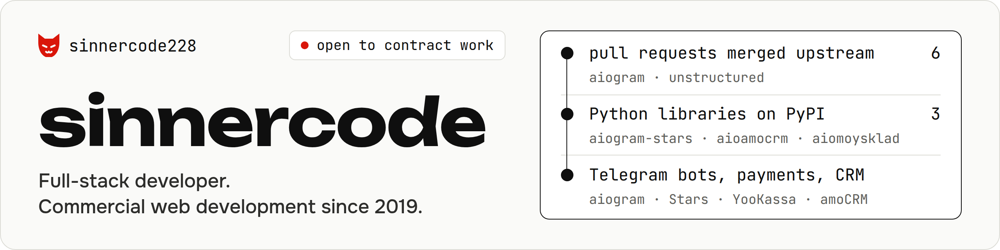
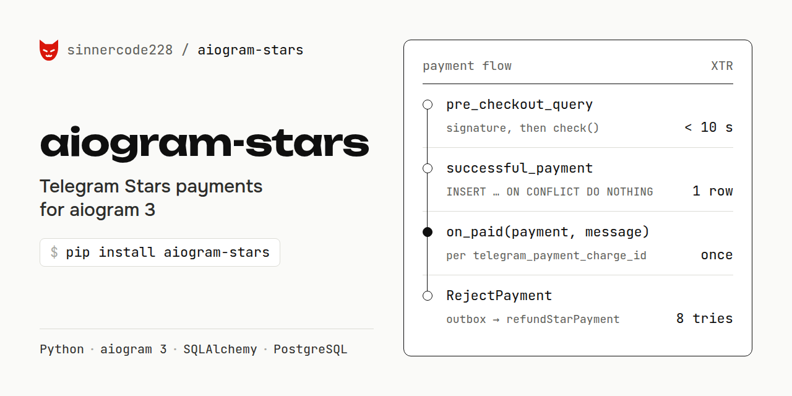
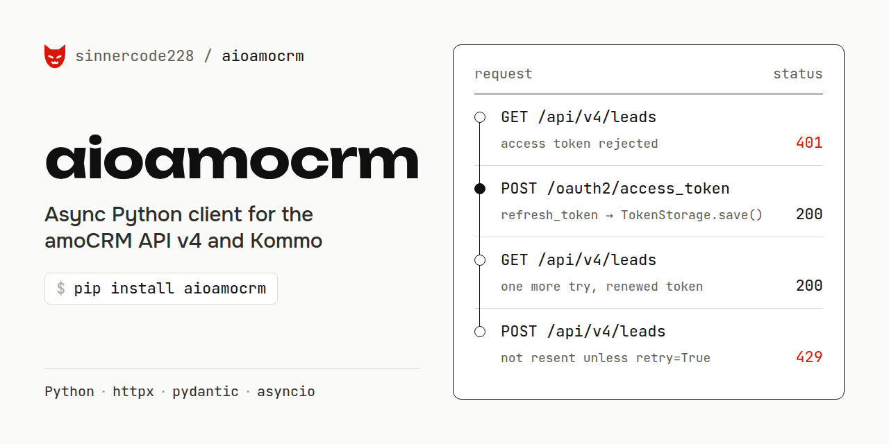
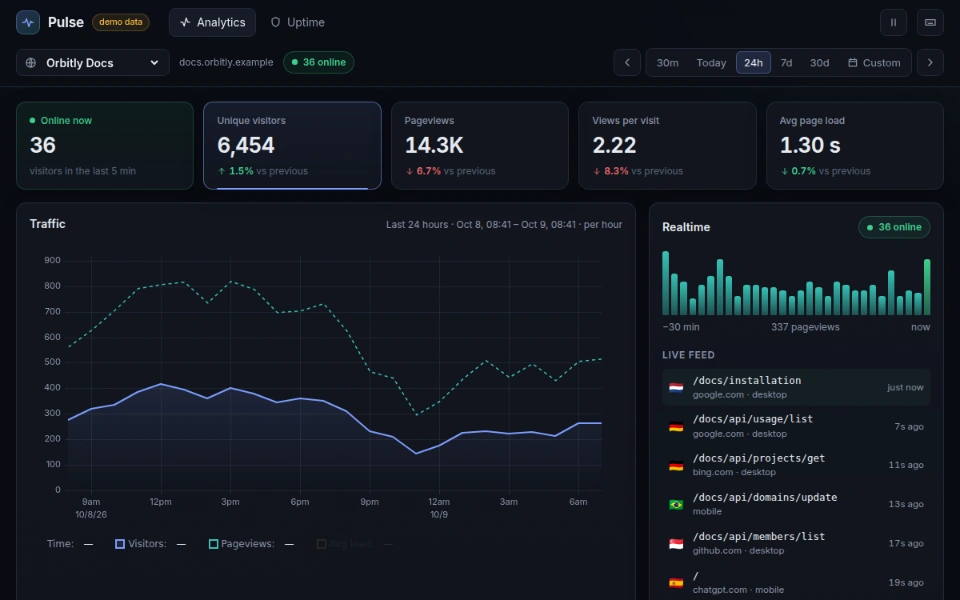
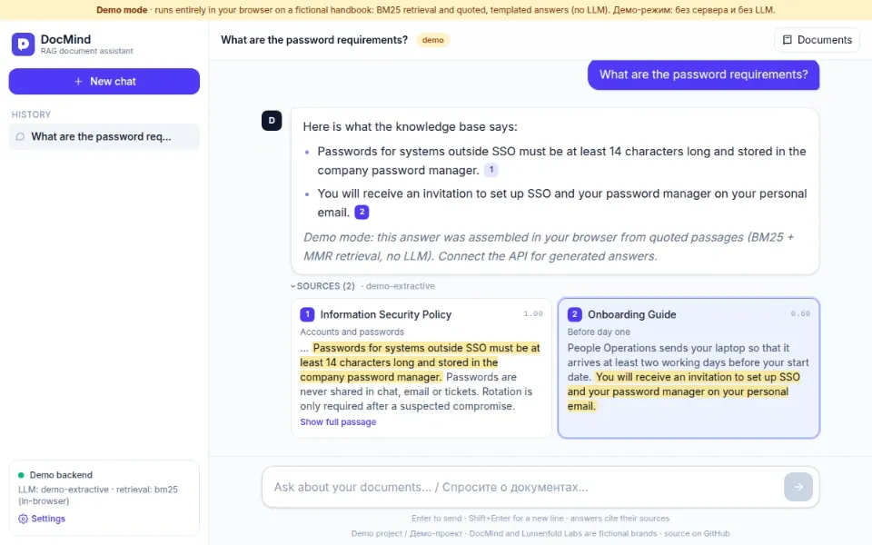

<picture>
  <source media="(max-width: 600px)" srcset="assets/banner-narrow.png">
  <source media="(prefers-color-scheme: dark)" srcset="assets/banner-dark.png">
  
</picture>

[Portfolio](https://sinnercode228.github.io/portfolio/?lang=en) · Telegram [@sinnercode](https://t.me/sinnercode) · [PyPI](https://pypi.org/user/sinnercode/) · [dev.to](https://dev.to/sinnercode228) · [По-русски](#по-русски)

Full-stack developer, in commercial web development since 2019. I build web products from scratch and work on existing ones: APIs, booking and subscription billing, CRM integrations, Telegram bots and Mini Apps, LLM features.

Available for contract work (fixed price, hourly or monthly), including joining your team or taking over an existing codebase. Telegram: [@sinnercode](https://t.me/sinnercode).

## Merged upstream

| Pull request | Change |
|---|---|
| [aiogram #1954](https://github.com/aiogram/aiogram/pull/1954) | `InlineKeyboardBuilder.as_markup()` no longer drops its options. Fixes [#1423](https://github.com/aiogram/aiogram/issues/1423) |
| [aiogram #1956](https://github.com/aiogram/aiogram/pull/1956) | Opt-in `tasks_shutdown_timeout`, so polling shutdown can wait for running handlers. Fixes [#1955](https://github.com/aiogram/aiogram/issues/1955) |
| [unstructured #4568](https://github.com/Unstructured-IO/unstructured/pull/4568) | `translate_text()` no longer repeats the first 512 tokens for every chunk. Fixes [#3607](https://github.com/Unstructured-IO/unstructured/issues/3607) |
| [unstructured #4597](https://github.com/Unstructured-IO/unstructured/pull/4597) | `partition_email()` no longer fails on attached emails (`message/rfc822`) |
| [unstructured #4599](https://github.com/Unstructured-IO/unstructured/pull/4599) | `.markdown` files are detected as Markdown. Follow-up to [#3670](https://github.com/Unstructured-IO/unstructured/issues/3670) |
| [unstructured #4602](https://github.com/Unstructured-IO/unstructured/pull/4602) | `partition_pdf()` debug overlays now use the DPI and PDF password passed to partitioning. Fixes [#3985](https://github.com/Unstructured-IO/unstructured/issues/3985) |

## Libraries

Both are on PyPI, MIT licensed, for Python 3.10+.

<table>
<tr>
<td width="50%" valign="top">
 
<b><a href="https://github.com/sinnercode228/aiogram-stars">aiogram-stars</a></b> 0.2.0 · <a href="https://pypi.org/project/aiogram-stars/">PyPI</a> 
Telegram Stars payments for aiogram 3, extracted from Zernolist. <code>on_paid</code> runs once per charge. Failed refunds are retried from a database outbox.
</td>
<td width="50%" valign="top">
 
<b><a href="https://github.com/sinnercode228/aioamocrm">aioamocrm</a></b> 0.1.1 · <a href="https://pypi.org/project/aioamocrm/">PyPI</a> 
Async client for the amoCRM and Kommo API v4, grown out of Relay. Handles OAuth2 token rotation and limits requests to 7 per second. A <code>POST</code> is resent only with <code>retry=True</code>, because amoCRM has no idempotency keys. Tested on mocked HTTP, not a live account.
</td>
</tr>
</table>

## Projects

Client code from my contract work is private, so these are standalone projects with sample data. The demos run on GitHub Pages with the API mocked in the browser.

- **[Zernolist](https://github.com/sinnercode228/tg-shop-miniapp)** · React, aiogram 3, FastAPI · [demo](https://sinnercode228.github.io/tg-shop-miniapp/) · [write-up](notes/zernolist-stars-payments.md)\
  A coffee and tea shop as a Telegram Mini App, paid in Stars or on receipt. Order totals are computed on the server from the catalog, never taken from the client.
- **[tg-paid-club](https://github.com/sinnercode228/tg-paid-club)** · Python, aiogram 3, FastAPI, PostgreSQL\
  Paid access to a private Telegram channel or group, with YooKassa card renewals, Stars subscriptions and a 3-day grace period after a declined card. Only paying members' join requests are approved. No live deployment: a simulator fills the admin dashboard with sample members.
- **[Relay](https://github.com/sinnercode228/integration-hub)** · Python, FastAPI, Redis, React · [demo](https://sinnercode228.github.io/integration-hub/) · [write-up](notes/relay-redis-lease-queue.md)\
  Webhooks from Tilda, amoCRM and Bitrix24, delivered to Telegram, Google Sheets, amoCRM and email. Workers lease jobs from a Redis queue, and a dead worker's jobs return to the queue when the lease runs out.
- **[FlowDesk](https://github.com/sinnercode228/flowdesk-crm)** · Next.js, Fastify, Prisma, PostgreSQL · [demo](https://sinnercode228.github.io/flowdesk-crm/) · [write-up](notes/flowdesk-refresh-rotation.md)\
  CRM with a deals kanban and roles. Refresh tokens rotate, and replaying an old one revokes every token from that login.
- **[Slotbook](https://github.com/sinnercode228/slotbook)** · Go, PostgreSQL, React · [demo](https://sinnercode228.github.io/slotbook/) · [write-up](notes/slotbook-exclusion-constraint.md)\
  Online booking for salons, with a booking widget and a staff day view. A PostgreSQL exclusion constraint prevents double booking under concurrent requests.
- **[Ledgerline](https://github.com/sinnercode228/ledgerline-billing)** · TypeScript, Fastify, PostgreSQL, React · [demo](https://sinnercode228.github.io/ledgerline-billing/) · [write-up](notes/ledgerline-balanced-but-wrong.md)\
  Subscription billing with trials, proration, gapless invoice numbers and dunning. The double-entry ledger rejects any transaction that doesn't balance at COMMIT.
- **[Pulse](https://github.com/sinnercode228/pulse-analytics)** · TypeScript, Fastify, SQLite, React · [demo](https://sinnercode228.github.io/pulse-analytics/) · [write-up](notes/pulse-hyperloglog.md)\
  Cookieless web analytics and uptime monitoring in one dashboard. Unique visitors are counted with HyperLogLog.
- **[DocMind](https://github.com/sinnercode228/docmind-rag)** · Python, FastAPI, pgvector, React · [demo](https://sinnercode228.github.io/docmind-rag/) · [write-up](notes/docmind-sources-before-tokens.md)\
  Q&A with citations over PDF, DOCX, HTML and web pages, also as a Telegram bot. Sources are sent before the answer, so each `[n]` is clickable as it streams. The demo searches with BM25 in the browser, without an LLM.

<table>
<tr>
<td width="50%" valign="top"> Pulse demo, synthetic traffic</td>
<td width="50%" valign="top"> DocMind demo</td>
</tr>
</table>

Smaller demos are in [portfolio](https://github.com/sinnercode228/portfolio): a landing page with a cost calculator, an async scraper, a lead-collection bot and an Excel dashboard.

Technical write-ups (English and Russian) are in [notes/](notes/), and the aiogram-stars one is also on [dev.to](https://dev.to/sinnercode228/the-stars-were-charged-and-onpaid-never-ran-where-telegram-stars-payments-get-lost-in-aiogram-5m2). Fix log: [notes/fixes.md](notes/fixes.md).

## Experience

**2025 – present · Senior Full-Stack Developer · Independent / Contract**\
New products and work on existing systems: APIs and integrations, admin panels, job queues and bulk imports, query optimization, CI/CD and monitoring, code review and releases.

**2023 – 2025 · Full-Stack Developer · Independent projects and contracts**\
Services with subscriptions, payments and automation: a SaaS for links and contacts, a Telegram sales platform with automatic delivery of digital goods, a website analytics service. I designed the APIs and databases, built the UIs, deployed and maintained them. Next.js, TypeScript, Node.js, Python, PostgreSQL, Redis, Nginx.

**2021 – 2023 · Full-Stack Developer · Contract development**\
Internal web apps for sales teams and service businesses: a CRM for incoming customer requests, a document portal with approvals, supplier catalog sync with price and stock updates. React, TypeScript, Node.js, PostgreSQL, Redis, Docker.

**2019 – 2021 · Web Developer · Freelance**\
Websites and online stores for small businesses: an auto parts store with CSV import, a repair-shop chain site with a cost calculator that sends leads to a CRM, WordPress sites with custom themes. JavaScript, PHP, WordPress, MySQL.

---

## По-русски

Full-stack разработчик, в коммерческой разработке с 2019 года. Делаю веб-продукты с нуля и дорабатываю существующие: API и базы данных, онлайн-запись, биллинг подписок, интеграции с amoCRM и Bitrix24, Telegram-боты и Mini Apps, функции на LLM.

- Приняты шесть моих PR: два в aiogram ([#1954](https://github.com/aiogram/aiogram/pull/1954), [#1956](https://github.com/aiogram/aiogram/pull/1956)) и четыре в unstructured ([#4568](https://github.com/Unstructured-IO/unstructured/pull/4568), [#4597](https://github.com/Unstructured-IO/unstructured/pull/4597), [#4599](https://github.com/Unstructured-IO/unstructured/pull/4599), [#4602](https://github.com/Unstructured-IO/unstructured/pull/4602)).
- На PyPI две мои библиотеки: [aiogram-stars](https://pypi.org/project/aiogram-stars/) для приёма платежей в Telegram Stars в aiogram 3 и [aioamocrm](https://pypi.org/project/aioamocrm/), асинхронный клиент API amoCRM и Kommo.
- Технические разборы проектов на русском: [notes/](notes/README.md#по-русски).

Работаю по фиксированной цене, почасово или помесячно. Могу подключиться к вашей команде или взять на поддержку существующий проект.

Telegram: [@sinnercode](https://t.me/sinnercode) · [Портфолио](https://sinnercode228.github.io/portfolio/)
