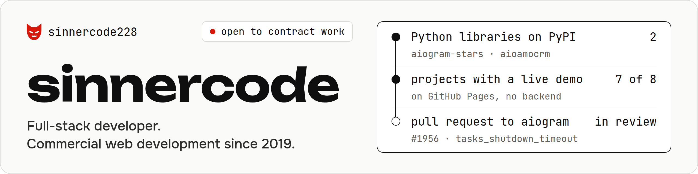
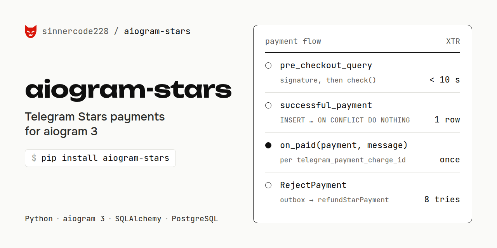
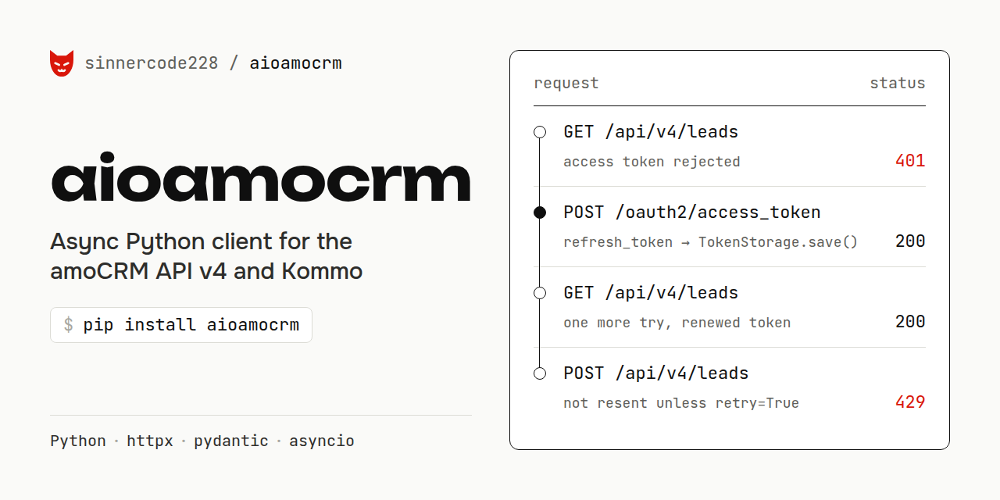
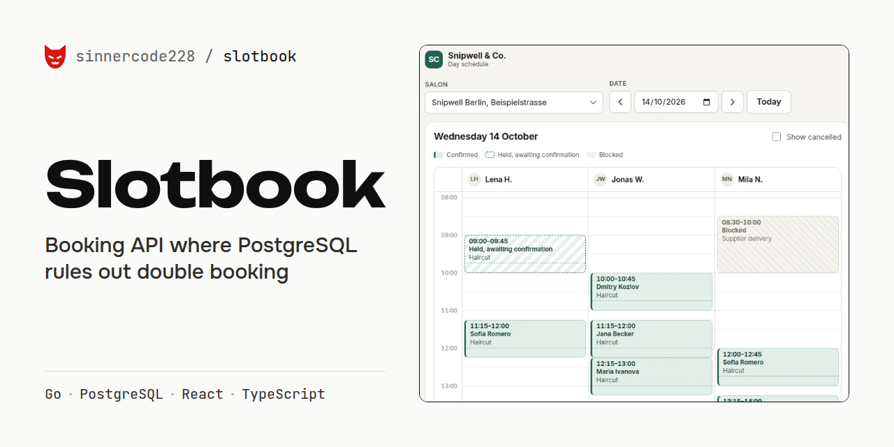
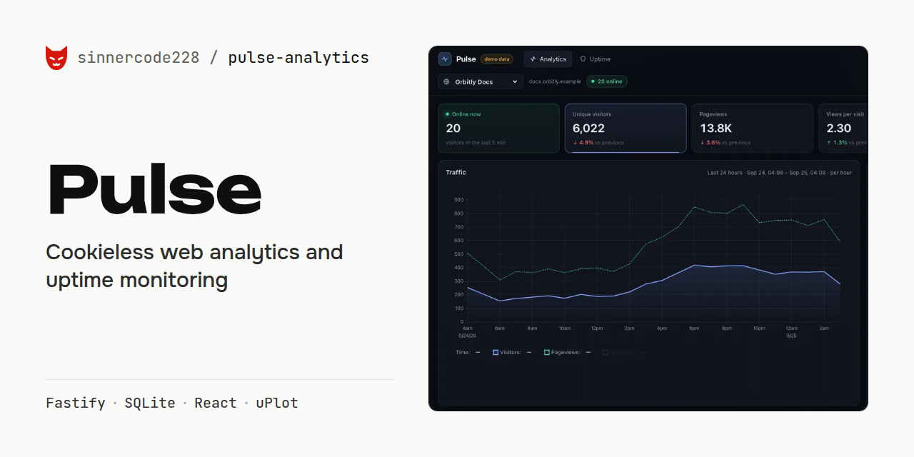
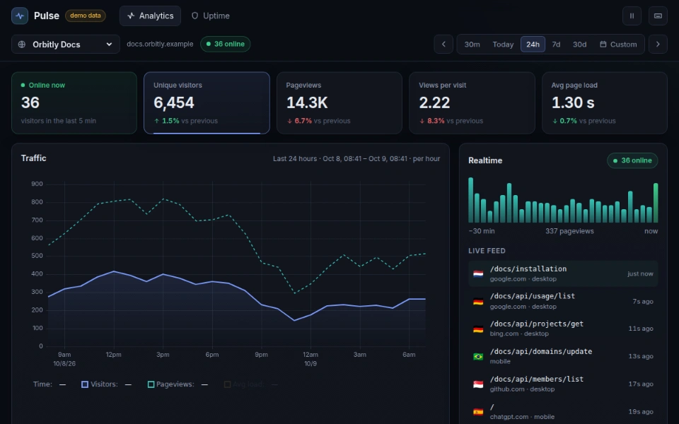
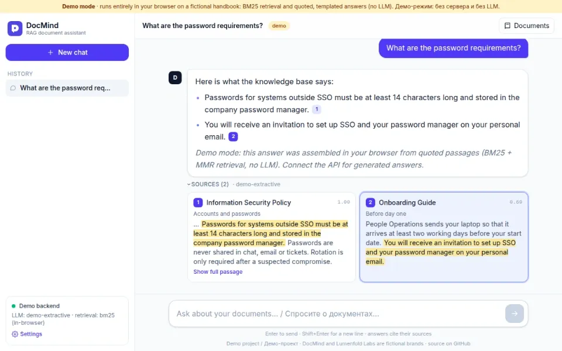

<picture>
  <source media="(max-width: 600px)" srcset="assets/banner-narrow.png">
  <source media="(prefers-color-scheme: dark)" srcset="assets/banner-dark.png">
  
</picture>

[Portfolio](https://sinnercode228.github.io/portfolio/?lang=en) · Telegram [@sinnercode](https://t.me/sinnercode) · [PyPI](https://pypi.org/user/sinnercode/) · [dev.to](https://dev.to/sinnercode228) · [По-русски](#по-русски)

I have done commercial web development since 2019. Now I build web products end to end and work on existing systems. The public projects below cover APIs, online booking and subscription billing, integrations, Telegram bots and Mini Apps, and LLM features; two Python libraries that grew out of them are on PyPI.

Open to contract work: a fixed-price project, hourly or monthly work, a seat on your team, or taking over an existing codebase.

## Featured

<table>
<tr>
<td width="50%" valign="top">
 
<b><a href="https://github.com/sinnercode228/aiogram-stars">aiogram-stars</a></b> · <a href="https://pypi.org/project/aiogram-stars/">PyPI</a> 
Telegram Stars payments for aiogram 3: calls <code>on_paid</code> once per charge and keeps refunds in your database until Telegram confirms them.
</td>
<td width="50%" valign="top">
 
<b><a href="https://github.com/sinnercode228/aioamocrm">aioamocrm</a></b> · <a href="https://pypi.org/project/aioamocrm/">PyPI</a> 
Async Python client for the amoCRM API v4 and Kommo, with retries that never send a write twice unless you ask.
</td>
</tr>
<tr>
<td width="50%" valign="top">
 
<b><a href="https://github.com/sinnercode228/slotbook">Slotbook</a></b> · <a href="https://sinnercode228.github.io/slotbook/">demo</a> 
Booking backend in Go: two customers can never book the same specialist for overlapping time, and PostgreSQL enforces it, not a check in Go.
</td>
<td width="50%" valign="top">
 
<b><a href="https://github.com/sinnercode228/pulse-analytics">Pulse</a></b> · <a href="https://sinnercode228.github.io/pulse-analytics/">demo</a> 
Cookieless web analytics and HTTP uptime monitoring in one dashboard, with a HyperLogLog visitor sketch in every rollup row.
</td>
</tr>
</table>

## Upstream

**[unstructured #4568](https://github.com/Unstructured-IO/unstructured/pull/4568)** · merged · fixes [issue #3607](https://github.com/Unstructured-IO/unstructured/issues/3607)\
`translate_text()` splits text longer than the model's window into chunks, but passed the whole text to the model for every chunk, so the first 512 tokens came out once per chunk and the rest of the text was dropped. Each chunk is now translated once, and a test with a fake model checks what the model receives.

**[unstructured #4597](https://github.com/Unstructured-IO/unstructured/pull/4597)** · merged\
`partition_email()` failed with a bare `AssertionError` on an attached email (`message/rfc822`: a message forwarded as an attachment, a bounce, a digest), and the whole result was lost with it. The attached email is now partitioned like any other attachment, and each of its parts reaches its partitioner with the exact bytes it was sent with.

**[unstructured #4599](https://github.com/Unstructured-IO/unstructured/pull/4599)** · merged · follow-up to [issue #3670](https://github.com/Unstructured-IO/unstructured/issues/3670)\
A `.markdown` file was detected as plain text, or not at all without libmagic, although the issue was closed as fixed. It is now detected as Markdown.

**[unstructured #4602](https://github.com/Unstructured-IO/unstructured/pull/4602)** · merged · fixes [issue #3985](https://github.com/Unstructured-IO/unstructured/issues/3985)\
With `analysis=True`, `partition_pdf()` drew its debug bounding-box overlays on pages rendered at the default 350 DPI, whatever `pdf_image_dpi` the partitioning used, so the boxes landed in the wrong place; for an encrypted PDF no overlays were written at all. The overlays now use the same DPI and password as the partitioning.

**[unstructured #4598](https://github.com/Unstructured-IO/unstructured/pull/4598)** · awaiting review\
With `overlap_all=True`, splitting a long element could emit a chunk that held nothing but the overlap from the chunk before it: 2 of 19 chunks on the repository's War and Peace sample with 300-character chunks and an overlap of 40. The splitter now skips such a split.

**[aiogram #1956](https://github.com/aiogram/aiogram/pull/1956)** · in review · fixes [issue #1955](https://github.com/aiogram/aiogram/issues/1955)\
Adds an opt-in `tasks_shutdown_timeout` to `start_polling()` and `run_polling()`: when polling stops, the dispatcher waits up to that many seconds for update handlers that are still running; today shutdown goes ahead without them, although their updates have usually been confirmed to Telegram already.

## Experience

**2025 – now · Senior Full-Stack Developer · Independent / Contract**\
Full-cycle web products and work on existing systems: architecture, dashboards and admin panels, APIs and integrations, optimizing queries, job queues and large imports, CI/CD, monitoring, backup and restore, code review, refactoring and releases.

**2023 – 2025 · Full-Stack Developer · Independent projects and contracts**\
Services with subscriptions, payments and automation: a SaaS for links and contacts, a Telegram sales platform with automatic delivery of digital goods, a website analytics service. I designed the API and database, built the UI, deployed and supported them. Next.js, TypeScript, Node.js, Python, PostgreSQL, Redis, Nginx.

**2021 – 2023 · Full-Stack Developer · Contract development**\
Internal web apps for sales departments and service companies: a CRM for handling requests, a document portal with approvals, supplier catalog sync with price and stock updates. React, TypeScript, Node.js, PostgreSQL, Redis, Docker.

**2019 – 2021 · Web Developer · Freelance**\
Websites and online stores for small businesses: an auto parts store with CSV import, a site for a chain of repair shops with a cost calculator and requests sent to a CRM, WordPress sites with custom themes. JavaScript, PHP, WordPress, MySQL.

The commercial code from this work is private, so the public repositories below are standalone projects built on made-up data.

## Libraries

Both are on PyPI, MIT licensed, for Python 3.10 or newer: aiogram-stars at version 0.2.0, aioamocrm at 0.1.1.

**[aiogram-stars](https://github.com/sinnercode228/aiogram-stars)** · Python, aiogram 3, SQLAlchemy, SQLite, PostgreSQL · [PyPI](https://pypi.org/project/aiogram-stars/) · [write-up](https://dev.to/sinnercode228/the-stars-were-charged-and-onpaid-never-ran-where-telegram-stars-payments-get-lost-in-aiogram-5m2) · `pip install aiogram-stars`\
Telegram Stars payments for aiogram 3, extracted from the payment code of [Zernolist](https://github.com/sinnercode228/tg-shop-miniapp): signed invoice payloads, a pre-checkout answer within Telegram's 10-second deadline, and a refund outbox in SQLite or PostgreSQL that retries `refundStarPayment` on errors. `on_paid` runs once per charge: the payment row is [inserted with `ON CONFLICT (charge_id) DO NOTHING`](https://github.com/sinnercode228/aiogram-stars/blob/d601bc348503130979eee6c2313de45265dbb23d/src/aiogram_stars/sqlalchemy.py#L364-L369), only the handler whose insert went through calls it, and a test feeds one update three times to each of two dispatchers on one database.

**[aioamocrm](https://github.com/sinnercode228/aioamocrm)** · Python, httpx, pydantic 2 · [PyPI](https://pypi.org/project/aioamocrm/) · `pip install aioamocrm`\
Async client for the amoCRM and Kommo API v4 that grew out of the amoCRM connector in [Relay](https://github.com/sinnercode228/integration-hub): OAuth2 with refresh-token rotation, requests spaced at 7 per second, pagination, typed models and webhook parsing. A request that got a 429 or a 5xx, or timed out after it was sent, is resent only if [its method is idempotent or the call passed `retry=True`](https://github.com/sinnercode228/aioamocrm/blob/a35f0c86ac0521a8397e90ae79e3fb32dad88caa/src/aioamocrm/_client.py#L264-L265), because amoCRM has no idempotency keys and a resent `POST` can create the lead twice. The tests run on mocked HTTP, with request and answer shapes checked against amoCRM's official PHP SDK, not a live account.

## Public projects

The demos run on GitHub Pages without a backend. The API is replaced by code in the browser.

**[Pulse](https://github.com/sinnercode228/pulse-analytics)** · TypeScript, Fastify, SQLite, React · [demo](https://sinnercode228.github.io/pulse-analytics/) · [write-up](notes/pulse-hyperloglog.md)\
Cookieless web analytics with uptime monitoring. Each rollup row stores a [HyperLogLog sketch](https://github.com/sinnercode228/pulse-analytics/blob/96645e153317f7bc35e5fc17bf4f76424d83c7c3/packages/core/src/hll.ts#L3-L7): an exact set up to 512 hashes, then 2048 registers. That is how unique visitors are merged across time buckets.

Recorded from the <a href="https://sinnercode228.github.io/pulse-analytics/">Pulse demo</a> on GitHub Pages. The traffic is synthetic.

**[Ledgerline](https://github.com/sinnercode228/ledgerline-billing)** · TypeScript, Fastify, PostgreSQL, React · [demo](https://sinnercode228.github.io/ledgerline-billing/) · [write-up](notes/ledgerline-balanced-but-wrong.md)\
Subscription billing with trials, proration, gapless invoice numbers, dunning and a double-entry ledger. A [constraint trigger deferred to COMMIT](https://github.com/sinnercode228/ledgerline-billing/blob/442e27c08854c39821ade0cbfe7ebe67bffd2c1c/server/migrations/002_ledger_guards.sql#L7-L50) rejects any journal transaction whose entries do not sum to zero, whatever code wrote it. The demo runs the same engine in the browser, with a test clock that moves a day, a week or a month at a time.

**[Slotbook](https://github.com/sinnercode228/slotbook)** · Go, PostgreSQL, React · [demo](https://sinnercode228.github.io/slotbook/) · [write-up](notes/slotbook-exclusion-constraint.md)\
Online booking for salons, with a booking widget and a staff day view. Double booking is ruled out by [one `EXCLUDE USING gist` constraint](https://github.com/sinnercode228/slotbook/blob/1c8318474319f6e61cc76a3bbc5b5911625d7c1e/internal/db/migrations/0001_schema.sql#L111-L113), not by a check in Go: when 20 goroutines hold the same slot, exactly one succeeds. 23 JSON vectors pin how slots behave across DST changes, and both the Go generator and its TypeScript port pass them.

**[Relay](https://github.com/sinnercode228/integration-hub)** · Python, FastAPI, Redis, SQLite, React · [demo](https://sinnercode228.github.io/integration-hub/) · [write-up](notes/relay-redis-lease-queue.md)\
Takes webhooks from Tilda, amoCRM and Bitrix24 and delivers them to Telegram, Google Sheets, amoCRM and email. The [Redis queue is built on sorted sets](https://github.com/sinnercode228/integration-hub/blob/b0ae35c14d753930be6c89155cdc75d31b861ff6/backend/src/relay/queue/redis.py#L29-L47): a worker claims a job with a lease (120 seconds by default) in one Lua script, and if the worker dies, the job goes back to the queue when the lease runs out.

**[DocMind](https://github.com/sinnercode228/docmind-rag)** · Python, FastAPI, pgvector, React · [demo](https://sinnercode228.github.io/docmind-rag/) · [write-up](notes/docmind-sources-before-tokens.md)\
Answers questions over PDF, DOCX, HTML files and web pages with citations, and has a Telegram bot. [Sources go out over SSE before the model is called](https://github.com/sinnercode228/docmind-rag/blob/6d8b1b24fd2b3a06cbc685e1b0702e8243269cc4/backend/src/docmind/rag/service.py#L110-L111), so each `[n]` is clickable as soon as it streams in. The demo has no LLM: it searches with BM25 in the browser.

**[Zernolist](https://github.com/sinnercode228/tg-shop-miniapp)** · React, aiogram 3, FastAPI, SQLAlchemy · [demo](https://sinnercode228.github.io/tg-shop-miniapp/) · [write-up](notes/zernolist-stars-payments.md)\
A coffee and tea shop inside Telegram, with payment in Stars or on receipt. The server [prices every order from the catalog](https://github.com/sinnercode228/tg-shop-miniapp/blob/54cb076af58b99b8e693ff301d43ea20a9dc1d91/bot/tgshop/services/orders.py#L76-L100) and ignores client prices: a test sends `price: 1` and still gets the catalog subtotal.

**[FlowDesk](https://github.com/sinnercode228/flowdesk-crm)** · Next.js, Fastify, Prisma, PostgreSQL · [demo](https://sinnercode228.github.io/flowdesk-crm/) · [write-up](notes/flowdesk-refresh-rotation.md)\
A CRM with a deals kanban and roles. Refresh tokens rotate, and a reused one revokes every token from that login. A [conditional `updateMany` inside a transaction](https://github.com/sinnercode228/flowdesk-crm/blob/de0a2c21755f9f59060d9d6d07f55e0b3b1cd42b/server/src/modules/auth/auth.service.ts#L44-L51) stops two concurrent refreshes from both getting a new pair.

**[tg-paid-club](https://github.com/sinnercode228/tg-paid-club)** · Python, aiogram 3, FastAPI, SQLAlchemy, SQLite, PostgreSQL\
A Telegram bot that sells access to a private channel or group by subscription, with YooKassa card payments renewed from the saved card, Telegram Stars subscriptions (30 days only), renewal reminders and a 3-day grace with retries after a declined card. The club's one invite link only sends join requests, the bot approves those of paying members, and anyone who gets in another way is removed. Removal is [`banChatMember` with an `until_date` ten minutes ahead, then `unbanChatMember(only_if_banned=True)`](https://github.com/sinnercode228/tg-paid-club/blob/ef679061c13ce2fde5bffc57436c1a98655f908e/src/paidclub/bot/revoker.py#L131-L139), so the link works again once they pay, and if the unban call is lost, the ban runs out by itself. No live demo, and no club runs on it: `paidclub simulate` fills a database with 300 made-up members over 120 days for the `/admin` dashboard.

**[n8n-home-ai-workflows](https://github.com/sinnercode228/n8n-home-ai-workflows)** · n8n, Ollama, Qdrant, Docker Compose\
Four workflows: meeting notes to Notion via Claude, a family calendar digest, document Q&A on local models, an error handler. Code-node logic is built from ES modules, and the [tests run the `jsCode` stored in the workflow JSON](https://github.com/sinnercode228/n8n-home-ai-workflows/blob/d314e04e913c38c894f52360271582a54ccf68e0/tests/harness.mjs#L51). No live demo, and I haven't run the workflows against live Anthropic, Notion, Google or Telegram accounts.

Smaller demos are in [portfolio](https://github.com/sinnercode228/portfolio): a landing page with a cost calculator, an async scraper, a lead-collection bot and an Excel dashboard.

## Notes

Write-ups on how specific parts of these projects work. Each one quotes the code, links to the lines at a pinned commit, then says what the tests cover and where the code is still thin. Index: [notes/](notes/).

- [The Stars were charged and on_paid never ran: where Telegram Stars payments get lost in aiogram](https://dev.to/sinnercode228/the-stars-were-charged-and-onpaid-never-ran-where-telegram-stars-payments-get-lost-in-aiogram-5m2) (dev.to): a `wait_for` that let the pre-checkout answer leave after 11 s, a catch-all router that took the payment, a shutdown that cut `on_paid` off, and a 429 that burnt an attempt of every refund
- [The trial balance was zero and the invoice was written off twice](notes/ledgerline-balanced-but-wrong.md): a retry loop working from stale invoice copies, and the invariants that catch what the trial balance cannot
- [Two tabs, one slot: letting PostgreSQL refuse the second booking](notes/slotbook-exclusion-constraint.md): a check in Go that gave one slot to 14 of 20 requests, and the retry that stopped a deadlock from turning a `409` into a `500`
- [Berlin on 29 March: booking slots across a DST change without adding 24 hours](notes/slotbook-dst-slots.md): dates walked on UTC midnights, and 23 vectors shared by Go and TypeScript
- [The late ack was the small bug: fencing a Redis queue with the lease deadline](notes/relay-lease-fencing.md): part 2, where the fencing token turns up a worse bug
- [My Redis queue claimed jobs atomically and still handed the same job to two workers](notes/relay-queue-races.md): two races, a test that forces them on every run, and the fix
- [Relay's delivery queue on two Redis sorted sets with a 120-second lease](notes/relay-redis-lease-queue.md)
- [How FlowDesk rotates refresh tokens with a conditional UPDATE and a cross-tab lock](notes/flowdesk-refresh-rotation.md)
- [How Zernolist prices an order on the server and accepts each Telegram Stars charge once](notes/zernolist-stars-payments.md)
- [How DocMind sends sources before the first token and links [n] markers mid-stream](notes/docmind-sources-before-tokens.md)
- [How Pulse counts unique visitors with a daily salt and a sparse-to-dense HyperLogLog](notes/pulse-hyperloglog.md)

## Open issues

_None right now._

## Recently fixed

Bugs I found in my own projects, each fixed with a test that failed first:

- DocMind: a chat follow-up was retrieved on the bare question — the history reached the model but not the retriever, so "what does it cost?" was embedded with no idea what "it" was and pulled back the wrong chunks; the retrieval query now carries the recent user turns, while the prompt and the citation highlight still use the original question ([issue #8](https://github.com/sinnercode228/docmind-rag/issues/8), [#9](https://github.com/sinnercode228/docmind-rag/pull/9))
- Zernolist: right after a successful Stars payment the order page offered to pay again, because the bot had not marked the order paid yet; the page now re-reads the order every 1.5 s, up to 8 times, with the main button in progress, and checkout tells it to wait too ([issue #9](https://github.com/sinnercode228/tg-shop-miniapp/issues/9), [#10](https://github.com/sinnercode228/tg-shop-miniapp/pull/10))
- FlowDesk: changing a deal's stage from the drawer always sent `position: 0`, so the moved card jumped to the top of the target column and shoved every other card down by one; the drawer now counts the target column from the deals cache and sends that count, so the card lands at the end, and re-selecting the current stage is a no-op ([issue #5](https://github.com/sinnercode228/flowdesk-crm/issues/5), [#6](https://github.com/sinnercode228/flowdesk-crm/pull/6))
- Pulse: hourly charts were bucketed on UTC hours whatever the site's zone, so on a half-hour zone (Asia/Kolkata, Asia/Tehran) every point sat 30 minutes off the local clock; hour buckets now align to the site zone the same way day buckets already did, and minute buckets stay UTC-floored because every zone offset is a whole number of minutes ([issue #6](https://github.com/sinnercode228/pulse-analytics/issues/6), [#7](https://github.com/sinnercode228/pulse-analytics/pull/7))
- DocMind: the prompt escaped a source's title but not its text, so a document containing `</source>` could close its block early and put the rest of the chunk outside the sources; source tags inside the text are now escaped and the rest is left as is ([issue #4](https://github.com/sinnercode228/docmind-rag/issues/4), [#5](https://github.com/sinnercode228/docmind-rag/pull/5))
- Relay: a Telegram message over 4096 characters was cut on the raw string, so in HTML mode the cut could split an entity or leave a tag open, Telegram answered 400 and the delivery went to the dead letters; the limit now counts only visible text, as Telegram does, and tags still open at the cut are closed ([issue #4](https://github.com/sinnercode228/integration-hub/issues/4), [#5](https://github.com/sinnercode228/integration-hub/pull/5))
- DocMind: a model that wrote citations as `[1, 2]` instead of `[1][2]` yielded an empty `cited` list and left every source card greyed out; the server regex and the client parser now split a bracket group into separate references ([issue #2](https://github.com/sinnercode228/docmind-rag/issues/2), [#3](https://github.com/sinnercode228/docmind-rag/pull/3))
- Zernolist: a `pending` result from `openInvoice` was collapsed into `payment=cancelled` on the redirect, so the Mini App told the user the payment had been cancelled although the Stars charge might still land; the status is now carried through and the pending case has its own note ([issue #5](https://github.com/sinnercode228/tg-shop-miniapp/issues/5), [#6](https://github.com/sinnercode228/tg-shop-miniapp/pull/6))
- Home AI flows: task owner resolved to the wrong attendee when two attendees shared a first name; the first-name fallback now only fires when exactly one attendee matches ([issue #3](https://github.com/sinnercode228/n8n-home-ai-workflows/issues/3), [#5](https://github.com/sinnercode228/n8n-home-ai-workflows/pull/5))
- Relay: a connection error or timeout on the amoCRM note, the request that follows the lead, made the worker retry the delivery and create the lead a second time; any failure of the note now goes into the delivery's result, and the note gives up before the attempt's timeout ([`fb4dbe9`](https://github.com/sinnercode228/integration-hub/commit/fb4dbe9c08d417cd35ccbdfa7bdc3edb0c5e068d))
- Slotbook: two writes on one period at the same moment could deadlock inside PostgreSQL's exclusion-constraint check, and the request whose transaction the deadlock detector aborted got `500`: a loser instead of `409 slot_taken`, a confirmation instead of going through; holds, blocks, reschedules and confirmations now run the transaction again on `40P01` ([`54ccd48`](https://github.com/sinnercode228/slotbook/commit/54ccd486199c9392846f2730a82e3a3e73a830b4), [`939022a`](https://github.com/sinnercode228/slotbook/commit/939022ae1a3c00362d064e0a11dee60eb2d4958d); see [the write-up](notes/slotbook-exclusion-constraint.md))
- Ledgerline: when a failed retry ended dunning inside the retry loop, every open invoice was written off, and the loop's stale copy of the next one reopened it, recorded another payment attempt and wrote it off a second time; the trial balance stayed at zero ([`b8aabf0`](https://github.com/sinnercode228/ledgerline-billing/commit/b8aabf0576976b7dade1b8158720c4b6c4cc7c99); see [the write-up](notes/ledgerline-balanced-but-wrong.md))
- Slotbook: the notification worker sent a claimed batch one row at a time under one lease, so with slow sends a row late in the batch could be reclaimed by another worker and sent by both; each row's lease is now renewed right before its send ([`a38902f`](https://github.com/sinnercode228/slotbook/commit/a38902fac3d147b686191bbc63534f8b2b3f0193))
- Relay: two claim races with several workers on one Redis, then a stale worker overwriting the new owner's record ([`b0ae35c`](https://github.com/sinnercode228/integration-hub/commit/b0ae35c14d753930be6c89155cdc75d31b861ff6), [`8c6ccb4`](https://github.com/sinnercode228/integration-hub/commit/8c6ccb42a436863df19aadec3e896cd45b4cf98f); see the two Relay notes above)
- Relay: an event stored but never queued when enqueue fails ([issue #1](https://github.com/sinnercode228/integration-hub/issues/1), [`c845ca0`](https://github.com/sinnercode228/integration-hub/commit/c845ca096591389e34603adba0a22f3bbac12368))
- DocMind: `docmind ask` finding nothing after `docmind ingest` with default settings, and `[0]` turning into a citation ([issue #1](https://github.com/sinnercode228/docmind-rag/issues/1), [`d89f9ea`](https://github.com/sinnercode228/docmind-rag/commit/d89f9ea1a8f19103ae485af111d1c3dec5baae39))
- Home AI flows: the doc-QA chunker dropping the start of a long paragraph with no whitespace, so the document was embedded from a fragment ([issue #1](https://github.com/sinnercode228/n8n-home-ai-workflows/issues/1), [#2](https://github.com/sinnercode228/n8n-home-ai-workflows/pull/2))
- Relay: a request longer than the lease could be sent twice; the lease is now renewed while the connector runs ([`c4be59c`](https://github.com/sinnercode228/integration-hub/commit/c4be59c91e59dc628734edbcdb2e5ec0c2d9f737))
- FlowDesk: a published fallback JWT secret accepted in production, a login limit bypassed with `X-Forwarded-For`, and refresh tokens that were never deleted ([`4770f75`](https://github.com/sinnercode228/flowdesk-crm/commit/4770f75891eb6648a4edc7d01a99ae70e1668454), [`af961e9`](https://github.com/sinnercode228/flowdesk-crm/commit/af961e9336ece99694ac0c72c1d998f90d0aa188))
- Pulse: live ranges dropping the current minute, hour or day, and uptime monitors probed every 5 minutes whatever their interval ([`b6a0fa4`](https://github.com/sinnercode228/pulse-analytics/commit/b6a0fa4275fb3f4ef1dbc1f1c269f8f071accc51), [`83ce266`](https://github.com/sinnercode228/pulse-analytics/commit/83ce266ede6cee82de3c1c36b6e304024d534732))
- Zernolist: two payments, or a payment and a cancel, racing on one order on SQLite ([`fa866de`](https://github.com/sinnercode228/tg-shop-miniapp/commit/fa866decb9ae35c63ae8a0a74d6b9f99d7ad615d))

## Contact

Telegram [@sinnercode](https://t.me/sinnercode) · [portfolio](https://sinnercode228.github.io/portfolio/?lang=en)

---

## По-русски

Коммерческая веб-разработка с 2019 года. Сейчас занимаюсь разработкой веб-продуктов полного цикла и развитием существующих систем. В открытых проектах выше — API, онлайн-запись и биллинг подписок, интеграции, Telegram-боты и Mini Apps, функции на LLM. Беру проекты с фиксированной ценой, почасовую и помесячную работу, могу войти в вашу команду или разобраться в чужом коде.

- **2025 — сейчас.** Senior Full-Stack Developer, independent / contract. Полный цикл разработки веб-продуктов и развитие существующих систем.
- **2023–2025.** Full-Stack Developer, независимые проекты и контракты. Сервисы с подписками, платёжными интеграциями и автоматизацией.
- **2021–2023.** Full-Stack Developer, контрактная разработка. Внутренние веб-приложения для отделов продаж и сервисных компаний.
- **2019–2021.** Web Developer, фриланс. Сайты и интернет-магазины для малого бизнеса.

Коммерческий код из этой работы закрыт, поэтому открытые репозитории выше — самостоятельные проекты на выдуманных данных. README у них на английском; у всех, кроме Relay, есть русская версия или короткий пересказ по-русски.

Две мои библиотеки на Python опубликованы на PyPI, aiogram-stars в версии 0.2.0 и aioamocrm в версии 0.1.1:

- [aiogram-stars](https://github.com/sinnercode228/aiogram-stars), [PyPI](https://pypi.org/project/aiogram-stars/): библиотека для оплаты в Telegram Stars в ботах на aiogram 3, которая подписывает payload счёта, успевает ответить на pre-checkout за десять секунд, вызывает `on_paid` один раз на платёж и повторяет неудавшиеся возвраты; я вынес её из платёжного кода Zernolist
- [aioamocrm](https://github.com/sinnercode228/aioamocrm), [PyPI](https://pypi.org/project/aioamocrm/): асинхронный клиент API v4 amoCRM и Kommo, который сам обновляет OAuth2-токены и сохраняет новый refresh-токен, отправляет не больше 7 запросов в секунду, а запрос на запись, который мог уже выполниться, без `retry=True` не повторяет; вырос из коннектора amoCRM в Relay; форматы запросов и ответов сверены с официальным PHP SDK amoCRM, но живого аккаунта за тестами пока нет

В aiogram на ревью мой PR [#1956](https://github.com/aiogram/aiogram/pull/1956) к [issue #1955](https://github.com/aiogram/aiogram/issues/1955): необязательный параметр `tasks_shutdown_timeout` в `start_polling()` и `run_polling()`. С ним при остановке polling диспетчер ждёт до заданного числа секунд обработчики, которые ещё работают, а сейчас остановка идёт, не дожидаясь их, хотя бот обычно уже подтвердил Telegram получение их апдейтов.

В unstructured приняли мой PR [#4568](https://github.com/Unstructured-IO/unstructured/pull/4568) к [issue #3607](https://github.com/Unstructured-IO/unstructured/issues/3607): `translate_text()` делит длинный текст на части по окну модели, но в каждой итерации отдавал модели весь текст, поэтому первые 512 токенов переводились столько раз, сколько было частей, а остальной текст пропадал. Теперь каждая часть переводится один раз, и тест с подменённой моделью проверяет, что она получает.

Там же приняли ещё три моих исправления: [#4597](https://github.com/Unstructured-IO/unstructured/pull/4597) — `partition_email()` падал с `AssertionError` на вложенном письме (`message/rfc822`: пересланное вложением письмо, отчёт о недоставке, дайджест) и терял весь результат; [#4599](https://github.com/Unstructured-IO/unstructured/pull/4599) — файл `.markdown` определялся как обычный текст, хотя [issue #3670](https://github.com/Unstructured-IO/unstructured/issues/3670) закрыли как исправленный; [#4602](https://github.com/Unstructured-IO/unstructured/pull/4602) — с `analysis=True` отладочные рамки `partition_pdf()` рисовались на страницах в 350 DPI по умолчанию, а не в том `pdf_image_dpi`, с которым шло разбиение, и съезжали. Ждёт ревью [#4598](https://github.com/Unstructured-IO/unstructured/pull/4598): с `overlap_all=True` при разбиении длинного элемента появлялся чанк, в котором было только перекрытие с предыдущим.

Ошибки, которые я нашёл у себя и исправил, каждую с тестом, который сначала падал, перечислены выше в разделе Recently fixed.

Разборы того, как устроены отдельные части проектов, с кодом и ссылками на строки:

- [Звёзды списаны, а on_paid не вызван: где теряются платежи Telegram Stars в aiogram](notes/aiogram-stars-payments.ru.md): `wait_for`, из-за которого ответ на pre-checkout ушёл через 11 с, роутер «на всё», который забрал платёж, остановка polling, оборвавшая `on_paid`, и 429, на котором каждый возврат в очереди терял попытку
- [Оборотная ведомость сходилась в ноль, а счёт списали дважды](notes/ledgerline-balanced-but-wrong.ru.md): цикл повторов на устаревших копиях счетов и инварианты, которые видят то, чего не видит оборотная ведомость
- [Две вкладки, один слот: вторую запись отклоняет сам PostgreSQL](notes/slotbook-exclusion-constraint.ru.md): проверка на Go, которая отдала один слот 14 запросам из 20, и повтор транзакции, после которого дедлок больше не превращает `409` в `500`
- [Берлин, 29 марта: слоты записи при переводе часов без прибавления 24 часов](notes/slotbook-dst-slots.ru.md): даты по полуночам UTC и 23 вектора, общие для Go и TypeScript
- [Поздний ack оказался мелочью: fencing token из срока аренды в очереди на Redis](notes/relay-lease-fencing.ru.md): вторая часть, где fencing token вскрывает ошибку посерьёзнее
- [Очередь на Redis атомарно забирала задачи и всё равно отдавала одну и ту же двум воркерам](notes/relay-queue-races.ru.md): две гонки, тест, который ловит их при каждом запуске, и исправление
- [Очередь доставок Relay на двух sorted set в Redis с арендой задачи на 120 секунд](notes/relay-redis-lease-queue.ru.md)
- [Ротация refresh-токенов в FlowDesk через условный UPDATE и блокировку между вкладками](notes/flowdesk-refresh-rotation.ru.md)
- [Как Zernolist считает цену заказа на сервере и принимает каждый платёж в Telegram Stars один раз](notes/zernolist-stars-payments.ru.md)
- [Как DocMind отдаёт источники раньше первого токена и превращает [n] в ссылки на лету](notes/docmind-sources-before-tokens.ru.md)
- [Как Pulse считает посетителей через суточную соль и HyperLogLog](notes/pulse-hyperloglog.ru.md)

Написать: Telegram [@sinnercode](https://t.me/sinnercode), [портфолио](https://sinnercode228.github.io/portfolio/).
