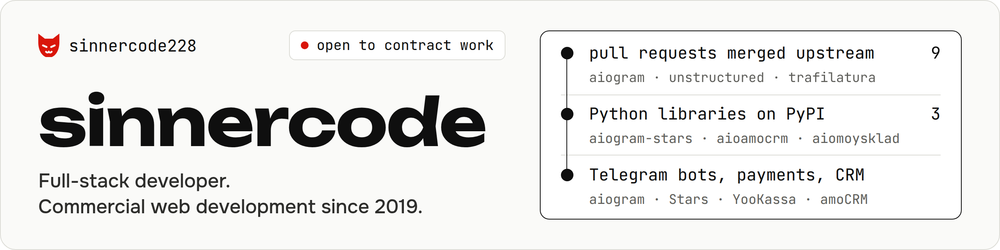
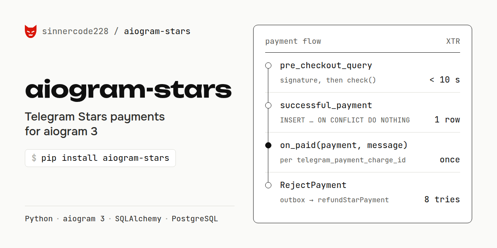
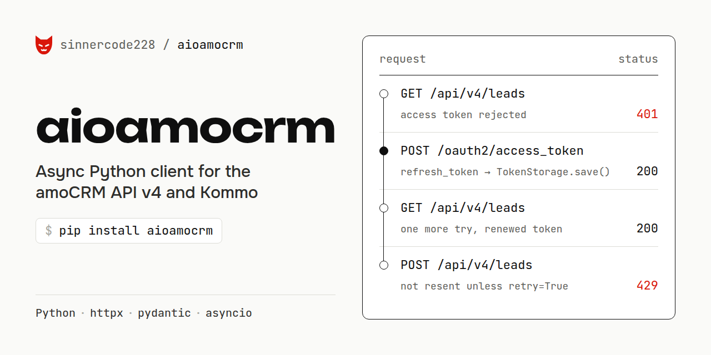
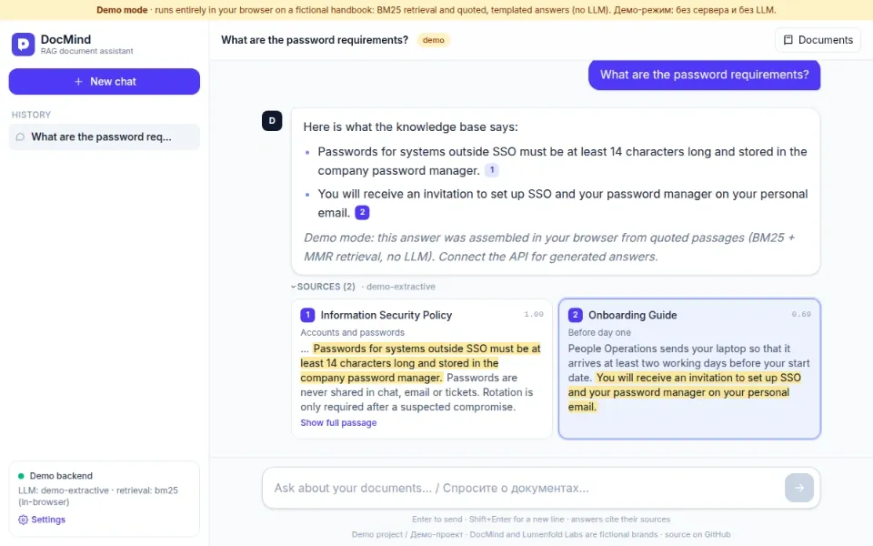

<picture>
  <source media="(max-width: 600px)" srcset="assets/banner-narrow.png">
  <source media="(prefers-color-scheme: dark)" srcset="assets/banner-dark.png">
  
</picture>

[Portfolio](https://sinnercode228.github.io/portfolio/?lang=en) · Telegram [@sinnercode](https://t.me/sinnercode) · [PyPI](https://pypi.org/user/sinnercode/) · [dev.to](https://dev.to/sinnercode228) · [По-русски](#по-русски)

Python backend developer (FastAPI, asyncio, PostgreSQL, Redis), in commercial web development since 2019, and at home with TypeScript and React on the frontend. I build and maintain APIs, booking and subscription billing, CRM integrations, Telegram bots and Mini Apps, LLM features.

**Open to full-time and contract roles, remote.** I can join your team, own a backend service, or take over an existing codebase. Telegram: [@sinnercode](https://t.me/sinnercode).

## Merged upstream

| Pull request | Change |
|---|---|
| [aiogram #1954](https://github.com/aiogram/aiogram/pull/1954) | `InlineKeyboardBuilder.as_markup()` no longer drops its options. Fixes [#1423](https://github.com/aiogram/aiogram/issues/1423) |
| [aiogram #1956](https://github.com/aiogram/aiogram/pull/1956) | Opt-in `tasks_shutdown_timeout`, so polling shutdown can wait for running handlers. Fixes [#1955](https://github.com/aiogram/aiogram/issues/1955) |
| [pyTelegramBotAPI #2657](https://github.com/eternnoir/pyTelegramBotAPI/pull/2657) | The sync `TextFilter` with `ignore_case=True` lowers every condition, not only the first one set, so `starts_with` and `ends_with` together match as in the asyncio filter |
| [unstructured #4568](https://github.com/Unstructured-IO/unstructured/pull/4568) | `translate_text()` no longer repeats the first 512 tokens for every chunk. Fixes [#3607](https://github.com/Unstructured-IO/unstructured/issues/3607) |
| [unstructured #4597](https://github.com/Unstructured-IO/unstructured/pull/4597) | `partition_email()` no longer fails on attached emails (`message/rfc822`) |
| [unstructured #4598](https://github.com/Unstructured-IO/unstructured/pull/4598) | Chunking with `overlap_all=True` no longer emits a chunk that holds only the overlap |
| [unstructured #4599](https://github.com/Unstructured-IO/unstructured/pull/4599) | `.markdown` files are detected as Markdown. Follow-up to [#3670](https://github.com/Unstructured-IO/unstructured/issues/3670) |
| [unstructured #4602](https://github.com/Unstructured-IO/unstructured/pull/4602) | `partition_pdf()` debug overlays now use the DPI and PDF password passed to partitioning. Fixes [#3985](https://github.com/Unstructured-IO/unstructured/issues/3985) |
| [trafilatura #1027](https://github.com/adbar/trafilatura/pull/1027) | `fetch_url()` retries a urllib3 read error once, without backoff, instead of waiting several times `DOWNLOAD_TIMEOUT`. Fixes [#1016](https://github.com/adbar/trafilatura/issues/1016) |
| [cashews #437](https://github.com/Krukov/cashews/pull/437) | `CacheEtagMiddleware` no longer fails on a cached `StreamingResponse` or gives every streaming endpoint the same ETag. Fixes [#428](https://github.com/Krukov/cashews/issues/428) |

In review: [sqladmin #1150](https://github.com/smithyhq/sqladmin/pull/1150) (approved), [taskiq #692](https://github.com/taskiq-python/taskiq/pull/692), [taskiq #698](https://github.com/taskiq-python/taskiq/pull/698), [tortoise-orm #2395](https://github.com/tortoise/tortoise-orm/pull/2395), [pyTelegramBotAPI #2656](https://github.com/eternnoir/pyTelegramBotAPI/pull/2656), [cashews #450](https://github.com/Krukov/cashews/pull/450).

## Libraries

All three are on PyPI, MIT licensed, for Python 3.10+.

<table>
<tr>
<td width="50%" valign="top">
 
<b><a href="https://github.com/sinnercode228/aiogram-stars">aiogram-stars</a></b> 0.2.0 · <a href="https://pypi.org/project/aiogram-stars/">PyPI</a> 
Telegram Stars payments for aiogram 3, extracted from Zernolist. <code>on_paid</code> runs once per charge. Failed refunds are retried from a database outbox.
</td>
<td width="50%" valign="top">
 
<b><a href="https://github.com/sinnercode228/aioamocrm">aioamocrm</a></b> 0.1.1 · <a href="https://pypi.org/project/aioamocrm/">PyPI</a> 
Async client for the amoCRM and Kommo API v4. Handles OAuth2 token rotation and limits requests to 7 per second. A <code>POST</code> is resent only with <code>retry=True</code>, because amoCRM has no idempotency keys. Tested on mocked HTTP, not a live account.
</td>
</tr>
</table>

**[aiomoysklad](https://github.com/sinnercode228/aiomoysklad)** 0.1.0 · [PyPI](https://pypi.org/project/aiomoysklad/)\
Async client for the MoySklad JSON API 1.2 that keeps to its limits: request weights per token kind, including the change on 1 December 2026, at most 5 requests in flight, retries on 429 from the Lognex headers, and a stop before the automatic cut-off. Covers stock reports, customer orders and webhooks. Tested on mocked HTTP, not a live account yet.

## Projects

Client code from my contract work is private, so these are standalone projects with sample data. The demos run on GitHub Pages with the API mocked in the browser.

- **[tg-paid-club](https://github.com/sinnercode228/tg-paid-club)** · Python, aiogram 3, FastAPI, PostgreSQL\
  Paid access to a private Telegram channel or group, with YooKassa card renewals, Stars subscriptions and a 3-day grace period after a declined card. Only paying members' join requests are approved. No live deployment: a simulator fills the admin dashboard with sample members.
- **[Zernolist](https://github.com/sinnercode228/tg-shop-miniapp)** · React, aiogram 3, FastAPI · [demo](https://sinnercode228.github.io/tg-shop-miniapp/) · [write-up](notes/zernolist-stars-payments.md)\
  A coffee and tea shop as a Telegram Mini App, paid in Stars or on receipt. Order totals are computed on the server from the catalog, never taken from the client. Stars payments go through aiogram-stars.
- **[Slotbook](https://github.com/sinnercode228/slotbook)** · Go, PostgreSQL, React · [demo](https://sinnercode228.github.io/slotbook/) · [write-up](notes/slotbook-exclusion-constraint.md)\
  Online booking for salons, with a booking widget and a staff day view. A PostgreSQL exclusion constraint prevents double booking under concurrent requests.
- **[DocMind](https://github.com/sinnercode228/docmind-rag)** · Python, FastAPI, pgvector, React · [demo](https://sinnercode228.github.io/docmind-rag/) · [write-up](notes/docmind-sources-before-tokens.md)\
  Q&A with citations over PDF, DOCX, HTML and web pages, also as a Telegram bot. Sources are sent before the answer, so each `[n]` is clickable as it streams. The demo searches with BM25 in the browser, without an LLM.

Smaller demos are in [portfolio](https://github.com/sinnercode228/portfolio): a landing page with a cost calculator, an async scraper, a lead-collection bot and an Excel dashboard.

Technical write-ups (English and Russian) are in [notes/](notes/), and the aiogram-stars one is also on [dev.to](https://dev.to/sinnercode228/the-stars-were-charged-and-onpaid-never-ran-where-telegram-stars-payments-get-lost-in-aiogram-5m2). Fix log: [notes/fixes.md](notes/fixes.md).

## Experience

**2025 – present · Senior Full-Stack Developer · Independent / Contract**\
New products and work on existing systems: APIs and integrations, admin panels, job queues and bulk imports, query optimization, CI/CD and monitoring, code review and releases.

**2023 – 2025 · Full-Stack Developer · Independent projects and contracts**\
Services with subscriptions, payments and automation: a SaaS for links and contacts, a Telegram sales platform with automatic delivery of digital goods, a website analytics service. I designed the APIs and databases, built the UIs, deployed and maintained them. Next.js, TypeScript, Node.js, Python, PostgreSQL, Redis, Nginx.

**2021 – 2023 · Full-Stack Developer · Contract development**\
Internal web apps for sales teams and service businesses: a CRM for incoming customer requests, a document portal with approvals, supplier catalog sync with price and stock updates. React, TypeScript, Node.js, PostgreSQL, Redis, Docker.

**2019 – 2021 · Web Developer · Freelance**\
Websites and online stores for small businesses: an auto parts store with CSV import, a repair-shop chain site with a cost calculator that sends leads to a CRM, WordPress sites with custom themes. JavaScript, PHP, WordPress, MySQL.

---

## По-русски

Python-бэкенд разработчик (FastAPI, asyncio, PostgreSQL, Redis), в коммерческой разработке с 2019 года, на фронтенде работаю с TypeScript и React. Делаю веб-продукты с нуля и дорабатываю существующие: API и базы данных, онлайн-запись, биллинг подписок, интеграции с amoCRM и Bitrix24, Telegram-боты и Mini Apps, функции на LLM.

- Приняты десять моих PR: два в aiogram ([#1954](https://github.com/aiogram/aiogram/pull/1954), [#1956](https://github.com/aiogram/aiogram/pull/1956)), пять в unstructured ([#4568](https://github.com/Unstructured-IO/unstructured/pull/4568), [#4597](https://github.com/Unstructured-IO/unstructured/pull/4597), [#4598](https://github.com/Unstructured-IO/unstructured/pull/4598), [#4599](https://github.com/Unstructured-IO/unstructured/pull/4599), [#4602](https://github.com/Unstructured-IO/unstructured/pull/4602)) и по одному в pyTelegramBotAPI ([#2657](https://github.com/eternnoir/pyTelegramBotAPI/pull/2657)), trafilatura ([#1027](https://github.com/adbar/trafilatura/pull/1027)) и cashews ([#437](https://github.com/Krukov/cashews/pull/437)).
- На PyPI три мои библиотеки: [aiogram-stars](https://pypi.org/project/aiogram-stars/) для приёма платежей в Telegram Stars в aiogram 3, [aioamocrm](https://pypi.org/project/aioamocrm/), асинхронный клиент API amoCRM и Kommo, и [aiomoysklad](https://pypi.org/project/aiomoysklad/), асинхронный клиент API МойСклада, который соблюдает его лимиты на запросы.
- Технические разборы проектов на русском: [notes/](notes/README.md#по-русски).

**Ищу работу в штате или на контракте, удалённо.** Могу подключиться к команде, вести бэкенд-сервис или взять на поддержку существующий проект.

Telegram: [@sinnercode](https://t.me/sinnercode) · [Портфолио](https://sinnercode228.github.io/portfolio/)
