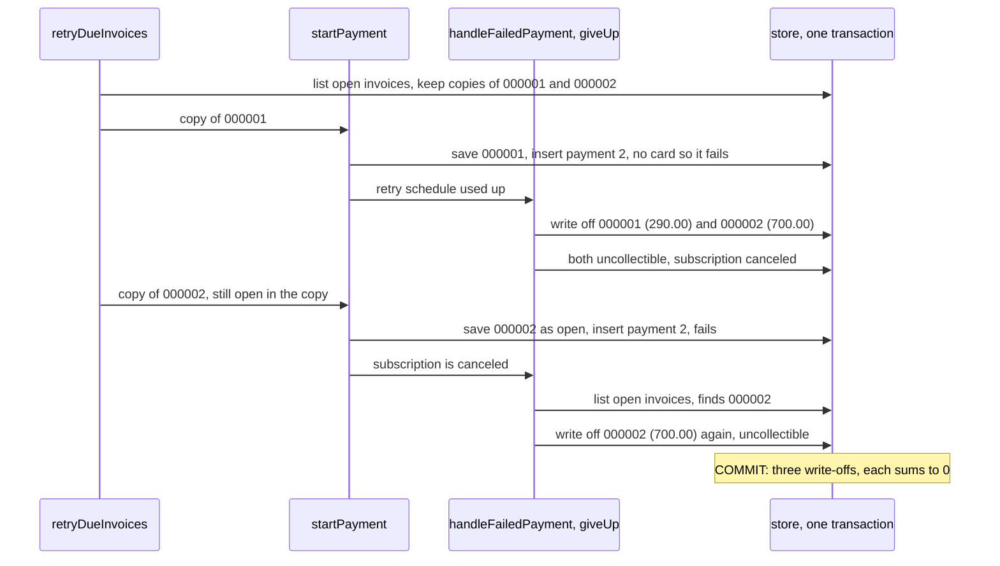

# The trial balance was zero and the invoice was written off twice

**English** · [Русский](ledgerline-balanced-but-wrong.ru.md)

Repository: [sinnercode228/ledgerline-billing](https://github.com/sinnercode228/ledgerline-billing) · Demo: [sinnercode228.github.io/ledgerline-billing](https://sinnercode228.github.io/ledgerline-billing/) · Code links point to commit [`ca11770`](https://github.com/sinnercode228/ledgerline-billing/tree/ca1177033b22a28331ed6d2a90ba1902546e9728) (before the fix) and [`442e27c`](https://github.com/sinnercode228/ledgerline-billing/tree/442e27c08854c39821ade0cbfe7ebe67bffd2c1c) (after it)

Ledgerline's ledger cannot go out of balance. Every posting is two lines of one amount, and both stores refuse a journal transaction whose lines do not sum to zero. Before commit `b8aabf0`, one due-work run could still write the same invoice off twice. In between, it saved the written-off invoice back as `open` and recorded a payment attempt on it. Bad debt came out too high by that invoice, the customer's receivable went negative by the same amount, and the trial balance was exactly zero.

Ledgerline is a demo: Payrail, the payment provider, and every customer are made up. The state this bug needs cannot be reached through the public API today; that part comes after the fix.

## Why the books always balance

There are five kinds of account: receivable and credit per customer, revenue, Payrail clearing and bad debt per currency. Every posting the engine makes comes from `transfer(kind, input, debit, credit, memo)` in `ledger.ts` or is the mirror image of one, and it always has two lines: `input.amount` on the debit account and `-input.amount` on the credit account ([`ledger.ts#L134-L137`](https://github.com/sinnercode228/ledgerline-billing/blob/442e27c08854c39821ade0cbfe7ebe67bffd2c1c/packages/core/src/ledger.ts#L134-L137)). A write-off debits `bad_debt:<currency>` and credits `receivable:<customer>` ([`ledger.ts#L174-L181`](https://github.com/sinnercode228/ledgerline-billing/blob/442e27c08854c39821ade0cbfe7ebe67bffd2c1c/packages/core/src/ledger.ts#L174-L181)). `post` runs `assertBalanced` once more before the insert ([`ledger-ops.ts#L6-L12`](https://github.com/sinnercode228/ledgerline-billing/blob/442e27c08854c39821ade0cbfe7ebe67bffd2c1c/packages/core/src/engine/ledger-ops.ts#L6-L12)). `MemoryStore` runs each transaction on a copy of its state and checks every journal transaction added during it before it swaps the copy in ([`memory-store.ts#L160-L185`](https://github.com/sinnercode228/ledgerline-billing/blob/442e27c08854c39821ade0cbfe7ebe67bffd2c1c/packages/core/src/memory/memory-store.ts#L160-L185)). PostgreSQL checks again on its own, whatever code writes to it:

```sql
CREATE CONSTRAINT TRIGGER journal_entries_balanced
  AFTER INSERT ON journal_entries
  DEFERRABLE INITIALLY DEFERRED
  FOR EACH ROW EXECUTE FUNCTION journal_entries_check_balanced();
```

[`002_ledger_guards.sql#L42-L45`](https://github.com/sinnercode228/ledgerline-billing/blob/442e27c08854c39821ade0cbfe7ebe67bffd2c1c/server/migrations/002_ledger_guards.sql#L42-L45)

The trigger's function calls `ledger_assert_balanced`, which counts and sums the transaction's entries and raises `check_violation` unless there are at least two and they sum to zero ([`#L7-L24`](https://github.com/sinnercode228/ledgerline-billing/blob/442e27c08854c39821ade0cbfe7ebe67bffd2c1c/server/migrations/002_ledger_guards.sql#L7-L24)). Deferred to COMMIT, entries can go in one by one. A test inserts +500 and −400 by hand: both inserts succeed, and COMMIT fails with "entries sum to 100" ([`ledger-constraints.test.ts#L41-L54`](https://github.com/sinnercode228/ledgerline-billing/blob/442e27c08854c39821ade0cbfe7ebe67bffd2c1c/server/test/ledger-constraints.test.ts#L41-L54)).

Each of these checks looks at one journal transaction. The trial balance adds up every account, and a sum of postings that each sum to zero is zero. It proves that every posting is consistent with itself. It cannot prove that a posting should exist. A write-off posted twice passes every check above twice.

## Two due invoices, one copy each

`runDueWork` claims one due subscription per transaction (on PostgreSQL with `FOR UPDATE OF s SKIP LOCKED`) and hands a past-due one to `retryDueInvoices`. Before the fix, the loop read the subscription's open invoices once and then worked on those copies:

```ts
  const due = (await tx.listInvoices({ subscriptionId: subscription.id, status: 'open' })).filter(
    (invoice) => invoice.nextRetryAt !== null && invoice.nextRetryAt <= now,
  );
  const intents: ChargeIntent[] = [];
  let effects = noEffects();
  for (const invoice of due) {
    if (await hasPaymentInFlight(tx, invoice.id)) {
      // The outcome of the payment in flight decides the next retry.
      await tx.updateInvoice({ ...invoice, nextRetryAt: null });
      continue;
    }
    const current = await requireSubscription(tx, subscription.id);
    const counted = { ...invoice, scheduledRetries: invoice.scheduledRetries + 1 };
    const started = await startPayment(ctx, tx, { subscription: current, customer, invoice: counted, trigger: 'scheduled_retry', now });
    if (started.intent) intents.push(started.intent);
    effects = addEffects(effects, started.effects);
  }
```

[`due-work.ts#L154-L170`](https://github.com/sinnercode228/ledgerline-billing/blob/ca1177033b22a28331ed6d2a90ba1902546e9728/packages/core/src/engine/due-work.ts#L154-L170) at `ca11770`

`startPayment` records the next attempt and returns a charge to send after COMMIT. One outcome comes back inside the transaction: when the customer has no default card, the payment is stored as failed with `payment_method_missing`, and `handleFailedPayment` runs right there:

```ts
  const amount = outstanding(invoice);
  if (invoice.status !== 'open' || amount <= 0) return { intent: null, effects: noEffects() };
...
  const attempted: Invoice = { ...invoice, attemptCount: attempt, nextRetryAt: null };
  await tx.updateInvoice(attempted);
  await tx.insertPayment(payment);

  if (!method) {
    return { intent: null, effects: await handleFailedPayment(ctx, tx, { subscription, invoice: attempted, now }) };
  }
```

[`charging.ts#L58-L87`](https://github.com/sinnercode228/ledgerline-billing/blob/442e27c08854c39821ade0cbfe7ebe67bffd2c1c/packages/core/src/engine/charging.ts#L58-L87)

If that failure uses up the retry schedule, `giveUp` ends dunning ([`payment-results.ts#L173-L212`](https://github.com/sinnercode228/ledgerline-billing/blob/442e27c08854c39821ade0cbfe7ebe67bffd2c1c/packages/core/src/engine/payment-results.ts#L173-L212)). It lists the subscription's open invoices from the store, posts a write-off for what each still owes, marks each one `uncollectible` and cancels the subscription. That includes the invoices the loop has not reached yet.

Then the loop takes its next copy. The copy was read before `giveUp` ran, so it still says `open`, and the status check in `startPayment` passes against the copy. `updateInvoice(attempted)` writes `open` over the `uncollectible` row, and payment 2 goes in. With no card it fails at once, and `handleFailedPayment` decides again:

```ts
  const firstFailedAt = invoice.firstFailedAt ?? now;
  const decision: DunningDecision =
    subscription.status === 'canceled'
      ? { action: 'give_up' }
      : decideAfterFailure({ policy: ctx.dunning, firstFailedAt, scheduledRetries: invoice.scheduledRetries, now });
```

[`payment-results.ts#L157-L161`](https://github.com/sinnercode228/ledgerline-billing/blob/442e27c08854c39821ade0cbfe7ebe67bffd2c1c/packages/core/src/engine/payment-results.ts#L157-L161)

The old loop did re-read the subscription before each attempt; it never looked at the status. So `startPayment` got the canceled subscription, and a canceled subscription always gives up. `giveUp` lists the open invoices again, finds the one just reopened, writes it off a second time and marks it `uncollectible` again:



## The run against the old code

Commit `b8aabf0` adds the scenario "writes each invoice off once when the first of two due retries gives up" ([`payments.ts#L259-L291`](https://github.com/sinnercode228/ledgerline-billing/blob/442e27c08854c39821ade0cbfe7ebe67bffd2c1c/packages/core/src/testing/scenarios/payments.ts#L259-L291)). Its dunning schedule is one retry, one day after the first failure. Tallowmere Press pays in EUR with a card Payrail declines, and Payrail answers only by webhook. The customer subscribes to Team (yearly) for 290.00 and, at the same instant, upgrades to Business (yearly) for 990.00, which issues a proration invoice of 700.00. The first charge is still in flight at that point, so the subscription is still active and the plan change is allowed; a synchronous decline would have made it past due first. Both failure webhooks are applied at 10 March, 12:00, and both invoices are due for their one retry at 11 March, 12:00. The scenario then drops the default card through the store and runs due work at that time.

I put the new scenario file on top of `ca11770` and ran it on both stores. Both fail at the first check after due work, on its report; the changed lines of Vitest's diff, expected first:

```
-   "paymentsFailed": 1,
+   "paymentsFailed": 2,
-   "writtenOff": 2,
+   "writtenOff": 3,
```

To see the books, I ran the same steps without the assertions and printed the journal in posting order, the account balances and the trial balance. In this run the cycle invoice `LL-2026-000001` came first in the loop:

```
invoice_finalized  LL-2026-000001  receivable +290.00    revenue    -290.00
invoice_finalized  LL-2026-000002  receivable +700.00    revenue    -700.00
write_off          LL-2026-000001  bad_debt   +290.00    receivable -290.00
write_off          LL-2026-000002  bad_debt   +700.00    receivable -700.00
write_off          LL-2026-000002  bad_debt   +700.00    receivable -700.00
bad_debt    1690.00
receivable  -700.00
revenue     -990.00
trial balance: {"balanced":true,"currencies":[{"currency":"EUR","debits":268000,"credits":268000,"net":0}]}
```

Both invoices end `uncollectible`, because the second `giveUp` set `LL-2026-000002` back. The invoice list looks right. The traces are on the invoice and in the journal: `LL-2026-000002` has a payment 2, trigger `scheduled_retry`, failed with `payment_method_missing` with the same timestamp as its write-offs, and there are two of those. Tallowmere Press was billed 990.00 in total, bad debt says 1,690.00, and its receivable is −700.00.

Which invoice is hit depends on the listing order. Both stores list invoices newest first and break ties by id, both invoices were created at the same instant, and the test's ids are random. With the proration invoice first, `LL-2026-000001` is the one written off twice: bad debt 1,280.00, receivable −290.00. I ran the steps 18 times on each store; on each, the cycle invoice came first 8 times, and every run wrote one invoice off twice, with the same numbers on `MemoryStore` and PostgreSQL. PostgreSQL committed every run: each of the five journal transactions sums to zero, and nothing in the schema checks how an invoice's status moves.

## What sees it, and what cannot

`findInvariantViolations` compares the books with the documents. Two of its rules fire here:

```ts
  for (const customer of customers) {
    const open = invoices.filter((i) => i.customerId === customer.id && i.status === 'open');
    const owed = sumMinor(open.map(outstanding));
    const receivable = balanceOf(`receivable:${customer.id}`);
    if (receivable !== owed) problems.push(`customer ${customer.name}: receivable ${receivable}, open invoices owe ${owed}`);
...
    const writtenOff = sumMinor(invoices.filter((i) => i.currency === currency && i.status === 'uncollectible').map(outstanding));
    const badDebt = balanceOf(`bad_debt:${currency}`);
    if (badDebt !== writtenOff) problems.push(`${currency} bad debt ${badDebt}, uncollectible invoices owe ${writtenOff}`);
```

[`invariants.ts#L53-L73`](https://github.com/sinnercode228/ledgerline-billing/blob/442e27c08854c39821ade0cbfe7ebe67bffd2c1c/packages/core/src/testing/invariants.ts#L53-L73)

For the run above, in cents:

```
customer Tallowmere Press: receivable -70000, open invoices owe 0
EUR bad debt 169000, uncollectible invoices owe 99000
```

These rules have a second source. The invoice row says `LL-2026-000002` is uncollectible and owes 700.00, so the rule counts it once; the journal counts it twice. The trial balance compares the books with themselves: 2,680.00 of debits against 2,680.00 of credits. Two other rules stay quiet. The trial balance is balanced ([`#L35-L36`](https://github.com/sinnercode228/ledgerline-billing/blob/442e27c08854c39821ade0cbfe7ebe67bffd2c1c/packages/core/src/testing/invariants.ts#L35-L36)). The rule that an invoice has as many payments as its `attemptCount` holds too ([`#L50`](https://github.com/sinnercode228/ledgerline-billing/blob/442e27c08854c39821ade0cbfe7ebe67bffd2c1c/packages/core/src/testing/invariants.ts#L50)), because the stale save wrote `attemptCount: 2` right before payment 2 went in.

The random walk runs `findInvariantViolations` after every step, over 240 simulated days on two seeds ([`random-walk.ts#L134`](https://github.com/sinnercode228/ledgerline-billing/blob/442e27c08854c39821ade0cbfe7ebe67bffd2c1c/packages/core/src/testing/scenarios/random-walk.ts#L134)). On `ca11770` both seeds pass on both stores. The walk drives the engine only through its methods, and the methods cannot produce the state.

The final state also hides part of the bug: the reopened invoice ends `uncollectible` again. So the scenario wraps the store's transaction in a `Proxy` ([`payments.ts#L21-L46`](https://github.com/sinnercode228/ledgerline-billing/blob/442e27c08854c39821ade0cbfe7ebe67bffd2c1c/packages/core/src/testing/scenarios/payments.ts#L21-L46)) that records two writes which must never happen, whatever comes later in the same transaction: an `updateInvoice` that moves an uncollectible invoice to `open`, and an `insertPayment` for an invoice that already has a write-off. On `ca11770` both fire, for the same invoice.

## Read again inside the loop

The fix re-reads the subscription and the invoice on every pass:

```ts
  const isDue = (invoice: Invoice) => invoice.status === 'open' && invoice.nextRetryAt !== null && invoice.nextRetryAt <= now;
  const due = (await tx.listInvoices({ subscriptionId: subscription.id, status: 'open' })).filter(isDue);
  const intents: ChargeIntent[] = [];
  let effects = noEffects();
  for (const listed of due) {
    // A retry that fails at once can end dunning and write off every open invoice, so each one is read again.
    const current = await requireSubscription(tx, subscription.id);
    if (current.status !== 'past_due') break;
    const invoice = await requireInvoice(tx, listed.id, 'for_update');
    if (!isDue(invoice)) continue;
```

[`due-work.ts#L154-L163`](https://github.com/sinnercode228/ledgerline-billing/blob/442e27c08854c39821ade0cbfe7ebe67bffd2c1c/packages/core/src/engine/due-work.ts#L154-L163)

If the subscription is no longer past due, dunning has ended and the loop stops. Otherwise the invoice is read again under lock and checked again, and `isDue` now checks the status too. The branch for a payment in flight, which clears `nextRetryAt`, also writes the fresh row now instead of the copy.

The lock follows the order the store port prescribes for every caller, "subscription -> customer -> invoice -> payment (-> invoice counter)" ([`ports/store.ts#L50-L55`](https://github.com/sinnercode228/ledgerline-billing/blob/442e27c08854c39821ade0cbfe7ebe67bffd2c1c/packages/core/src/ports/store.ts#L50-L55)). The claim locks the subscription, `retryDueInvoices` locks the customer before the loop, and each invoice is locked inside it. Before the fix the loop read the invoices without a lock, although the comment on `startPayment` says the caller holds the subscription, customer and invoice locks ([`charging.ts#L46-L51`](https://github.com/sinnercode228/ledgerline-billing/blob/442e27c08854c39821ade0cbfe7ebe67bffd2c1c/packages/core/src/engine/charging.ts#L46-L51)). That gap was not the bug. Every engine path that writes an invoice holds the lock on its subscription, and due work holds it from the claim on, so no other transaction could change these invoices during the loop. The copy went stale inside its own transaction, and only reading it again fixes that.

`retryPastDueInvoices` in `customers.ts` has the same shape. It runs when a card becomes the default, on attach or on a switch, and retries every failing invoice of each past-due subscription. It got the same change: re-read the subscription, stop unless it is past due, re-read the invoice under lock, check `status === 'open'` again ([`customers.ts#L91-L121`](https://github.com/sinnercode228/ledgerline-billing/blob/442e27c08854c39821ade0cbfe7ebe67bffd2c1c/packages/core/src/engine/customers.ts#L91-L121)).

On `442e27c` the scenario passes on both stores. The same printout shows one write-off per invoice, bad debt 990.00, receivable 0.00 and 1,980.00 on each side of the trial balance. The invoice that was not retried keeps its single payment.

## Not reachable through the API today

The bug needs a payment that fails inside the due-work transaction, and that happens only when the customer has no default card. A customer who has one keeps one. The API attaches cards and switches the default, but no route removes a card, and both stores refuse a default that is not one of the customer's cards ([`memory-store.ts#L194-L203`](https://github.com/sinnercode228/ledgerline-billing/blob/442e27c08854c39821ade0cbfe7ebe67bffd2c1c/packages/core/src/memory/memory-store.ts#L194-L203), a foreign key in [`001_schema.sql#L44-L45`](https://github.com/sinnercode228/ledgerline-billing/blob/442e27c08854c39821ade0cbfe7ebe67bffd2c1c/server/migrations/001_schema.sql#L44-L45)). A customer without a card can only take a plan with a trial ([`subscriptions.ts#L63-L65`](https://github.com/sinnercode228/ledgerline-billing/blob/442e27c08854c39821ade0cbfe7ebe67bffd2c1c/packages/core/src/engine/subscriptions.ts#L63-L65)). When the trial ends, the first invoice fails at once and the subscription turns past due in the same transaction. A past-due subscription cannot change plans ([`plan-change.ts#L38-L40`](https://github.com/sinnercode228/ledgerline-billing/blob/442e27c08854c39821ade0cbfe7ebe67bffd2c1c/packages/core/src/engine/plan-change.ts#L38-L40)) and is not renewed while dunning runs, and every plan in the catalog costs more than zero. So a subscription without a card never has two failing invoices. That is why the scenario removes the card through the store:

```ts
      // The engine cannot detach a card, so the store drops it: the retry then fails at once, inside the due-work transaction.
      await world.store.run(async (tx) => {
        const current = await tx.getCustomer(customer.id, 'for_update');
        await tx.updateCustomer({ ...current!, defaultPaymentMethodId: null });
      });
```

[`payments.ts#L273-L277`](https://github.com/sinnercode228/ledgerline-billing/blob/442e27c08854c39821ade0cbfe7ebe67bffd2c1c/packages/core/src/testing/scenarios/payments.ts#L273-L277)

For the data, this means no demo world and no seeded database could have hit the bug: the demo, the seed and the HTTP routes all go through the engine's methods. For the code, it means the defect sat in the engine, one route away. `giveUp` can close every open invoice of a subscription, so a loop that calls into it must not reuse rows it read before the call. With a route that detaches a card, two failing invoices due in the same run would have been enough, the first one in the loop on its last retry, under the default schedule as well. In `retryPastDueInvoices` it is one step further away: that loop runs right after a card became the default, so a failure inside it would need the card to disappear between two transactions.

## Tests, and where the code is still thin

At `442e27c` there are 234 Vitest tests in 38 files: 102 in `packages/core`, 83 in `server`, 49 in `web`. All pass when I run them against PostgreSQL 16, and CI passed on that commit. 70 of them are the 35 shared scenarios, once on `MemoryStore` and once on `PgStore` with a freshly migrated schema per test; the new scenario is one of the 35.

- The scenario covers the due-work loop only. No test makes a payment fail inside the `retryPastDueInvoices` loop, because it runs right after a card became the default. The `break` and `continue` the fix added there are never taken in a test, so that half of the fix has no test of its own.
- The engine checks each status change it makes against the copy it holds (`assertInvoiceTransition`, [`invoice.ts#L49-L62`](https://github.com/sinnercode228/ledgerline-billing/blob/442e27c08854c39821ade0cbfe7ebe67bffd2c1c/packages/core/src/invoice.ts#L49-L62)). For the stale copy the save was `open` to `open`, so no check ran. Neither store checks status changes: `uncollectible -> open` is not in the table, and both stores accepted it. Payments have a trigger that only lets the status move forward ([`002_ledger_guards.sql#L122-L135`](https://github.com/sinnercode228/ledgerline-billing/blob/442e27c08854c39821ade0cbfe7ebe67bffd2c1c/server/migrations/002_ledger_guards.sql#L122-L135)); invoices have none. With one, PostgreSQL would have refused the reopen, the whole step would have rolled back, and `runDueWork` would have reported an error for that subscription.
- `findInvariantViolations` lives under `testing/` and runs only in tests. Nothing in the server or the worker compares the books with the documents at runtime, so neither would flag the double write-off. It would stay in the data: a negative receivable, more bad debt than the uncollectible invoices owe, and two write-offs of one invoice in the journal.
- From the README's known limitations: there is no adapter for a real payment provider, revenue is recognized when an invoice is finalized (no deferred revenue account), a plan change keeps the billing interval, a refund returns everything the card paid for one invoice, nothing produces the `void` status, and a past-due subscription is not renewed while dunning runs.

## The rule I took from it

A trial balance of zero proves that every posting balances. It does not prove that any posting should exist. For that, the books need a second source to agree with, here the invoices, and the invariants are where that comparison is written down. In the code: when a call inside a loop can change rows the loop has already read, read each row again after the call, inside the same transaction.

Fix: [`b8aabf0` Re-read each invoice in the retry loops so a written-off invoice is not charged or reopened](https://github.com/sinnercode228/ledgerline-billing/commit/b8aabf0576976b7dade1b8158720c4b6c4cc7c99) · Tests: [`payments.ts#L259-L291`](https://github.com/sinnercode228/ledgerline-billing/blob/442e27c08854c39821ade0cbfe7ebe67bffd2c1c/packages/core/src/testing/scenarios/payments.ts#L259-L291), [`invariants.ts`](https://github.com/sinnercode228/ledgerline-billing/blob/442e27c08854c39821ade0cbfe7ebe67bffd2c1c/packages/core/src/testing/invariants.ts)
