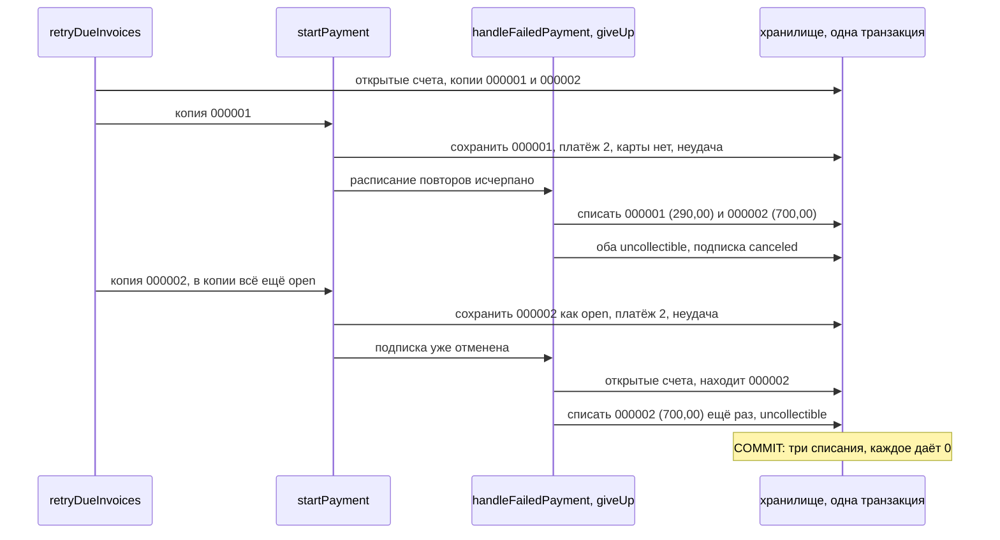

# Оборотная ведомость сходилась в ноль, а счёт списали дважды

[English](ledgerline-balanced-but-wrong.md) · **Русский**

Репозиторий: [sinnercode228/ledgerline-billing](https://github.com/sinnercode228/ledgerline-billing) · Демо: [sinnercode228.github.io/ledgerline-billing](https://sinnercode228.github.io/ledgerline-billing/) · Ссылки на код ведут на коммит [`ca11770`](https://github.com/sinnercode228/ledgerline-billing/tree/ca1177033b22a28331ed6d2a90ba1902546e9728) (до исправления) и [`442e27c`](https://github.com/sinnercode228/ledgerline-billing/tree/442e27c08854c39821ade0cbfe7ebe67bffd2c1c) (после него)

Главная книга Ledgerline не может разойтись. Каждая проводка — две строки на одну сумму, и оба хранилища отказываются записать операцию журнала, строки которой в сумме не дают ноль. И всё же до коммита `b8aabf0` один прогон наступившей работы мог списать один и тот же счёт дважды. Между двумя списаниями он сохранял уже списанный счёт обратно как `open` и записывал на него попытку оплаты. Списанные долги оказывались больше ровно на этот счёт, дебиторка клиента уходила в минус на ту же сумму, а оборотная ведомость сходилась точно в ноль.

Ledgerline — демо-проект: платёжный провайдер Payrail и все клиенты выдуманы. До состояния, которое нужно этой ошибке, через публичный API сейчас не добраться; об этом — после исправления.

## Почему книга всегда сходится

Счетов учёта пять видов: дебиторка и кредит у каждого клиента, выручка, транзитный счёт Payrail и списанные долги в каждой валюте. Каждую проводку движок строит через `transfer(kind, input, debit, credit, memo)` из `ledger.ts` или зеркально отражает уже существующую, и строк в ней всегда две: `input.amount` на счёте дебета и `-input.amount` на счёте кредита ([`ledger.ts#L134-L137`](https://github.com/sinnercode228/ledgerline-billing/blob/442e27c08854c39821ade0cbfe7ebe67bffd2c1c/packages/core/src/ledger.ts#L134-L137)). Списание долга дебетует `bad_debt:<валюта>` и кредитует `receivable:<клиент>` ([`ledger.ts#L174-L181`](https://github.com/sinnercode228/ledgerline-billing/blob/442e27c08854c39821ade0cbfe7ebe67bffd2c1c/packages/core/src/ledger.ts#L174-L181)). Перед вставкой `post` ещё раз вызывает `assertBalanced` ([`ledger-ops.ts#L6-L12`](https://github.com/sinnercode228/ledgerline-billing/blob/442e27c08854c39821ade0cbfe7ebe67bffd2c1c/packages/core/src/engine/ledger-ops.ts#L6-L12)). `MemoryStore` выполняет каждую транзакцию на копии состояния и, прежде чем подставить копию вместо исходного, проверяет все операции журнала, добавленные за транзакцию ([`memory-store.ts#L160-L185`](https://github.com/sinnercode228/ledgerline-billing/blob/442e27c08854c39821ade0cbfe7ebe67bffd2c1c/packages/core/src/memory/memory-store.ts#L160-L185)). PostgreSQL проверяет всё заново сам, кто бы в него ни писал:

```sql
CREATE CONSTRAINT TRIGGER journal_entries_balanced
  AFTER INSERT ON journal_entries
  DEFERRABLE INITIALLY DEFERRED
  FOR EACH ROW EXECUTE FUNCTION journal_entries_check_balanced();
```

[`002_ledger_guards.sql#L42-L45`](https://github.com/sinnercode228/ledgerline-billing/blob/442e27c08854c39821ade0cbfe7ebe67bffd2c1c/server/migrations/002_ledger_guards.sql#L42-L45)

Функция триггера вызывает `ledger_assert_balanced`, а та считает строки операции и их сумму и выбрасывает `check_violation`, если строк меньше двух или сумма не ноль ([`#L7-L24`](https://github.com/sinnercode228/ledgerline-billing/blob/442e27c08854c39821ade0cbfe7ebe67bffd2c1c/server/migrations/002_ledger_guards.sql#L7-L24)). Проверка отложена до COMMIT, поэтому строки можно вставлять по одной. Тест вручную вставляет +500 и −400: обе вставки проходят, а COMMIT падает с «entries sum to 100» ([`ledger-constraints.test.ts#L41-L54`](https://github.com/sinnercode228/ledgerline-billing/blob/442e27c08854c39821ade0cbfe7ebe67bffd2c1c/server/test/ledger-constraints.test.ts#L41-L54)).

Каждая из этих проверок смотрит на одну операцию журнала. Оборотная ведомость складывает все счета, а сумма проводок, каждая из которых сама даёт ноль, тоже ноль. Она доказывает, что каждая проводка сходится сама с собой. Доказать, что проводка вообще должна была появиться, она не может. Списание, проведённое дважды, дважды проходит все проверки выше.

## Два счёта к повтору, у каждого своя копия

`runDueWork` за одну транзакцию забирает одну подписку, у которой наступила работа (в PostgreSQL через `FOR UPDATE OF s SKIP LOCKED`), и просроченную передаёт в `retryDueInvoices`. До исправления цикл один раз читал открытые счета подписки и дальше работал с этими копиями:

```ts
  const due = (await tx.listInvoices({ subscriptionId: subscription.id, status: 'open' })).filter(
    (invoice) => invoice.nextRetryAt !== null && invoice.nextRetryAt <= now,
  );
  const intents: ChargeIntent[] = [];
  let effects = noEffects();
  for (const invoice of due) {
    if (await hasPaymentInFlight(tx, invoice.id)) {
      // The outcome of the payment in flight decides the next retry.
      await tx.updateInvoice({ ...invoice, nextRetryAt: null });
      continue;
    }
    const current = await requireSubscription(tx, subscription.id);
    const counted = { ...invoice, scheduledRetries: invoice.scheduledRetries + 1 };
    const started = await startPayment(ctx, tx, { subscription: current, customer, invoice: counted, trigger: 'scheduled_retry', now });
    if (started.intent) intents.push(started.intent);
    effects = addEffects(effects, started.effects);
  }
```

[`due-work.ts#L154-L170`](https://github.com/sinnercode228/ledgerline-billing/blob/ca1177033b22a28331ed6d2a90ba1902546e9728/packages/core/src/engine/due-work.ts#L154-L170) на `ca11770`

`startPayment` записывает следующую попытку и возвращает запрос на оплату, который уйдёт в Payrail после COMMIT. Один исход приходит прямо внутри транзакции: если у клиента нет карты по умолчанию, платёж сохраняется неудачным с `payment_method_missing`, и `handleFailedPayment` выполняется тут же:

```ts
  const amount = outstanding(invoice);
  if (invoice.status !== 'open' || amount <= 0) return { intent: null, effects: noEffects() };
...
  const attempted: Invoice = { ...invoice, attemptCount: attempt, nextRetryAt: null };
  await tx.updateInvoice(attempted);
  await tx.insertPayment(payment);

  if (!method) {
    return { intent: null, effects: await handleFailedPayment(ctx, tx, { subscription, invoice: attempted, now }) };
  }
```

[`charging.ts#L58-L87`](https://github.com/sinnercode228/ledgerline-billing/blob/442e27c08854c39821ade0cbfe7ebe67bffd2c1c/packages/core/src/engine/charging.ts#L58-L87)

Если эта неудача исчерпала расписание повторов, `giveUp` завершает dunning ([`payment-results.ts#L173-L212`](https://github.com/sinnercode228/ledgerline-billing/blob/442e27c08854c39821ade0cbfe7ebe67bffd2c1c/packages/core/src/engine/payment-results.ts#L173-L212)). Он берёт из хранилища открытые счета подписки, проводит списание того, что по каждому ещё не оплачено, помечает каждый `uncollectible` и отменяет подписку. В том числе и те счета, до которых цикл ещё не дошёл.

Потом цикл берёт следующую копию. Её прочитали до того, как сработал `giveUp`, поэтому в ней всё ещё `open`, и проверка статуса в `startPayment` проходит — по копии. `updateInvoice(attempted)` записывает `open` поверх строки со статусом `uncollectible`, и добавляется платёж 2. Карты нет, он сразу неудачен, и `handleFailedPayment` решает ещё раз:

```ts
  const firstFailedAt = invoice.firstFailedAt ?? now;
  const decision: DunningDecision =
    subscription.status === 'canceled'
      ? { action: 'give_up' }
      : decideAfterFailure({ policy: ctx.dunning, firstFailedAt, scheduledRetries: invoice.scheduledRetries, now });
```

[`payment-results.ts#L157-L161`](https://github.com/sinnercode228/ledgerline-billing/blob/442e27c08854c39821ade0cbfe7ebe67bffd2c1c/packages/core/src/engine/payment-results.ts#L157-L161)

Старый цикл перечитывал подписку перед каждой попыткой, но на её статус не смотрел. Поэтому `startPayment` получил уже отменённую подписку, а для отменённой подписки решение всегда одно — сдаться. `giveUp` снова берёт открытые счета, находит только что переоткрытый, списывает его второй раз и снова помечает `uncollectible`:



## Прогон на старом коде

Коммит `b8aabf0` добавляет сценарий «writes each invoice off once when the first of two due retries gives up» ([`payments.ts#L259-L291`](https://github.com/sinnercode228/ledgerline-billing/blob/442e27c08854c39821ade0cbfe7ebe67bffd2c1c/packages/core/src/testing/scenarios/payments.ts#L259-L291)). Расписание повторов в нём — один повтор через сутки после первой неудачи. Tallowmere Press платит в евро картой, которую Payrail отклоняет, а Payrail отвечает только вебхуками. Клиент подписывается на Team (yearly) за 290,00 и в тот же момент переходит на Business (yearly) за 990,00, отчего выставляется счёт на пересчёт на 700,00. Первый платёж в этот момент ещё в пути, поэтому подписка ещё активна и смену тарифа движок разрешает; при синхронном отказе она стала бы просроченной раньше. Оба вебхука о неудаче применяются 10 марта в 12:00, и оба счёта ждут своего единственного повтора 11 марта в 12:00. Затем сценарий убирает карту по умолчанию прямо через хранилище и запускает наступившую работу на это время.

Я положил новый файл сценария поверх `ca11770` и запустил его на обоих хранилищах. Оба прогона падают на первой проверке после наступившей работы, на её отчёте; вот изменившиеся строки диффа Vitest, ожидаемое значение первым:

```
-   "paymentsFailed": 1,
+   "paymentsFailed": 2,
-   "writtenOff": 2,
+   "writtenOff": 3,
```

Чтобы увидеть книгу, я прогнал те же шаги без проверок и вывел журнал в порядке проводок, остатки по счетам учёта и оборотную ведомость. В этом прогоне первым в цикле оказался счёт за период `LL-2026-000001`:

```
invoice_finalized  LL-2026-000001  receivable +290.00    revenue    -290.00
invoice_finalized  LL-2026-000002  receivable +700.00    revenue    -700.00
write_off          LL-2026-000001  bad_debt   +290.00    receivable -290.00
write_off          LL-2026-000002  bad_debt   +700.00    receivable -700.00
write_off          LL-2026-000002  bad_debt   +700.00    receivable -700.00
bad_debt    1690.00
receivable  -700.00
revenue     -990.00
trial balance: {"balanced":true,"currencies":[{"currency":"EUR","debits":268000,"credits":268000,"net":0}]}
```

Оба счёта в конце `uncollectible`: этот статус `LL-2026-000002` вернул второй `giveUp`. Список счетов выглядит правильно. Следы остаются в самом счёте и в журнале: у `LL-2026-000002` есть платёж 2 с триггером `scheduled_retry`, неудачный с `payment_method_missing`, с той же отметкой времени, что и списания, а списаний два. Всего Tallowmere Press выставили 990,00, списанные долги показывают 1 690,00, а дебиторка клиента равна −700,00.

Какой счёт пострадает, зависит от порядка в списке. Оба хранилища отдают счета от новых к старым, а при равном времени сортируют по id; оба счёта созданы в один момент, а id в тесте случайные. Если первым идёт счёт на пересчёт, дважды списывается `LL-2026-000001`: списанные долги 1 280,00, дебиторка −290,00. Я прогнал шаги по 18 раз на каждом хранилище; на каждом счёт за период шёл первым 8 раз, и в каждом прогоне один из счетов списывался дважды, с одинаковыми числами в `MemoryStore` и в PostgreSQL. PostgreSQL зафиксировал каждый прогон: каждая из пяти операций журнала даёт ноль, а то, как меняется статус счёта, схема не проверяет.

## Кто это видит, а кто не может

`findInvariantViolations` сверяет книгу с документами. Здесь срабатывают два её правила:

```ts
  for (const customer of customers) {
    const open = invoices.filter((i) => i.customerId === customer.id && i.status === 'open');
    const owed = sumMinor(open.map(outstanding));
    const receivable = balanceOf(`receivable:${customer.id}`);
    if (receivable !== owed) problems.push(`customer ${customer.name}: receivable ${receivable}, open invoices owe ${owed}`);
...
    const writtenOff = sumMinor(invoices.filter((i) => i.currency === currency && i.status === 'uncollectible').map(outstanding));
    const badDebt = balanceOf(`bad_debt:${currency}`);
    if (badDebt !== writtenOff) problems.push(`${currency} bad debt ${badDebt}, uncollectible invoices owe ${writtenOff}`);
```

[`invariants.ts#L53-L73`](https://github.com/sinnercode228/ledgerline-billing/blob/442e27c08854c39821ade0cbfe7ebe67bffd2c1c/packages/core/src/testing/invariants.ts#L53-L73)

Для прогона выше, в центах:

```
customer Tallowmere Press: receivable -70000, open invoices owe 0
EUR bad debt 169000, uncollectible invoices owe 99000
```

У этих правил есть второй источник. Строка счёта говорит, что `LL-2026-000002` в статусе `uncollectible` и по нему не оплачено 700,00, и правило учитывает его один раз; журнал учитывает дважды. Оборотная ведомость сверяет книгу саму с собой: 2 680,00 по дебету против 2 680,00 по кредиту. Ещё два правила молчат. Оборотная ведомость сходится ([`#L35-L36`](https://github.com/sinnercode228/ledgerline-billing/blob/442e27c08854c39821ade0cbfe7ebe67bffd2c1c/packages/core/src/testing/invariants.ts#L35-L36)). Правило, что платежей у счёта столько, сколько указано в `attemptCount`, тоже выполняется ([`#L50`](https://github.com/sinnercode228/ledgerline-billing/blob/442e27c08854c39821ade0cbfe7ebe67bffd2c1c/packages/core/src/testing/invariants.ts#L50)): устаревшее сохранение записало `attemptCount: 2` прямо перед тем, как добавился платёж 2.

Случайное блуждание вызывает `findInvariantViolations` после каждого шага, 240 смоделированных дней на двух сидах ([`random-walk.ts#L134`](https://github.com/sinnercode228/ledgerline-billing/blob/442e27c08854c39821ade0cbfe7ebe67bffd2c1c/packages/core/src/testing/scenarios/random-walk.ts#L134)). На `ca11770` оба сида проходят на обоих хранилищах. Блуждание работает с движком только через его методы, а методами это состояние не получить.

К тому же часть ошибки конечное состояние прячет: переоткрытый счёт снова заканчивает в `uncollectible`. Поэтому сценарий оборачивает транзакцию хранилища в `Proxy` ([`payments.ts#L21-L46`](https://github.com/sinnercode228/ledgerline-billing/blob/442e27c08854c39821ade0cbfe7ebe67bffd2c1c/packages/core/src/testing/scenarios/payments.ts#L21-L46)) и отмечает две записи, которых не должно быть, что бы ни случилось дальше в той же транзакции: `updateInvoice`, который переводит списанный счёт в `open`, и `insertPayment` для счёта, у которого уже есть списание. На `ca11770` срабатывают обе отметки, и по одному и тому же счёту.

## Перечитать внутри цикла

Исправление перечитывает подписку и счёт на каждом проходе:

```ts
  const isDue = (invoice: Invoice) => invoice.status === 'open' && invoice.nextRetryAt !== null && invoice.nextRetryAt <= now;
  const due = (await tx.listInvoices({ subscriptionId: subscription.id, status: 'open' })).filter(isDue);
  const intents: ChargeIntent[] = [];
  let effects = noEffects();
  for (const listed of due) {
    // A retry that fails at once can end dunning and write off every open invoice, so each one is read again.
    const current = await requireSubscription(tx, subscription.id);
    if (current.status !== 'past_due') break;
    const invoice = await requireInvoice(tx, listed.id, 'for_update');
    if (!isDue(invoice)) continue;
```

[`due-work.ts#L154-L163`](https://github.com/sinnercode228/ledgerline-billing/blob/442e27c08854c39821ade0cbfe7ebe67bffd2c1c/packages/core/src/engine/due-work.ts#L154-L163)

Если подписка уже не просрочена, dunning закончился, и цикл останавливается. Иначе счёт читается заново под блокировкой и заново проверяется, причём `isDue` теперь смотрит и на статус. Ветка для платежа, который ещё в пути, сбрасывает `nextRetryAt` и теперь тоже пишет свежую строку, а не копию.

Блокировки берутся в том порядке, который порт хранилища предписывает всем вызывающим: «subscription -> customer -> invoice -> payment (-> invoice counter)» ([`ports/store.ts#L50-L55`](https://github.com/sinnercode228/ledgerline-billing/blob/442e27c08854c39821ade0cbfe7ebe67bffd2c1c/packages/core/src/ports/store.ts#L50-L55)). Подписку блокирует захват, клиента `retryDueInvoices` блокирует до цикла, а каждый счёт — внутри него. До исправления цикл читал счета без блокировки, хотя в комментарии к `startPayment` сказано, что вызывающий держит блокировки подписки, клиента и счёта ([`charging.ts#L46-L51`](https://github.com/sinnercode228/ledgerline-billing/blob/442e27c08854c39821ade0cbfe7ebe67bffd2c1c/packages/core/src/engine/charging.ts#L46-L51)). Ошибка была не в этом. Каждый путь в движке, который пишет счёт, держит блокировку его подписки, а наступившая работа держит её с момента захвата, так что другая транзакция не могла изменить эти счета посреди цикла. Копия устарела внутри своей же транзакции, и помогает от этого только повторное чтение.

У `retryPastDueInvoices` в `customers.ts` то же устройство. Она запускается, когда карта становится картой по умолчанию, при привязке или при смене, и повторяет все неоплаченные счета каждой просроченной подписки. Изменение то же: перечитать подписку, остановиться, если она уже не просрочена, перечитать счёт под блокировкой, снова проверить `status === 'open'` ([`customers.ts#L91-L121`](https://github.com/sinnercode228/ledgerline-billing/blob/442e27c08854c39821ade0cbfe7ebe67bffd2c1c/packages/core/src/engine/customers.ts#L91-L121)).

На `442e27c` сценарий проходит на обоих хранилищах. Та же распечатка показывает по одному списанию на счёт, списанные долги 990,00, дебиторку 0,00 и по 1 980,00 с каждой стороны оборотной ведомости. У счёта, до повтора которого дело не дошло, остаётся один платёж.

## Через API сейчас не воспроизвести

Ошибке нужен платёж, который проваливается внутри транзакции наступившей работы, а так бывает, только если у клиента нет карты по умолчанию. Если карта у клиента есть, она уже не пропадёт. API умеет привязать карту и сменить карту по умолчанию, но маршрута, который удаляет карту, нет, а оба хранилища не примут в качестве карты по умолчанию карту, которая клиенту не принадлежит ([`memory-store.ts#L194-L203`](https://github.com/sinnercode228/ledgerline-billing/blob/442e27c08854c39821ade0cbfe7ebe67bffd2c1c/packages/core/src/memory/memory-store.ts#L194-L203), внешний ключ в [`001_schema.sql#L44-L45`](https://github.com/sinnercode228/ledgerline-billing/blob/442e27c08854c39821ade0cbfe7ebe67bffd2c1c/server/migrations/001_schema.sql#L44-L45)). Клиент без карты может взять только тариф с пробным периодом ([`subscriptions.ts#L63-L65`](https://github.com/sinnercode228/ledgerline-billing/blob/442e27c08854c39821ade0cbfe7ebe67bffd2c1c/packages/core/src/engine/subscriptions.ts#L63-L65)). Когда пробный период кончается, первый счёт сразу проваливается, и подписка становится просроченной в той же транзакции. Просроченная подписка не может сменить тариф ([`plan-change.ts#L38-L40`](https://github.com/sinnercode228/ledgerline-billing/blob/442e27c08854c39821ade0cbfe7ebe67bffd2c1c/packages/core/src/engine/plan-change.ts#L38-L40)) и не продлевается, пока идут повторы, а бесплатных тарифов в каталоге нет. Значит, у подписки без карты не бывает двух неоплаченных счетов сразу. Поэтому сценарий убирает карту через хранилище:

```ts
      // The engine cannot detach a card, so the store drops it: the retry then fails at once, inside the due-work transaction.
      await world.store.run(async (tx) => {
        const current = await tx.getCustomer(customer.id, 'for_update');
        await tx.updateCustomer({ ...current!, defaultPaymentMethodId: null });
      });
```

[`payments.ts#L273-L277`](https://github.com/sinnercode228/ledgerline-billing/blob/442e27c08854c39821ade0cbfe7ebe67bffd2c1c/packages/core/src/testing/scenarios/payments.ts#L273-L277)

Для данных это значит, что ни демо, ни база после сида на эту ошибку попасть не могли: демо, сид и HTTP-маршруты работают через методы движка. Для кода это значит, что дефект сидел в движке и от пользователя его отделял один маршрут. `giveUp` может закрыть все открытые счета подписки, поэтому цикл, из которого до него можно дойти, не должен пользоваться строками, прочитанными до вызова. Будь в API маршрут для отвязки карты, хватило бы двух неоплаченных счетов, которые ждут повтора в одном прогоне, если первый в цикле стоит на последнем повторе, и при расписании по умолчанию тоже. В `retryPastDueInvoices` до ошибки на шаг дальше: этот цикл запускается сразу после того, как карта стала картой по умолчанию, и для неудачи внутри него карта должна исчезнуть между двумя транзакциями.

## Тесты и где код пока слабый

На `442e27c` 234 теста Vitest в 38 файлах: 102 в `packages/core`, 83 в `server`, 49 в `web`. У меня все проходят на PostgreSQL 16, и CI на этом коммите тоже прошёл. 70 из них — 35 общих сценариев, по разу на `MemoryStore` и на `PgStore` со свежей схемой на каждый тест; новый сценарий — один из этих 35.

- Сценарий покрывает только цикл наступившей работы. Ни в одном тесте платёж не проваливается внутри цикла `retryPastDueInvoices`: он запускается сразу после того, как карта стала картой по умолчанию. Добавленные туда `break` и `continue` в тестах ни разу не срабатывают, так что у этой половины исправления своего теста нет.
- Каждую смену статуса, которую делает движок, он проверяет по копии, которая у него в руках (`assertInvoiceTransition`, [`invoice.ts#L49-L62`](https://github.com/sinnercode228/ledgerline-billing/blob/442e27c08854c39821ade0cbfe7ebe67bffd2c1c/packages/core/src/invoice.ts#L49-L62)). Для устаревшей копии сохранение было переходом из `open` в `open`, так что проверка не запускалась. Хранилища смену статуса не проверяют вовсе: перехода `uncollectible -> open` в таблице нет, и оба хранилища его приняли. Для платежей есть триггер, который пускает статус только вперёд ([`002_ledger_guards.sql#L122-L135`](https://github.com/sinnercode228/ledgerline-billing/blob/442e27c08854c39821ade0cbfe7ebe67bffd2c1c/server/migrations/002_ledger_guards.sql#L122-L135)); для счетов такого нет. С ним PostgreSQL отказал бы в переоткрытии, весь шаг откатился бы, а `runDueWork` сообщил бы об ошибке по этой подписке.
- `findInvariantViolations` лежит в `testing/` и работает только в тестах. Ни сервер, ни воркер не сверяют книгу с документами во время работы, так что сами они двойное списание не заметили бы. Оно осталось бы в данных: отрицательная дебиторка, списанных долгов больше, чем не оплачено по счетам `uncollectible`, и два списания одного счёта в журнале.
- Из известных ограничений в README: адаптера к настоящему платёжному провайдеру нет, выручка признаётся при финализации счёта (счёта доходов будущих периодов нет), смена тарифа не меняет интервал оплаты, возврат отдаёт всё, что карта заплатила по одному счёту, статус `void` ничто не выставляет, а просроченная подписка не продлевается, пока идут повторы.

## Правило, которое я из этого вынес

Оборотная ведомость, сошедшаяся в ноль, доказывает, что каждая проводка сбалансирована. Что хоть одна из них должна была появиться, она не доказывает. Для этого книге нужен второй источник, с которым она обязана совпадать, — здесь это счета, и сравнение с ними записано в инвариантах. В коде: если вызов внутри цикла может изменить строки, которые цикл уже прочитал, после вызова каждую строку нужно прочитать заново в той же транзакции.

Исправление: [`b8aabf0` Re-read each invoice in the retry loops so a written-off invoice is not charged or reopened](https://github.com/sinnercode228/ledgerline-billing/commit/b8aabf0576976b7dade1b8158720c4b6c4cc7c99) · Тесты: [`payments.ts#L259-L291`](https://github.com/sinnercode228/ledgerline-billing/blob/442e27c08854c39821ade0cbfe7ebe67bffd2c1c/packages/core/src/testing/scenarios/payments.ts#L259-L291), [`invariants.ts`](https://github.com/sinnercode228/ledgerline-billing/blob/442e27c08854c39821ade0cbfe7ebe67bffd2c1c/packages/core/src/testing/invariants.ts)
