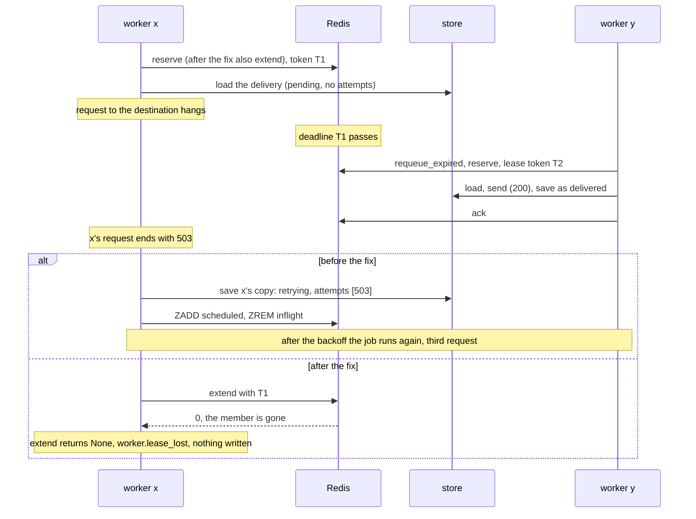

# The late ack was the small bug: fencing a Redis queue with the lease deadline

**English** · [Русский](relay-lease-fencing.ru.md)

Repository: [sinnercode228/integration-hub](https://github.com/sinnercode228/integration-hub) · Code links point to commit [`06e5b8d`](https://github.com/sinnercode228/integration-hub/tree/06e5b8d9145490782377e76ef43c6e2e14323efd) (before the fix) and [`8c6ccb4`](https://github.com/sinnercode228/integration-hub/tree/8c6ccb42a436863df19aadec3e896cd45b4cf98f) (the fix)

Part 1: [My Redis queue claimed jobs atomically and still handed the same job to two workers](relay-queue-races.md)

A worker whose lease had run out could overwrite the new owner's delivery record with the stale copy it had loaded when its attempt started. A delivered lead went back to `retrying`, lost its successful attempt from the history and was sent again. Next to that, the late `ack` from part 1 was the smaller bug.

Part 1 ended with that bug open. `ack` was a plain `ZREM` on `inflight`, so a worker whose lease had run out could remove the lease of the worker that took the job over. A strict xfail pinned it, and I proposed a fix: use the lease deadline as a fencing token. Commit `8c6ccb4` adds the token. To make it hold, I had to go through every write a worker makes after an attempt, not only the ack.

Relay is a demo project with made-up leads, and its Compose file runs one worker process. Every bug here needs two or more workers on one Redis, so nothing broke anywhere.

## The stale record

The worker loads the delivery from the store when an attempt starts, appends the attempt, and saves the whole record at the end. Before the fix, nothing between the load and the save asked whether this worker still owned the job:

```python
        delivery.attempts.append(attempt)
        delivery.updated_at = now
        await self.store.save_delivery(delivery)

        if delivery.status is DeliveryStatus.RETRYING:
            assert attempt.retry_in_seconds is not None
            await self.queue.enqueue(job, delay=attempt.retry_in_seconds)
        elif delivery.status is DeliveryStatus.DEAD:
            await self.queue.dead_letter(job, delivery.last_error or "failed")
        await self.queue.ack(job)
```

[`worker.py#L185-L194`](https://github.com/sinnercode228/integration-hub/blob/06e5b8d9145490782377e76ef43c6e2e14323efd/backend/src/relay/worker.py#L185-L194)

`save_delivery` replaces the record's JSON document in SQLite ([`store/sqlite.py#L128-L136`](https://github.com/sinnercode228/integration-hub/blob/8c6ccb42a436863df19aadec3e896cd45b4cf98f/backend/src/relay/store/sqlite.py#L128-L136)). Whatever a worker loaded at the start is what ends up in the store. In part 1 I looked only at the queue and missed this.

The worker-level test `test_a_worker_that_lost_its_lease_leaves_the_record_alone` replays the takeover. Worker x is waiting on the destination. Its lease runs out, worker y takes the job over and delivers it with a `200`, and then x's request comes back with a `503`:



On `06e5b8d` the test fails at the first check:

```
E       AssertionError: x must not write its retry over y
E       assert <DeliveryStatus.RETRYING: 'retrying'> is <DeliveryStatus.DELIVERED: 'delivered'>
```

I also ran the old code past that point. After x's write, the record was `retrying` with x's `503` as its only attempt, so y's successful attempt was gone from the history. The job was back in `scheduled`. Once its 2-second backoff (the test's retry policy) had passed, the next `process_due` sent a third request and marked the delivery `delivered` again. That is three requests for one lead, two of them answered with `200`.

## The lease deadline as a token

`reserve` already wrote the lease deadline as the member's score in `inflight`. Now it also returns that number with the job:

```python
@dataclass(frozen=True, slots=True)
class Job:
    delivery_id: str
    event_id: str
    # Lease deadline from ``reserve``/``extend``, used as a fencing token. Not part of the
    # job's identity and not encoded.
    lease: float | None = field(default=None, compare=False)
```

[`queue/base.py#L23-L29`](https://github.com/sinnercode228/integration-hub/blob/8c6ccb42a436863df19aadec3e896cd45b4cf98f/backend/src/relay/queue/base.py#L23-L29)

A token only works if two owners never hold the same one. Here a new owner's token is always larger. `requeue_expired` moves a member only once its deadline has come. Worker y can therefore reserve the job only after its `now` has reached x's deadline, and y's token is that `now` plus the lease. The caveat is clocks: each worker computes its deadline from its own `time.time()`, so this holds as long as the workers' clocks agree to well within a lease.

The fence compares floats for exact equality, which needs care. The token goes from Python's `repr(float)` into Redis as a double, comes back out of `ZSCORE` as a string, and Lua parses it with `tonumber`. The string Redis returns does not have to match Python's `repr` character for character, so the script compares numbers, not strings: `tonumber` on both sides. I checked this with 20,000 reserve, extend and finish cycles per backend, on fakeredis and on Redis 7.0.15, with realistic `time.time()` values. There were no mismatches, and a token one ulp off was rejected.

## Four scripts with one head

Four operations now act only while the member's score still equals the worker's token, each as one Lua script that starts with the same check:

```python
# Shared head of the fenced scripts. KEYS[1]: inflight. ARGV[1]: member, ARGV[2]: the lease
# token ("" = not fenced; extend never gets "", it returns early for a job without a token).
_FENCE = """
local score = redis.call('ZSCORE', KEYS[1], ARGV[1])
if ARGV[2] ~= '' and (not score or tonumber(score) ~= tonumber(ARGV[2])) then
  return 0
end
"""
...
# KEYS[2]: scheduled. ARGV[3]: due time.
_RETRY = (
    _FENCE
    + """
redis.call('ZREM', KEYS[1], ARGV[1])
redis.call('ZADD', KEYS[2], ARGV[3], ARGV[1])
return 1
"""
)
```

[`queue/redis.py#L52-L86`](https://github.com/sinnercode228/integration-hub/blob/8c6ccb42a436863df19aadec3e896cd45b4cf98f/backend/src/relay/queue/redis.py#L52-L86)

- `extend` renews the lease with `ZADD XX` and returns a job carrying the new token, or `None`.
- `ack` removes a delivered job.
- `retry` moves the job from `inflight` to `scheduled`. It replaces the old `enqueue` plus `ack`.
- `bury` moves the job to dead letters, replacing `dead_letter` plus `ack`.

`retry` and `bury` used to be two round trips. Now each is one atomic step, so a process killed in between can no longer leave a job in `inflight` and also in `scheduled` or in dead letters. A job without a token (`lease=None`, as in a job built by hand) is not fenced, and `extend` returns it unchanged. The in-memory queue does the same checks under its lock ([`queue/memory.py#L38-L74`](https://github.com/sinnercode228/integration-hub/blob/8c6ccb42a436863df19aadec3e896cd45b4cf98f/backend/src/relay/queue/memory.py#L38-L74)).

## Renewing the lease at two points

The worker calls `extend` twice per job. The first call comes when the job gets its slot. `process_due` reserves up to `concurrency * 2` jobs, 8 with the default concurrency of 4, and a semaphore lets 4 of them run at a time. The rest wait, and their lease runs from the moment of `reserve`. A renewal at the start gives a job that waited a fresh lease. If another worker has taken it over in the meantime, `extend` returns `None` and the worker does not send at all.

The second call comes right before the worker writes anything:

```python
        # Renew right before writing: if another worker has taken the job over while this
        # attempt ran, its record and its place in the queue are not ours to overwrite.
        try:
            held = await self.queue.extend(job, lease_seconds=self.lease_seconds)
        except Exception:
            # Ownership is unknown, not lost. Saving is the smaller risk: if the job runs
            # again, it finds this attempt recorded instead of sending a second time.
            log.exception("worker.lease_unknown", delivery_id=delivery.id)
            held = job
        if held is None:
            log.warning(
                "worker.lease_lost",
                delivery_id=delivery.id,
                stage="save",
                outcome=outcome_label,
                attempt=attempt.number,
            )
            self.metrics.deliveries.labels(delivery.destination, connector_kind, "lease_lost").inc()
            return delivery
        job = held
        await self.store.save_delivery(delivery)
```

[`worker.py#L194-L214`](https://github.com/sinnercode228/integration-hub/blob/8c6ccb42a436863df19aadec3e896cd45b4cf98f/backend/src/relay/worker.py#L194-L214)

After the save, the worker finishes with `retry`, `bury` or `ack`, and logs `worker.lease_lost` if that returns `False`. The store is SQLite, not Redis, so the renewal and the save are not one atomic step. Time covers the gap between them. The renewal has just given this worker a full lease, 120 seconds by default, for one write.

## My first version treated an error as a lost lease

In my first version, an exception from `extend`, such as Redis being unreachable, went down the same path as `None`: log, skip the save, return. That looked cautious. After a successful send it was the opposite. The attempt was never recorded, the job stayed in `inflight`, and once the lease ran out the job ran again and sent again. The old code, which saved first and asked nothing, would have sent once.

`test_a_queue_error_before_saving_does_not_cause_a_second_send` pins this. The destination answers `200`, the renewal before the save raises `ConnectionError`, and so does the `ack` after it. On the first version the test fails:

```
E       AssertionError: assert <DeliveryStatus.PENDING: 'pending'> is <DeliveryStatus.DELIVERED: 'delivered'>
```

The rule is narrower now: skip a write only on positive evidence that the lease is gone, meaning `None` or `False` from the queue. An error is not evidence. On an error the current code logs `worker.lease_unknown` and saves. When the job runs again after the lease, it finds the delivery final and does not send.

## A warning for timeouts longer than the lease

`relay check-config` now compares each destination's attempt timeout with `RELAY_LEASE_SECONDS`. The timeout is `timeout_seconds` from the config, or `max(http_timeout_seconds * 2, 5)`, which is 20 seconds with default settings. With a 15-second lease, the first of four warnings reads:

```
warning: destination 'sales-telegram': the attempt timeout (20 s) is not below the lease (15 s, RELAY_LEASE_SECONDS). Another worker can take the job over mid-attempt and send it a second time.
```

The check is in [`cli.py#L61-L72`](https://github.com/sinnercode228/integration-hub/blob/8c6ccb42a436863df19aadec3e896cd45b4cf98f/backend/src/relay/cli.py#L61-L72). It needs the `RELAY_*` settings, which `check-config --config` did not load before. If they are invalid, it prints a warning that the lease check was skipped and still validates the file. Without `--config` it exits with a settings error instead of a traceback.

## What the fence does not stop

An attempt that outlives its lease can still be sent twice. The worker renews the lease before the request and before the write, not during the request. If the destination takes longer than the lease, another worker can take the job over and send it again. The token stops the first worker from corrupting the record or moving the job, but its request has already gone out. Only the outbound webhook connector sends an `Idempotency-Key` header ([`webhook.py#L55`](https://github.com/sinnercode228/integration-hub/blob/8c6ccb42a436863df19aadec3e896cd45b4cf98f/backend/src/relay/connectors/outbound/webhook.py#L55)), so Telegram, SMTP, Google Sheets and amoCRM can get a second message, row or lead.

The stale worker's attempt is logged as `worker.lease_lost` and counted in `relay_delivery_attempts_total` with `outcome="lease_lost"`. It is not stored in the delivery's history, because writing it there would mean writing to a record the worker no longer owns.

The next step is to renew the lease during the request too. A heartbeat task would call `extend` while the connector runs and cancel the attempt if the lease is lost. I have not built it. Until then I rely on the `check-config` warning to keep every attempt timeout below the lease.

## The tests now

The strict xfail from part 1 is gone, and the late-ack test passes. A `take_over()` helper lets worker x claim the job, lets its lease run out, and has worker y claim the job again ([`test_queue_races.py#L125-L132`](https://github.com/sinnercode228/integration-hub/blob/8c6ccb42a436863df19aadec3e896cd45b4cf98f/backend/tests/test_queue_races.py#L125-L132)). Four tests then try a late `ack`, `retry`, `bury` and `extend` with x's token, and each must be refused while y's job stays untouched. All four run on the in-memory queue and on Redis. The Redis case uses the `workers` fixture from part 1, so it runs on fakeredis locally and on a real Redis when `RELAY_TEST_REDIS_URL` is set, as it is in CI. CI on the fix commit passed on Python 3.12, 3.13 and 3.14, with Redis 7.4.11 in the service container.

Three worker-level tests in [`test_pipeline.py`](https://github.com/sinnercode228/integration-hub/blob/8c6ccb42a436863df19aadec3e896cd45b4cf98f/backend/tests/test_pipeline.py#L169-L297) cover the takeover through `process()`. One is the stale-record test above. `test_a_job_that_waited_for_a_slot_gets_a_fresh_lease` spends all but one second of the lease before the job starts, then checks that the job is not requeued mid-request. `test_a_job_taken_over_while_waiting_is_not_sent` hands the job to y before x starts, and checks that x sends nothing. All three fail on `06e5b8d`. The fourth worker-level test is the queue-error one described earlier. The backend has 166 tests, with 92% coverage.

## The rule I took from it

A worker that has lost its lease can still be running, and it can still write. Fencing the queue is not enough. Every write that follows an attempt has to check the token first, the store included. A write may be skipped only on proof that the lease is gone, never on an error.

Fix: [`8c6ccb4` Fence every write after an attempt with the lease token](https://github.com/sinnercode228/integration-hub/commit/8c6ccb42a436863df19aadec3e896cd45b4cf98f) · Tests: [`backend/tests/test_queue_races.py`](https://github.com/sinnercode228/integration-hub/blob/8c6ccb42a436863df19aadec3e896cd45b4cf98f/backend/tests/test_queue_races.py), [`backend/tests/test_pipeline.py`](https://github.com/sinnercode228/integration-hub/blob/8c6ccb42a436863df19aadec3e896cd45b4cf98f/backend/tests/test_pipeline.py#L169-L297)
