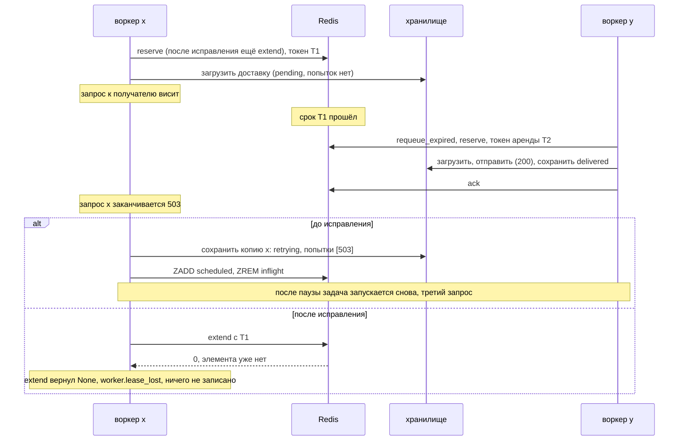

# Поздний ack оказался мелочью: fencing token из срока аренды в очереди на Redis

[English](relay-lease-fencing.md) · **Русский**

Репозиторий: [sinnercode228/integration-hub](https://github.com/sinnercode228/integration-hub) · Ссылки на код ведут на коммит [`06e5b8d`](https://github.com/sinnercode228/integration-hub/tree/06e5b8d9145490782377e76ef43c6e2e14323efd) (до исправления) и [`8c6ccb4`](https://github.com/sinnercode228/integration-hub/tree/8c6ccb42a436863df19aadec3e896cd45b4cf98f) (исправление)

Первая часть: [Очередь на Redis атомарно забирала задачи и всё равно отдавала одну и ту же двум воркерам](relay-queue-races.ru.md)

Воркер с истёкшей арендой мог сохранить поверх записи нового владельца устаревшую копию доставки, которую загрузил в начале своей попытки. Доставленная заявка возвращалась в `retrying`, успешная попытка пропадала из истории, и заявка уходила ещё раз. На этом фоне поздний `ack` из первой части оказался мелочью.

В первой части эта ошибка так и осталась открытой. `ack` был обычным `ZREM` по `inflight`, поэтому воркер с истёкшей арендой мог удалить аренду воркера, который перехватил задачу. Ошибку фиксировал строгий xfail, и я предложил исправление: использовать срок аренды как fencing token. Коммит `8c6ccb4` этот токен добавляет. Чтобы он работал, пришлось пройти по всем записям, которые воркер делает после попытки, а не только по `ack`.

Relay — демо-проект, заявки в нём выдуманы, а Compose-файл запускает один процесс-воркер. Каждой ошибке из этого текста нужны два воркера или больше на одном Redis, так что нигде ничего не сломалось.

## Устаревшая запись

В начале попытки воркер загружает доставку из хранилища, в конце добавляет к ней попытку и сохраняет запись целиком. До исправления между загрузкой и сохранением ничто не проверяло, владеет ли воркер задачей до сих пор:

```python
        delivery.attempts.append(attempt)
        delivery.updated_at = now
        await self.store.save_delivery(delivery)

        if delivery.status is DeliveryStatus.RETRYING:
            assert attempt.retry_in_seconds is not None
            await self.queue.enqueue(job, delay=attempt.retry_in_seconds)
        elif delivery.status is DeliveryStatus.DEAD:
            await self.queue.dead_letter(job, delivery.last_error or "failed")
        await self.queue.ack(job)
```

[`worker.py#L185-L194`](https://github.com/sinnercode228/integration-hub/blob/06e5b8d9145490782377e76ef43c6e2e14323efd/backend/src/relay/worker.py#L185-L194)

`save_delivery` заменяет JSON-документ записи в SQLite ([`store/sqlite.py#L128-L136`](https://github.com/sinnercode228/integration-hub/blob/8c6ccb42a436863df19aadec3e896cd45b4cf98f/backend/src/relay/store/sqlite.py#L128-L136)). Что воркер загрузил в начале, то и окажется в хранилище. В первой части я смотрел только на очередь и это пропустил.

Тест `test_a_worker_that_lost_its_lease_leaves_the_record_alone` воспроизводит перехват на уровне воркера. Воркер x ждёт ответа получателя. Его аренда истекает, воркер y перехватывает задачу и доставляет её с ответом `200`, а потом запрос x возвращается с `503`:



На `06e5b8d` тест падает на первой же проверке:

```
E       AssertionError: x must not write its retry over y
E       assert <DeliveryStatus.RETRYING: 'retrying'> is <DeliveryStatus.DELIVERED: 'delivered'>
```

Я прогнал старый код и дальше этой точки. После записи x доставка была в статусе `retrying`, и единственной попыткой в ней был `503` от x: успешная попытка y пропала из истории. Задача снова лежала в `scheduled`. Когда прошла её двухсекундная пауза (так задана политика повторов в тесте), следующий `process_due` отправил третий запрос и снова отметил доставку как `delivered`. Три запроса на одну заявку, и на два из них получатель ответил `200`.

## Срок аренды как токен

`reserve` и раньше записывал срок аренды как score элемента в `inflight`. Теперь он ещё и возвращает это число вместе с задачей:

```python
@dataclass(frozen=True, slots=True)
class Job:
    delivery_id: str
    event_id: str
    # Lease deadline from ``reserve``/``extend``, used as a fencing token. Not part of the
    # job's identity and not encoded.
    lease: float | None = field(default=None, compare=False)
```

[`queue/base.py#L23-L29`](https://github.com/sinnercode228/integration-hub/blob/8c6ccb42a436863df19aadec3e896cd45b4cf98f/backend/src/relay/queue/base.py#L23-L29)

Токен работает, только если у двух владельцев он никогда не совпадает. Здесь токен нового владельца всегда больше. `requeue_expired` возвращает элемент в очередь, только когда его срок наступил. Значит, y может забрать задачу не раньше, чем его `now` дойдёт до срока x, а токен y равен этому `now` плюс длительность аренды. Есть оговорка про часы: каждый воркер считает срок по своему `time.time()`, поэтому это верно, пока часы воркеров расходятся намного меньше, чем на длительность аренды.

Проверка сравнивает float на точное равенство, а с этим нужно быть осторожным. Токен уходит из Python как `repr(float)`, в Redis хранится как double, возвращается из `ZSCORE` строкой, и Lua разбирает её через `tonumber`. Строка от Redis не обязана посимвольно совпадать с `repr` из Python, поэтому скрипт сравнивает числа, а не строки: `tonumber` с обеих сторон. Я проверил это на 20 000 циклах reserve, extend и завершения для каждой очереди, на fakeredis и на Redis 7.0.15, с реалистичными значениями `time.time()`. Расхождений не было, а токен, отличающийся на один ulp, отклонялся.

## Четыре скрипта с общим началом

Четыре операции теперь срабатывают, только пока score элемента равен токену воркера. Каждая — один Lua-скрипт, и все начинаются с одной и той же проверки:

```python
# Shared head of the fenced scripts. KEYS[1]: inflight. ARGV[1]: member, ARGV[2]: the lease
# token ("" = not fenced; extend never gets "", it returns early for a job without a token).
_FENCE = """
local score = redis.call('ZSCORE', KEYS[1], ARGV[1])
if ARGV[2] ~= '' and (not score or tonumber(score) ~= tonumber(ARGV[2])) then
  return 0
end
"""
...
# KEYS[2]: scheduled. ARGV[3]: due time.
_RETRY = (
    _FENCE
    + """
redis.call('ZREM', KEYS[1], ARGV[1])
redis.call('ZADD', KEYS[2], ARGV[3], ARGV[1])
return 1
"""
)
```

[`queue/redis.py#L52-L86`](https://github.com/sinnercode228/integration-hub/blob/8c6ccb42a436863df19aadec3e896cd45b4cf98f/backend/src/relay/queue/redis.py#L52-L86)

- `extend` продлевает аренду через `ZADD XX` и возвращает задачу с новым токеном или `None`.
- `ack` удаляет доставленную задачу.
- `retry` переносит задачу из `inflight` в `scheduled` и заменяет прежние `enqueue` и `ack`.
- `bury` переносит задачу в dead letters вместо `dead_letter` и `ack`.

Раньше `retry` и `bury` занимали по два сетевых запроса. Теперь каждая операция — один атомарный шаг, и процесс, убитый между двумя запросами, уже не оставит задачу в `inflight` и одновременно в `scheduled` или в dead letters. Задача без токена (`lease=None`, например собранная вручную) не проверяется, а `extend` возвращает её без изменений. Очередь в памяти делает те же проверки под своей блокировкой ([`queue/memory.py#L38-L74`](https://github.com/sinnercode228/integration-hub/blob/8c6ccb42a436863df19aadec3e896cd45b4cf98f/backend/src/relay/queue/memory.py#L38-L74)).

## Продление аренды в двух местах

Воркер вызывает `extend` дважды на задачу. Первый раз — когда задачу пускают в работу. `process_due` забирает до `concurrency * 2` задач, то есть 8 при параллельности по умолчанию, равной 4, а семафор пускает в работу 4 одновременно. Остальные ждут, и их аренда отсчитывается с момента `reserve`. Продление в начале даёт дождавшейся задаче свежую аренду. Если за это время задачу перехватил другой воркер, `extend` вернёт `None`, и воркер вообще ничего не отправит.

Второй раз — прямо перед тем, как воркер что-либо запишет:

```python
        # Renew right before writing: if another worker has taken the job over while this
        # attempt ran, its record and its place in the queue are not ours to overwrite.
        try:
            held = await self.queue.extend(job, lease_seconds=self.lease_seconds)
        except Exception:
            # Ownership is unknown, not lost. Saving is the smaller risk: if the job runs
            # again, it finds this attempt recorded instead of sending a second time.
            log.exception("worker.lease_unknown", delivery_id=delivery.id)
            held = job
        if held is None:
            log.warning(
                "worker.lease_lost",
                delivery_id=delivery.id,
                stage="save",
                outcome=outcome_label,
                attempt=attempt.number,
            )
            self.metrics.deliveries.labels(delivery.destination, connector_kind, "lease_lost").inc()
            return delivery
        job = held
        await self.store.save_delivery(delivery)
```

[`worker.py#L194-L214`](https://github.com/sinnercode228/integration-hub/blob/8c6ccb42a436863df19aadec3e896cd45b4cf98f/backend/src/relay/worker.py#L194-L214)

После сохранения воркер завершает задачу через `retry`, `bury` или `ack` и пишет `worker.lease_lost` в лог, если операция вернула `False`. Хранилище — SQLite, а не Redis, поэтому продление и сохранение — не один атомарный шаг. Промежуток между ними прикрывает время. Продление только что дало воркеру полную аренду, по умолчанию 120 секунд, на одну запись.

## Моя первая версия считала ошибку потерей аренды

В первой версии исключение из `extend`, например когда Redis недоступен, шло по той же ветке, что и `None`: записать в лог, пропустить сохранение, выйти. Это казалось осторожным решением. После успешной отправки выходило наоборот. Попытка не записывалась, задача оставалась в `inflight`, а когда аренда истекала, задача запускалась снова и отправлялась ещё раз. Старый код, который сохранял сразу и ничего не проверял, отправил бы один раз.

Это фиксирует тест `test_a_queue_error_before_saving_does_not_cause_a_second_send`. Получатель отвечает `200`, продление перед сохранением бросает `ConnectionError`, и `ack` после него тоже. На первой версии тест падает:

```
E       AssertionError: assert <DeliveryStatus.PENDING: 'pending'> is <DeliveryStatus.DELIVERED: 'delivered'>
```

Теперь правило такое: пропускать запись можно только при прямом подтверждении, что аренды больше нет, то есть когда очередь вернула `None` или `False`. Ошибка подтверждением не считается. При ошибке текущий код пишет в лог `worker.lease_unknown` и сохраняет доставку. Когда после истечения аренды задача запускается снова, она находит доставку в финальном статусе и ничего не отправляет.

## Предупреждение, если таймаут дольше аренды

`relay check-config` теперь сравнивает таймаут попытки каждого получателя с `RELAY_LEASE_SECONDS`. Таймаут — это `timeout_seconds` из конфига или `max(http_timeout_seconds * 2, 5)`, то есть 20 секунд при настройках по умолчанию. При аренде в 15 секунд первое из четырёх предупреждений выглядит так:

```
warning: destination 'sales-telegram': the attempt timeout (20 s) is not below the lease (15 s, RELAY_LEASE_SECONDS). Another worker can take the job over mid-attempt and send it a second time.
```

Проверка — в [`cli.py#L61-L72`](https://github.com/sinnercode228/integration-hub/blob/8c6ccb42a436863df19aadec3e896cd45b4cf98f/backend/src/relay/cli.py#L61-L72). Ей нужны настройки `RELAY_*`, которые `check-config --config` раньше не загружал. Если они заданы неверно, команда предупреждает, что проверка аренды пропущена, и всё равно проверяет файл. Без `--config` она завершается с ошибкой настроек, а не с трассировкой стека.

## Чего токен не предотвращает

Попытка, которая длится дольше своей аренды, всё ещё может уйти дважды. Воркер продлевает аренду перед запросом и перед записью, но не во время запроса. Если получатель отвечает дольше, чем длится аренда, другой воркер может перехватить задачу и отправить её ещё раз. Токен не даёт первому воркеру испортить запись или передвинуть задачу, но его запрос уже ушёл. Заголовок `Idempotency-Key` отправляет только коннектор исходящего вебхука ([`webhook.py#L55`](https://github.com/sinnercode228/integration-hub/blob/8c6ccb42a436863df19aadec3e896cd45b4cf98f/backend/src/relay/connectors/outbound/webhook.py#L55)), так что Telegram, SMTP, Google Sheets и amoCRM могут получить второе сообщение, строку или сделку.

Попытку воркера, потерявшего аренду, видно в логе как `worker.lease_lost` и в счётчике `relay_delivery_attempts_total` с `outcome="lease_lost"`. В историю доставки она не попадает: для этого пришлось бы писать в запись, которой воркер уже не владеет.

Следующий шаг — продлевать аренду и во время запроса. Фоновый цикл вызывал бы `extend`, пока работает коннектор, и отменял бы попытку, если аренда потеряна. Пока я этого не сделал. До тех пор я полагаюсь на предупреждение `check-config`, чтобы таймаут каждой попытки оставался меньше аренды.

## Тесты сейчас

Строгого xfail из первой части больше нет, тест на поздний ack проходит. Вспомогательная функция `take_over()` даёт воркеру x забрать задачу, ждёт, пока его аренда истечёт, и отдаёт задачу воркеру y ([`test_queue_races.py#L125-L132`](https://github.com/sinnercode228/integration-hub/blob/8c6ccb42a436863df19aadec3e896cd45b4cf98f/backend/tests/test_queue_races.py#L125-L132)). Затем четыре теста пробуют поздние `ack`, `retry`, `bury` и `extend` с токеном x. Каждая операция должна получить отказ, а задача y — остаться нетронутой. Все четыре идут на очереди в памяти и на Redis. Вариант с Redis использует фикстуру `workers` из первой части, поэтому локально он идёт на fakeredis, а на настоящем Redis — когда задан `RELAY_TEST_REDIS_URL`, как в CI. CI на коммите с исправлением прошёл на Python 3.12, 3.13 и 3.14, в контейнере сервиса был Redis 7.4.11.

Три теста в [`test_pipeline.py`](https://github.com/sinnercode228/integration-hub/blob/8c6ccb42a436863df19aadec3e896cd45b4cf98f/backend/tests/test_pipeline.py#L169-L297) проверяют перехват на уровне воркера, через `process()`. Первый — тест на устаревшую запись, описанный выше. `test_a_job_that_waited_for_a_slot_gets_a_fresh_lease` тратит на ожидание всю аренду, кроме одной секунды, и проверяет, что задачу не возвращают в очередь посреди запроса. `test_a_job_taken_over_while_waiting_is_not_sent` отдаёт задачу y ещё до старта x и проверяет, что x ничего не отправляет. Все три падают на `06e5b8d`. Четвёртый тест на уровне воркера — тот, что с ошибкой очереди, о нём было выше. Всего в бэкенде 166 тестов, покрытие 92%.

## Правило, которое я из этого вынес

Воркер, потерявший аренду, может ещё работать и писать. Защитить одну очередь мало. Каждая запись после попытки, в том числе в хранилище, должна сначала сверить токен. А пропускать запись можно только при подтверждении, что аренды нет, но не при ошибке.

Исправление: [`8c6ccb4` Fence every write after an attempt with the lease token](https://github.com/sinnercode228/integration-hub/commit/8c6ccb42a436863df19aadec3e896cd45b4cf98f) · Тесты: [`backend/tests/test_queue_races.py`](https://github.com/sinnercode228/integration-hub/blob/8c6ccb42a436863df19aadec3e896cd45b4cf98f/backend/tests/test_queue_races.py), [`backend/tests/test_pipeline.py`](https://github.com/sinnercode228/integration-hub/blob/8c6ccb42a436863df19aadec3e896cd45b4cf98f/backend/tests/test_pipeline.py#L169-L297)
