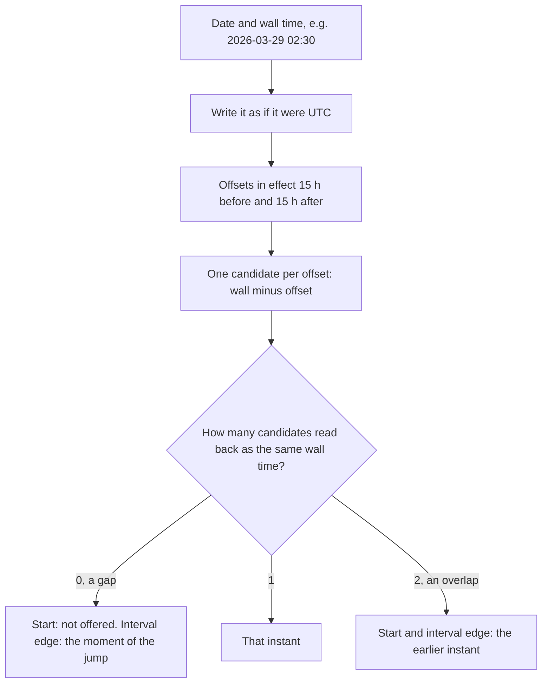

# Berlin on 29 March: booking slots across a DST change without adding 24 hours

**English** · [Русский](slotbook-dst-slots.ru.md)

Repository: [sinnercode228/slotbook](https://github.com/sinnercode228/slotbook) · Demo: [sinnercode228.github.io/slotbook](https://sinnercode228.github.io/slotbook/) · Code links point to commit [`1c83184`](https://github.com/sinnercode228/slotbook/tree/1c8318474319f6e61cc76a3bbc5b5911625d7c1e)

Slotbook stores a specialist's working hours as local wall-clock times, such as Sunday 01:00-05:00 in Europe/Berlin, and offers bookable starts as instants. On 29 March 2026 Berlin's clocks jump from 02:00 to 03:00: 02:30 never shows on a clock, and 01:00-05:00 lasts three hours. On 25 October 02:30 shows twice. The Go generator in `internal/slots` decides what each case means, and the in-browser demo runs a TypeScript port that has to decide the same way, down to the output string.

Slotbook is a demo: Snipwell & Co., its salons in Moscow and Berlin, the staff and the customers are made up. The code and the tests are real.

## A day is a date, not 24 hours

The generator steps through dates, and a date carries no zone. `AddDays` is `DateOf(d.midnightUTC().AddDate(0, 0, n))`: calendar arithmetic on a UTC midnight, "UTC has no DST, so AddDate on it moves exactly one calendar day per day" ([`date.go#L37-L51`](https://github.com/sinnercode228/slotbook/blob/1c8318474319f6e61cc76a3bbc5b5911625d7c1e/internal/slots/date.go#L37-L51)). `Generate` takes today from `Now` in the location's zone and loops `for d := r.From; !d.After(r.To); d = d.AddDays(1)` ([`slots.go#L85-L100`](https://github.com/sinnercode228/slotbook/blob/1c8318474319f6e61cc76a3bbc5b5911625d7c1e/internal/slots/slots.go#L85-L100)). A day's real length appears only when its wall times become instants.

Both shortcuts this avoids go wrong on DST days. I ran them with Go 1.24.7. Adding 24 hours keeps the dates and moves the time of day: in Berlin, Saturday 24 October 09:00 plus 24 hours is `2026-10-25T08:00:00+01:00`. `AddDate(0, 0, 1)` on a zoned time breaks the dates instead. America/Santiago skips midnight itself on 6 September. Walking from local midnight on 4 September, `AddDate` calls `time.Date` for 6 September 00:00 and gets 23:00 on the 5th, so the walk visits 5 September twice and stays at 23:00 after that:

```
walk in zone: 2026-09-04T00:00:00-04:00 2026-09-04
walk in zone: 2026-09-05T00:00:00-04:00 2026-09-05
walk in zone: 2026-09-05T23:00:00-04:00 2026-09-05
walk in zone: 2026-09-06T23:00:00-03:00 2026-09-06
```

## What time.Date does in a gap and in an overlap

Inside a gap or an overlap, "which instant is 02:30?" has zero or two answers. Go's documentation says `time.Date` "returns a time that is correct in one of the two zones involved in the transition, but it does not guarantee which." The same run shows the choice depends on the zone:

```
time.Date(2026-03-29 02:30 Europe/Berlin) = 2026-03-29T03:30:00+02:00  (01:30 UTC)
time.Date(2026-03-08 02:30 America/New_York) = 2026-03-08T01:30:00-05:00  (06:30 UTC)
time.Date(2026-10-25 02:30 Europe/Berlin) = 2026-10-25T02:30:00+01:00  (01:30 UTC)
time.Date(2026-11-01 01:30 America/New_York) = 2026-11-01T01:30:00-04:00  (05:30 UTC)
```

In a gap Berlin moves forward an hour and New York moves back. In an overlap Berlin gets the second occurrence and New York the first. `time.Date` first looks up the offset in effect at the wall time read as if it were UTC, a point later than the real instant east of Greenwich and earlier west of it. In an overlap that offset fits and is kept. In a gap it never fits, and a second lookup returns the offset from the other side of the jump. To measure the cost, I replaced `occurrences` and `edge` in a scratch checkout with one `time.Date` call each and ran the 23 vectors. Five failed: `berlin-fall-back`, `berlin-interval-ends-in-gap`, `berlin-override-on-fall-back`, `cairo-fall-back-at-midnight` and `santiago-midnight-gap`. In Santiago, Sunday's list began with `2026-09-05T23:00:00-04:00` and `2026-09-05T23:30:00-04:00`, two Saturday evening instants. Both New York vectors passed: in the overlap `time.Date` picks the first occurrence there, and in the gap it moves 02:00 and 02:30 back to 01:00 and 01:30, which the list already has. Berlin's spring-forward vector passed as well: the shifted 02:00 and 02:30 become 03:00 and 03:30, which the list already has.

## Asking which instants show a wall time

`wallclock.go` never passes the location to `time.Date`:

```go
func occurrences(d Date, at TimeOfDay, loc *time.Location) []time.Time {
	wall := time.Date(d.Year, d.Month, d.Day, 0, int(at), 0, 0, time.UTC)
	var found []time.Time
	for _, offset := range nearbyOffsets(wall, loc) {
		t := wall.Add(-offset).In(loc)
		if sameWallTime(t, wall) && !slices.ContainsFunc(found, t.Equal) {
			found = append(found, t)
		}
	}
	slices.SortFunc(found, func(a, b time.Time) int { return a.Compare(b) })
	return found
}
```

[`wallclock.go#L15-L26`](https://github.com/sinnercode228/slotbook/blob/1c8318474319f6e61cc76a3bbc5b5911625d7c1e/internal/slots/wallclock.go#L15-L26)

`wall` is the date and time written down as UTC. Every instant that can show this wall time is `wall` minus a real offset. `nearbyOffsets` returns the offsets in effect 15 hours before and after `wall`; its comment gives the reason: "Real offsets lie within UTC-12 and UTC+14, so probing 15 hours either side covers one transition, which is the most any zone has within a day" ([`wallclock.go#L28-L42`](https://github.com/sinnercode228/slotbook/blob/1c8318474319f6e61cc76a3bbc5b5911625d7c1e/internal/slots/wallclock.go#L28-L42)). A candidate stays only if the zone reads it back as the same date, hour, minute and second. For 02:30 on 25 October in Berlin the offsets are +02:00 and +01:00, and both candidates, 00:30Z and 01:30Z, read back as 02:30. For 02:30 on 29 March the candidates read back as 03:30 and 01:30, and the list is empty.



`edge` turns an interval boundary into an instant: the first occurrence if there is one, and inside a gap the jump itself:

```go
	wall := time.Date(d.Year, d.Month, d.Day, 0, int(at), 0, 0, time.UTC)
	before := nearbyOffsets(wall, loc)[0]
	// Read with the pre-jump offset, the wall time lands just after the
	// jump, and the zone it lands in starts exactly at the jump.
	jumpedTo, _ := wall.Add(-before).In(loc).ZoneBounds()
	return jumpedTo.In(loc)
```

[`wallclock.go#L58-L63`](https://github.com/sinnercode228/slotbook/blob/1c8318474319f6e61cc76a3bbc5b5911625d7c1e/internal/slots/wallclock.go#L58-L63)

## Four rules in one loop

```go
	for _, iv := range r.hoursOn(d) {
		closes := edge(d, iv.End, r.Location)
		for at := alignUp(iv.Start, step); at < iv.End; at += step {
			found := occurrences(d, at, r.Location)
			if len(found) == 0 {
				continue
			}
			start := found[0]
			end := start.Add(span)
			if start.Before(earliest) || end.After(closes) || r.overlapsBusy(start, end) {
				continue
			}
			starts = append(starts, start)
		}
	}
```

[`slots.go#L126-L140`](https://github.com/sinnercode228/slotbook/blob/1c8318474319f6e61cc76a3bbc5b5911625d7c1e/internal/slots/slots.go#L126-L140)

1. A wall time the clocks skip is not offered: `occurrences` is empty and the loop moves on. The grid is in wall-clock minutes from local midnight, so a 30-minute step keeps :00 and :30 on both sides of a jump.
2. A wall time that happens twice means its first occurrence, `found[0]`. The repeated hour adds no starts of its own.
3. An interval closes at the `edge` of its end, and `end.After(closes)` compares instants, so the interval keeps its real length: 01:00-05:00 is three hours on 29 March and five on 25 October.
4. Minimum notice is elapsed time: `earliest` is `r.Now.Add(r.MinNotice)` ([`slots.go#L124`](https://github.com/sinnercode228/slotbook/blob/1c8318474319f6e61cc76a3bbc5b5911625d7c1e/internal/slots/slots.go#L124)). Busy intervals are compared as instants too.

## What the vectors pin for Berlin and New York

29 March, hours 01:00-05:00, a 60-minute service, a 30-minute step:

```json
      "slots": [
        "2026-03-29T01:00:00+01:00",
        "2026-03-29T01:30:00+01:00",
        "2026-03-29T03:00:00+02:00",
        "2026-03-29T03:30:00+02:00",
        "2026-03-29T04:00:00+02:00"
      ]
```

[`berlin-spring-forward.json#L22-L28`](https://github.com/sinnercode228/slotbook/blob/1c8318474319f6e61cc76a3bbc5b5911625d7c1e/testdata/slots/berlin-spring-forward.json#L22-L28)

The 01:30 booking runs across the jump and ends at 03:30 summer time. A 180-minute service in the same interval has one start, `2026-03-29T01:00:00+01:00` ([`berlin-spring-forward-real-length.json`](https://github.com/sinnercode228/slotbook/blob/1c8318474319f6e61cc76a3bbc5b5911625d7c1e/testdata/slots/berlin-spring-forward-real-length.json)). An interval 00:00-02:30 ends at a time that does not exist and closes at the jump, so a 60-minute service gets 00:00, 00:30 and 01:00, and not 01:30 ([`berlin-interval-ends-in-gap.json`](https://github.com/sinnercode228/slotbook/blob/1c8318474319f6e61cc76a3bbc5b5911625d7c1e/testdata/slots/berlin-interval-ends-in-gap.json)). At 01:30 winter time, 120 minutes of notice end at 04:30 summer time, so the first start is `2026-03-29T04:30:00+02:00` ([`berlin-notice-across-jump.json`](https://github.com/sinnercode228/slotbook/blob/1c8318474319f6e61cc76a3bbc5b5911625d7c1e/testdata/slots/berlin-notice-across-jump.json)).

25 October, hours 01:00-04:00:

```json
      "slots": [
        "2026-10-25T01:00:00+02:00",
        "2026-10-25T01:30:00+02:00",
        "2026-10-25T02:00:00+02:00",
        "2026-10-25T02:30:00+02:00",
        "2026-10-25T03:00:00+01:00"
      ]
```

[`berlin-fall-back.json#L22-L28`](https://github.com/sinnercode228/slotbook/blob/1c8318474319f6e61cc76a3bbc5b5911625d7c1e/testdata/slots/berlin-fall-back.json#L22-L28)

The interval lasts four real hours, 23:00Z to 03:00Z. The second 02:00 and 02:30 (+01:00), at 01:00Z and 01:30Z, are not starts. The booking from the first 02:30 runs until 01:30Z, so with this 60-minute service the half hour from 01:30Z to 02:00Z stays empty. An override 02:30-04:00 on that date gives `02:30:00+02:00` and `03:00:00+01:00`, two and a half real hours ([`berlin-override-on-fall-back.json`](https://github.com/sinnercode228/slotbook/blob/1c8318474319f6e61cc76a3bbc5b5911625d7c1e/testdata/slots/berlin-override-on-fall-back.json)).

America/New_York repeats 01:00-02:00 on 1 November. Hours 00:30-03:00, a 60-minute service, and a booking in the second 01:30, from `2026-11-01T01:30:00-05:00` to `2026-11-01T02:00:00-05:00`:

```json
        "2026-11-01T00:30:00-04:00",
        "2026-11-01T01:00:00-04:00",
        "2026-11-01T01:30:00-04:00",
        "2026-11-01T02:00:00-05:00"
```

[`new-york-fall-back.json#L25-L28`](https://github.com/sinnercode228/slotbook/blob/1c8318474319f6e61cc76a3bbc5b5911625d7c1e/testdata/slots/new-york-fall-back.json#L25-L28)

The booking is 06:30Z-07:00Z. The first 01:30 runs 05:30Z-06:30Z and ends when the booking starts; busy time is half-open, so it stays. 02:00 EST starts at 07:00Z, when the booking ends.

## Lord Howe, Santiago and Cairo

- Australia/Lord_Howe moves its clocks by 30 minutes on 4 October, from 02:00 to 02:30. With 01:00-04:00, a 60-minute service and a 15-minute step, the starts are 01:00, 01:15, 01:30 and 01:45 at +10:30, then 02:30, 02:45 and 03:00 at +11:00. The interval lasts two and a half real hours.
- America/Santiago skips midnight on 6 September. Saturday's 22:00-24:00 closes at the jump, 01:00 on Sunday at -03:00, so a 60-minute service gets 22:00, 22:30 and 23:00. Sunday's 00:00 and 00:30 do not exist; its starts are 01:00, 01:30 and 02:00 at -03:00.
- Africa/Cairo goes back from 24:00 to 23:00 on 29 October. A Thursday interval 22:00-24:00 ends at the only midnight, one real hour later than it looks, so a 120-minute service starts at 22:00, 22:30 and 23:00 at +03:00. Friday starts at that midnight: `2026-10-30T00:00:00+02:00`. 24:00 is a valid interval end ([`timeofday.go#L10-L14`](https://github.com/sinnercode228/slotbook/blob/1c8318474319f6e61cc76a3bbc5b5911625d7c1e/internal/slots/timeofday.go#L10-L14)), and `time.Date` in UTC normalises minute 1440 to 00:00 of the next date, so Thursday's end resolves to Friday's midnight.

## The TypeScript port

The demo on GitHub Pages has no server. Its mock API runs the booking rules in the browser on [`generate.ts`](https://github.com/sinnercode228/slotbook/blob/1c8318474319f6e61cc76a3bbc5b5911625d7c1e/web/src/schedule/generate.ts), a port of `Generate` whose top comment says a change in one has to be made in the other. JavaScript's `Date` knows only UTC and the machine's own zone. `Intl.DateTimeFormat` knows the IANA database but converts only from an instant to a wall clock, so `offsetAt` formats the instant with `formatToParts`, reads the parts back with `Date.UTC` and subtracts the instant truncated to seconds ([`zone.ts#L49-L69`](https://github.com/sinnercode228/slotbook/blob/1c8318474319f6e61cc76a3bbc5b5911625d7c1e/web/src/schedule/zone.ts#L49-L69)). With that, `occurrences` is the Go algorithm: probe 15 hours either side and keep each candidate for which `candidate + offsetAt(candidate, zone) === wall` ([`zone.ts#L94-L118`](https://github.com/sinnercode228/slotbook/blob/1c8318474319f6e61cc76a3bbc5b5911625d7c1e/web/src/schedule/zone.ts#L94-L118)). Intl has no `ZoneBounds`, so `edge` finds the jump by bisection:

```ts
function offsetStart(instant: number, zone: string): number {
  const target = offsetAt(instant, zone);
  let lo = instant - 24 * HOUR;
  let hi = instant;
  if (offsetAt(lo, zone) === target) return instant;
  while (hi - lo > 1000) {
    const mid = Math.floor((lo + hi) / 2000) * 1000;
    if (offsetAt(mid, zone) === target) hi = mid;
    else lo = mid;
  }
  return hi;
}
```

[`zone.ts#L136-L147`](https://github.com/sinnercode228/slotbook/blob/1c8318474319f6e61cc76a3bbc5b5911625d7c1e/web/src/schedule/zone.ts#L136-L147)

At most 17 halvings take 24 hours down to one second, and tz transitions fall on whole seconds, so the result is the instant `ZoneBounds` gives in Go. `formatInstant` writes it like Go's `time.RFC3339`: seconds, no fraction, `Z` for a zero offset ([`zone.ts#L169-L180`](https://github.com/sinnercode228/slotbook/blob/1c8318474319f6e61cc76a3bbc5b5911625d7c1e/web/src/schedule/zone.ts#L169-L180)).

## One set of vectors, two test runners

[`testdata/slots`](https://github.com/sinnercode228/slotbook/tree/1c8318474319f6e61cc76a3bbc5b5911625d7c1e/testdata/slots) holds 23 JSON files, each a full input with the exact expected strings; its README fixes the format and five rules. [`golden_test.go`](https://github.com/sinnercode228/slotbook/blob/1c8318474319f6e61cc76a3bbc5b5911625d7c1e/internal/slots/golden_test.go#L65-L106) globs the directory and runs each file as a subtest. [`golden.test.ts`](https://github.com/sinnercode228/slotbook/blob/1c8318474319f6e61cc76a3bbc5b5911625d7c1e/web/src/schedule/golden.test.ts#L30-L68) lists it with `readdirSync` at run time and compares with `toEqual`; its comment says `import.meta.glob` would cache the file list and miss new vectors. Both fail on fewer than 10 files, and CI runs both suites on every push to main and every pull request. [`9fbc282`](https://github.com/sinnercode228/slotbook/commit/9fbc2828ff1f2ea29ddea72f1e6fdf9822e21cf4) brought the generator with 15 vectors. The port in [`af2fa85`](https://github.com/sinnercode228/slotbook/commit/af2fa8560027bec6f6014c090f00b1786c6a9e63) added the interval that ends inside a gap, which its message says neither generator's tests covered. [`01efcbf`](https://github.com/sinnercode228/slotbook/commit/01efcbf4f9cba887d72ed20f045094125e4d42fa) added Lord Howe, Santiago, Cairo, notice across the jump, the override on 25 October and Los Angeles, where 03:00 UTC is still the previous day. [`1cf8330`](https://github.com/sinnercode228/slotbook/commit/1cf8330ab3e065d3758401a1bcb54214592ed206) added other offsets and milliseconds. By zone: 9 Europe/Berlin, 8 Europe/Moscow (no DST), 2 America/New_York, one each for the other four.

## Milliseconds

Go keeps nanoseconds and `Date.parse` keeps milliseconds, so the vector README limits `now` and busy instants to millisecond precision ([`README.md#L34-L36`](https://github.com/sinnercode228/slotbook/blob/1c8318474319f6e61cc76a3bbc5b5911625d7c1e/testdata/slots/README.md#L34-L36)). `notice-boundary-offset-instants.json` sits at that limit: `now` is `2026-10-19T10:00:00.001+03:00`, one millisecond past 09:00 in Berlin, and with 60 minutes of notice 10:00 is gone. In the scratch checkout I copied that vector with `now` at `10:00:00.0009+03:00` and left the expected list as it was. Go passed: 0.9 ms past 09:00 still rules out 10:00. Vitest failed on that file with one extra start:

```
      "slots": [
+       "2026-10-19T10:00:00+02:00",
        "2026-10-19T10:30:00+02:00",
```

Node 22 parses `.0009` as `.000`, so for the port 10:00 is exactly 60 minutes away. In the demo `now` comes from `Date.now()` ([`mockApi.ts#L35`](https://github.com/sinnercode228/slotbook/blob/1c8318474319f6e61cc76a3bbc5b5911625d7c1e/web/src/mock/mockApi.ts#L35)), which is whole milliseconds, so the limit applies to inputs written by hand.

## A wider comparison, run once

The 23 vectors use 7 zones. To compare the generators beyond them, I wrote a scratch Go test outside the repository. It walked every date of 2026 in each of the 418 zones that `Intl.supportedValuesOf('timeZone')` lists in Node 22.22.2 and found 265 transition days: 260 dates whose length is not 24 hours, and 5 that last 24 hours but end at a change of offset, such as 5 September in Santiago. For each it wrote three vectors over the day before, the day and the day after, with Go's output as expected: hours 00:00-24:00 at a 15-minute step; hours 00:00-01:30, 01:45-02:30, 02:30-03:15 and 03:30-24:00 with a 15-minute buffer; and 95 minutes of notice from 90 minutes after the day starts. The port matched all 795. Go read the system tz database (2025b), Node its ICU copy (2025c). This check is not in the repository or in CI.

## What the tests cover, and where it is still thin

At `1c83184`, run now: `go test ./internal/slots/` passes 19 test functions and 41 subtests (the 23 vectors, 8 `occurrences` cases, 10 invalid requests). Vitest passes 33 tests in `web/src/schedule`: 24 in `golden.test.ts`, the vectors and the count check, and 9 in `zone.test.ts`. The whole web package has 121 tests in 12 files. The vectors cover a skipped hour, a skipped half hour, a skipped midnight, a repeated hour, a repeated hour that ends at midnight, an interval ending in a gap, an override on a transition day, notice across a jump, busy time on a second occurrence, and today in a zone behind UTC. [`wallclock_test.go`](https://github.com/sinnercode228/slotbook/blob/1c8318474319f6e61cc76a3bbc5b5911625d7c1e/internal/slots/wallclock_test.go) tests `occurrences` and `edge` directly.

- The vectors pin the algorithm, not the tz database. Go reads `ZONEINFO` and the system directories before the copy compiled in through `time/tzdata` ([`main.go#L22-L23`](https://github.com/sinnercode228/slotbook/blob/1c8318474319f6e61cc76a3bbc5b5911625d7c1e/cmd/slotbook/main.go#L22-L23)), and the browser uses its own ICU data. After a rule change the server and the demo can disagree, and no test would notice. The comment on that import says the embedded data makes slot times independent of the image's tzdata; in Go's lookup order it is a fallback, so that holds only for an image without zoneinfo.
- All vectors use 2026 dates. No test checks the assumption in `nearbyOffsets` that a zone has at most one transition within a day.
- The first-occurrence rule costs time: in `berlin-fall-back` no offered booking covers 01:30Z-02:00Z, half an hour of the four real hours.
- The millisecond limit is documented, not enforced. `parseInstant` accepts any number of fraction digits ([`zone.ts#L159-L165`](https://github.com/sinnercode228/slotbook/blob/1c8318474319f6e61cc76a3bbc5b5911625d7c1e/web/src/schedule/zone.ts#L159-L165)), so a vector with more digits loads on both sides, and when the extra digits decide a boundary, only the TypeScript side fails.

## The rule I took from it

A wall time is not an instant. Ask the zone which instants show it, and decide in code what zero and two answers mean instead of taking what `time.Date` returns. A port stays in step with the original only through inputs and exact outputs that both test suites run in CI.

Code: [`internal/slots`](https://github.com/sinnercode228/slotbook/tree/1c8318474319f6e61cc76a3bbc5b5911625d7c1e/internal/slots) · [`web/src/schedule`](https://github.com/sinnercode228/slotbook/tree/1c8318474319f6e61cc76a3bbc5b5911625d7c1e/web/src/schedule) · Vectors: [`testdata/slots`](https://github.com/sinnercode228/slotbook/tree/1c8318474319f6e61cc76a3bbc5b5911625d7c1e/testdata/slots)
