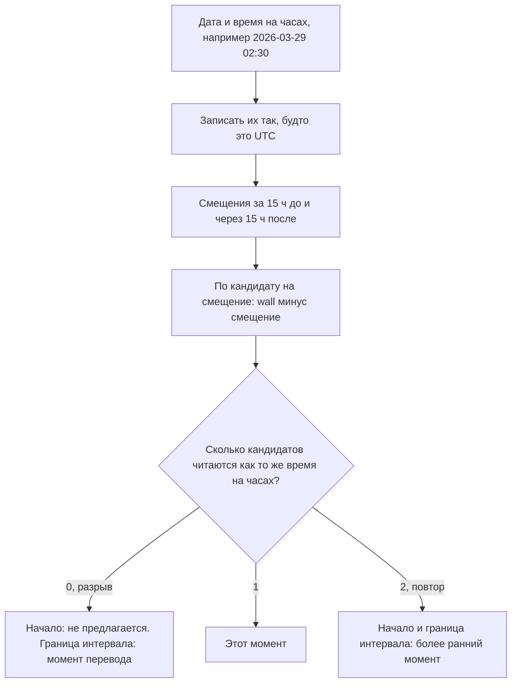

# Берлин, 29 марта: слоты записи при переводе часов без прибавления 24 часов

[English](slotbook-dst-slots.md) · **Русский**

Репозиторий: [sinnercode228/slotbook](https://github.com/sinnercode228/slotbook) · Демо: [sinnercode228.github.io/slotbook](https://sinnercode228.github.io/slotbook/) · Ссылки на код ведут на коммит [`1c83184`](https://github.com/sinnercode228/slotbook/tree/1c8318474319f6e61cc76a3bbc5b5911625d7c1e)

Slotbook хранит рабочие часы мастера как местное время на часах, например воскресенье 01:00-05:00 в Europe/Berlin, а свободные начала для записи отдаёт как моменты времени. 29 марта 2026 года часы в Берлине переводят с 02:00 на 03:00: 02:30 на часах не бывает, а интервал 01:00-05:00 длится три часа. 25 октября 02:30 бывает дважды. Что значит каждый такой случай, решает генератор на Go в `internal/slots`, а демо в браузере работает на копии генератора на TypeScript, которая обязана решать так же, вплоть до строки в ответе.

Slotbook — демо-проект: Snipwell & Co., её салоны в Москве и Берлине, мастера и клиенты выдуманы. Код и тесты настоящие.

## День — это дата, а не 24 часа

Генератор перебирает даты, и у даты нет часового пояса. `AddDays` — это `DateOf(d.midnightUTC().AddDate(0, 0, n))`, календарная арифметика на полуночи по UTC; комментарий в коде объясняет: «UTC has no DST, so AddDate on it moves exactly one calendar day per day» ([`date.go#L37-L51`](https://github.com/sinnercode228/slotbook/blob/1c8318474319f6e61cc76a3bbc5b5911625d7c1e/internal/slots/date.go#L37-L51)). `Generate` берёт «сегодня» из `Now` в поясе салона и идёт циклом `for d := r.From; !d.After(r.To); d = d.AddDays(1)` ([`slots.go#L85-L100`](https://github.com/sinnercode228/slotbook/blob/1c8318474319f6e61cc76a3bbc5b5911625d7c1e/internal/slots/slots.go#L85-L100)). Настоящая длина дня появляется только тогда, когда время на часах превращается в моменты.

Оба простых способа, которых код избегает, в дни перевода часов ломаются. Я проверил их на Go 1.24.7. Если прибавлять 24 часа, даты остаются верными, но сдвигается время суток: в Берлине суббота 24 октября 09:00 плюс 24 часа даёт `2026-10-25T08:00:00+01:00`. `AddDate(0, 0, 1)` на времени в поясе ломает уже сами даты. В America/Santiago 6 сентября пропускается сама полночь. Если идти от местной полуночи 4 сентября, `AddDate` просит у `time.Date` 6 сентября 00:00 и получает 23:00 пятого числа, поэтому обход проходит 5 сентября дважды и дальше остаётся на 23:00:

```
walk in zone: 2026-09-04T00:00:00-04:00 2026-09-04
walk in zone: 2026-09-05T00:00:00-04:00 2026-09-05
walk in zone: 2026-09-05T23:00:00-04:00 2026-09-05
walk in zone: 2026-09-06T23:00:00-03:00 2026-09-06
```

## Что делает time.Date в разрыве и в повторе

Внутри разрыва или повтора у вопроса «какой момент — это 02:30?» ноль ответов или два. Документация Go так и пишет: `time.Date` «returns a time that is correct in one of the two zones involved in the transition, but it does not guarantee which». Тот же запуск показывает, что выбор зависит от пояса:

```
time.Date(2026-03-29 02:30 Europe/Berlin) = 2026-03-29T03:30:00+02:00  (01:30 UTC)
time.Date(2026-03-08 02:30 America/New_York) = 2026-03-08T01:30:00-05:00  (06:30 UTC)
time.Date(2026-10-25 02:30 Europe/Berlin) = 2026-10-25T02:30:00+01:00  (01:30 UTC)
time.Date(2026-11-01 01:30 America/New_York) = 2026-11-01T01:30:00-04:00  (05:30 UTC)
```

В разрыве Берлин уезжает на час вперёд, а Нью-Йорк на час назад. В повторе Берлин получает второе вхождение, а Нью-Йорк первое. `time.Date` сначала ищет смещение в момент, который получится, если прочитать время на часах как UTC; к востоку от Гринвича этот момент позже настоящего, к западу раньше. В повторе это смещение подходит и остаётся. В разрыве оно не подходит никогда, и второй поиск даёт смещение с другой стороны перевода. Чтобы оценить цену, я заменил во временной копии репозитория `occurrences` и `edge` одним вызовом `time.Date` каждую и прогнал 23 вектора. Упали пять: `berlin-fall-back`, `berlin-interval-ends-in-gap`, `berlin-override-on-fall-back`, `cairo-fall-back-at-midnight` и `santiago-midnight-gap`. В Сантьяго список воскресенья начинался с `2026-09-05T23:00:00-04:00` и `2026-09-05T23:30:00-04:00`, двух моментов субботнего вечера. Оба вектора для Нью-Йорка прошли: в повторе `time.Date` там выбирает первое вхождение, а в разрыве сдвигает 02:00 и 02:30 назад, в 01:00 и 01:30, которые в списке уже есть. Прошёл и берлинский вектор на весенний перевод: сдвинутые 02:00 и 02:30 превращаются в 03:00 и 03:30, а они в списке уже есть.

## Какие моменты показывают это время на часах

`wallclock.go` никогда не передаёт пояс в `time.Date`:

```go
func occurrences(d Date, at TimeOfDay, loc *time.Location) []time.Time {
	wall := time.Date(d.Year, d.Month, d.Day, 0, int(at), 0, 0, time.UTC)
	var found []time.Time
	for _, offset := range nearbyOffsets(wall, loc) {
		t := wall.Add(-offset).In(loc)
		if sameWallTime(t, wall) && !slices.ContainsFunc(found, t.Equal) {
			found = append(found, t)
		}
	}
	slices.SortFunc(found, func(a, b time.Time) int { return a.Compare(b) })
	return found
}
```

[`wallclock.go#L15-L26`](https://github.com/sinnercode228/slotbook/blob/1c8318474319f6e61cc76a3bbc5b5911625d7c1e/internal/slots/wallclock.go#L15-L26)

`wall` — это дата и время, записанные так, будто это UTC. Любой момент, в который часы показывают это время, равен `wall` минус настоящее смещение. `nearbyOffsets` возвращает смещения, действующие за 15 часов до `wall` и через 15 часов после; причину объясняет комментарий: «Real offsets lie within UTC-12 and UTC+14, so probing 15 hours either side covers one transition, which is the most any zone has within a day» ([`wallclock.go#L28-L42`](https://github.com/sinnercode228/slotbook/blob/1c8318474319f6e61cc76a3bbc5b5911625d7c1e/internal/slots/wallclock.go#L28-L42)). Кандидат остаётся, только если пояс читает его обратно как ту же дату, час, минуту и секунду. Для 02:30 25 октября в Берлине смещения +02:00 и +01:00, и оба кандидата, 00:30Z и 01:30Z, читаются как 02:30. Для 02:30 29 марта кандидаты читаются как 03:30 и 01:30, и список пуст.



`edge` превращает границу интервала в момент: первое вхождение, если оно есть, а внутри разрыва сам момент перевода:

```go
	wall := time.Date(d.Year, d.Month, d.Day, 0, int(at), 0, 0, time.UTC)
	before := nearbyOffsets(wall, loc)[0]
	// Read with the pre-jump offset, the wall time lands just after the
	// jump, and the zone it lands in starts exactly at the jump.
	jumpedTo, _ := wall.Add(-before).In(loc).ZoneBounds()
	return jumpedTo.In(loc)
```

[`wallclock.go#L58-L63`](https://github.com/sinnercode228/slotbook/blob/1c8318474319f6e61cc76a3bbc5b5911625d7c1e/internal/slots/wallclock.go#L58-L63)

## Четыре правила в одном цикле

```go
	for _, iv := range r.hoursOn(d) {
		closes := edge(d, iv.End, r.Location)
		for at := alignUp(iv.Start, step); at < iv.End; at += step {
			found := occurrences(d, at, r.Location)
			if len(found) == 0 {
				continue
			}
			start := found[0]
			end := start.Add(span)
			if start.Before(earliest) || end.After(closes) || r.overlapsBusy(start, end) {
				continue
			}
			starts = append(starts, start)
		}
	}
```

[`slots.go#L126-L140`](https://github.com/sinnercode228/slotbook/blob/1c8318474319f6e61cc76a3bbc5b5911625d7c1e/internal/slots/slots.go#L126-L140)

1. Время, которое часы пропускают, не предлагается: `occurrences` пуст, и цикл идёт дальше. Сетка шага считается в минутах на часах от местной полуночи, поэтому шаг 30 минут сохраняет :00 и :30 по обе стороны перевода.
2. Время, которое бывает дважды, означает первое вхождение, `found[0]`. Повторный час своих начал не добавляет.
3. Интервал закрывается в `edge` своего конца, а `end.After(closes)` сравнивает моменты, поэтому у интервала его настоящая длина: 01:00-05:00 длится три часа 29 марта и пять часов 25 октября.
4. Минимальный запас до начала записи — это прошедшее время: `earliest` равен `r.Now.Add(r.MinNotice)` ([`slots.go#L124`](https://github.com/sinnercode228/slotbook/blob/1c8318474319f6e61cc76a3bbc5b5911625d7c1e/internal/slots/slots.go#L124)). Занятые интервалы тоже сравниваются как моменты.

## Что векторы фиксируют для Берлина и Нью-Йорка

29 марта, часы 01:00-05:00, услуга на 60 минут, шаг 30 минут:

```json
      "slots": [
        "2026-03-29T01:00:00+01:00",
        "2026-03-29T01:30:00+01:00",
        "2026-03-29T03:00:00+02:00",
        "2026-03-29T03:30:00+02:00",
        "2026-03-29T04:00:00+02:00"
      ]
```

[`berlin-spring-forward.json#L22-L28`](https://github.com/sinnercode228/slotbook/blob/1c8318474319f6e61cc76a3bbc5b5911625d7c1e/testdata/slots/berlin-spring-forward.json#L22-L28)

Запись на 01:30 идёт через перевод и заканчивается в 03:30 по летнему времени. У услуги на 180 минут в том же интервале одно начало, `2026-03-29T01:00:00+01:00` ([`berlin-spring-forward-real-length.json`](https://github.com/sinnercode228/slotbook/blob/1c8318474319f6e61cc76a3bbc5b5911625d7c1e/testdata/slots/berlin-spring-forward-real-length.json)). Интервал 00:00-02:30 кончается во время, которого нет, и закрывается в момент перевода, поэтому у услуги на 60 минут есть 00:00, 00:30 и 01:00, а 01:30 нет ([`berlin-interval-ends-in-gap.json`](https://github.com/sinnercode228/slotbook/blob/1c8318474319f6e61cc76a3bbc5b5911625d7c1e/testdata/slots/berlin-interval-ends-in-gap.json)). В 01:30 по зимнему времени запас в 120 минут заканчивается в 04:30 по летнему, поэтому первое начало — `2026-03-29T04:30:00+02:00` ([`berlin-notice-across-jump.json`](https://github.com/sinnercode228/slotbook/blob/1c8318474319f6e61cc76a3bbc5b5911625d7c1e/testdata/slots/berlin-notice-across-jump.json)).

25 октября, часы 01:00-04:00:

```json
      "slots": [
        "2026-10-25T01:00:00+02:00",
        "2026-10-25T01:30:00+02:00",
        "2026-10-25T02:00:00+02:00",
        "2026-10-25T02:30:00+02:00",
        "2026-10-25T03:00:00+01:00"
      ]
```

[`berlin-fall-back.json#L22-L28`](https://github.com/sinnercode228/slotbook/blob/1c8318474319f6e61cc76a3bbc5b5911625d7c1e/testdata/slots/berlin-fall-back.json#L22-L28)

Интервал длится четыре настоящих часа, с 23:00Z до 03:00Z. Вторые 02:00 и 02:30 (+01:00), то есть 01:00Z и 01:30Z, началами не становятся. Запись с первых 02:30 идёт до 01:30Z, поэтому при услуге на 60 минут полчаса с 01:30Z до 02:00Z остаются пустыми. Исключение на эту дату с часами 02:30-04:00 даёт `02:30:00+02:00` и `03:00:00+01:00`, два с половиной настоящих часа ([`berlin-override-on-fall-back.json`](https://github.com/sinnercode228/slotbook/blob/1c8318474319f6e61cc76a3bbc5b5911625d7c1e/testdata/slots/berlin-override-on-fall-back.json)).

В America/New_York 1 ноября час 01:00-02:00 повторяется. Часы 00:30-03:00, услуга на 60 минут и запись во втором 01:30, с `2026-11-01T01:30:00-05:00` до `2026-11-01T02:00:00-05:00`:

```json
        "2026-11-01T00:30:00-04:00",
        "2026-11-01T01:00:00-04:00",
        "2026-11-01T01:30:00-04:00",
        "2026-11-01T02:00:00-05:00"
```

[`new-york-fall-back.json#L25-L28`](https://github.com/sinnercode228/slotbook/blob/1c8318474319f6e61cc76a3bbc5b5911625d7c1e/testdata/slots/new-york-fall-back.json#L25-L28)

Запись занимает 06:30Z-07:00Z. Первое 01:30 идёт 05:30Z-06:30Z и заканчивается ровно тогда, когда запись начинается; занятые интервалы полуоткрытые, так что это начало остаётся. 02:00 EST начинается в 07:00Z, когда запись заканчивается.

## Лорд-Хау, Сантьяго и Каир

- Australia/Lord_Howe 4 октября переводит часы всего на 30 минут, с 02:00 на 02:30. При часах 01:00-04:00, услуге на 60 минут и шаге 15 минут начала такие: 01:00, 01:15, 01:30 и 01:45 при +10:30, затем 02:30, 02:45 и 03:00 при +11:00. Интервал длится два с половиной настоящих часа.
- America/Santiago 6 сентября пропускает полночь. Субботний интервал 22:00-24:00 закрывается в момент перевода, в 01:00 воскресенья при -03:00, поэтому у услуги на 60 минут есть 22:00, 22:30 и 23:00. Воскресных 00:00 и 00:30 не существует; начала воскресенья — 01:00, 01:30 и 02:00 при -03:00.
- Africa/Cairo 29 октября переводит часы назад с 24:00 на 23:00. Интервал четверга 22:00-24:00 кончается в единственную полночь, на настоящий час позже, чем кажется, поэтому услуга на 120 минут начинается в 22:00, 22:30 и 23:00 при +03:00. Пятница начинается с этой полуночи: `2026-10-30T00:00:00+02:00`. 24:00 — допустимый конец интервала ([`timeofday.go#L10-L14`](https://github.com/sinnercode228/slotbook/blob/1c8318474319f6e61cc76a3bbc5b5911625d7c1e/internal/slots/timeofday.go#L10-L14)), а `time.Date` в UTC нормализует минуту 1440 в 00:00 следующей даты, так что конец четверга совпадает с полуночью пятницы.

## Копия на TypeScript

У демо на GitHub Pages нет сервера. Его mock API выполняет правила записи в браузере на [`generate.ts`](https://github.com/sinnercode228/slotbook/blob/1c8318474319f6e61cc76a3bbc5b5911625d7c1e/web/src/schedule/generate.ts), переносе `Generate`, в верхнем комментарии которого сказано, что изменение в одном нужно повторить в другом. `Date` в JavaScript знает только UTC и пояс самой машины. `Intl.DateTimeFormat` знает базу IANA, но переводит только из момента во время на часах, поэтому `offsetAt` форматирует момент через `formatToParts`, собирает части обратно через `Date.UTC` и вычитает момент, усечённый до секунд ([`zone.ts#L49-L69`](https://github.com/sinnercode228/slotbook/blob/1c8318474319f6e61cc76a3bbc5b5911625d7c1e/web/src/schedule/zone.ts#L49-L69)). Дальше `occurrences` повторяет алгоритм из Go: берёт смещения за 15 часов до и после и оставляет кандидатов, для которых `candidate + offsetAt(candidate, zone) === wall` ([`zone.ts#L94-L118`](https://github.com/sinnercode228/slotbook/blob/1c8318474319f6e61cc76a3bbc5b5911625d7c1e/web/src/schedule/zone.ts#L94-L118)). `ZoneBounds` в Intl нет, поэтому `edge` ищет момент перевода делением пополам:

```ts
function offsetStart(instant: number, zone: string): number {
  const target = offsetAt(instant, zone);
  let lo = instant - 24 * HOUR;
  let hi = instant;
  if (offsetAt(lo, zone) === target) return instant;
  while (hi - lo > 1000) {
    const mid = Math.floor((lo + hi) / 2000) * 1000;
    if (offsetAt(mid, zone) === target) hi = mid;
    else lo = mid;
  }
  return hi;
}
```

[`zone.ts#L136-L147`](https://github.com/sinnercode228/slotbook/blob/1c8318474319f6e61cc76a3bbc5b5911625d7c1e/web/src/schedule/zone.ts#L136-L147)

Не больше чем за 17 делений пополам 24 часа сужаются до одной секунды, а переходы в базе tz приходятся на целые секунды, так что результат совпадает с моментом, который в Go даёт `ZoneBounds`. `formatInstant` записывает его так же, как `time.RFC3339` в Go: секунды, без дробной части, `Z` при нулевом смещении ([`zone.ts#L169-L180`](https://github.com/sinnercode228/slotbook/blob/1c8318474319f6e61cc76a3bbc5b5911625d7c1e/web/src/schedule/zone.ts#L169-L180)).

## Одни векторы, два набора тестов

В [`testdata/slots`](https://github.com/sinnercode228/slotbook/tree/1c8318474319f6e61cc76a3bbc5b5911625d7c1e/testdata/slots) лежат 23 JSON-файла, в каждом полный вход и точные ожидаемые строки; README рядом задаёт формат и пять правил. [`golden_test.go`](https://github.com/sinnercode228/slotbook/blob/1c8318474319f6e61cc76a3bbc5b5911625d7c1e/internal/slots/golden_test.go#L65-L106) находит файлы по маске и запускает каждый как подтест. [`golden.test.ts`](https://github.com/sinnercode228/slotbook/blob/1c8318474319f6e61cc76a3bbc5b5911625d7c1e/web/src/schedule/golden.test.ts#L30-L68) читает тот же каталог через `readdirSync` во время запуска и сравнивает через `toEqual`; комментарий объясняет, что `import.meta.glob` закешировал бы список файлов и не увидел бы новые векторы. Оба теста падают, если файлов меньше 10, и CI запускает оба набора на каждый push в main и на каждый pull request. [`9fbc282`](https://github.com/sinnercode228/slotbook/commit/9fbc2828ff1f2ea29ddea72f1e6fdf9822e21cf4) добавил генератор с 15 векторами. Перенос на TypeScript в [`af2fa85`](https://github.com/sinnercode228/slotbook/commit/af2fa8560027bec6f6014c090f00b1786c6a9e63) добавил интервал, который кончается внутри разрыва; в сообщении коммита сказано, что раньше этого не покрывали тесты ни одного из генераторов. [`01efcbf`](https://github.com/sinnercode228/slotbook/commit/01efcbf4f9cba887d72ed20f045094125e4d42fa) добавил Лорд-Хау, Сантьяго, Каир, запас времени через перевод, исключение на 25 октября и Лос-Анджелес, где 03:00 UTC — ещё предыдущий день. [`1cf8330`](https://github.com/sinnercode228/slotbook/commit/1cf8330ab3e065d3758401a1bcb54214592ed206) добавил другие смещения и миллисекунды. По поясам: 9 векторов в Europe/Berlin, 8 в Europe/Moscow (без перевода часов), 2 в America/New_York и по одному в остальных четырёх.

## Миллисекунды

Go хранит наносекунды, а `Date.parse` — миллисекунды, поэтому README векторов ограничивает `now` и занятые интервалы точностью до миллисекунды ([`README.md#L34-L36`](https://github.com/sinnercode228/slotbook/blob/1c8318474319f6e61cc76a3bbc5b5911625d7c1e/testdata/slots/README.md#L34-L36)). `notice-boundary-offset-instants.json` стоит ровно на этой границе: `now` равен `2026-10-19T10:00:00.001+03:00`, на одну миллисекунду позже 09:00 в Берлине, и при запасе в 60 минут 10:00 уже недоступно. Во временной копии я скопировал этот вектор с `now`, равным `10:00:00.0009+03:00`, и оставил ожидаемый список без изменений. Go прошёл: 0,9 мс после 09:00 всё ещё исключают 10:00. Vitest упал на этом файле с одним лишним началом:

```
      "slots": [
+       "2026-10-19T10:00:00+02:00",
        "2026-10-19T10:30:00+02:00",
```

Node 22 разбирает `.0009` как `.000`, так что для TypeScript-версии до 10:00 ровно 60 минут. В демо `now` берётся из `Date.now()` ([`mockApi.ts#L35`](https://github.com/sinnercode228/slotbook/blob/1c8318474319f6e61cc76a3bbc5b5911625d7c1e/web/src/mock/mockApi.ts#L35)), а там целые миллисекунды, так что ограничение касается только входных данных, написанных вручную.

## Сравнение на всех поясах, один прогон

23 вектора используют 7 поясов. Чтобы сравнить генераторы шире, я написал временный тест на Go вне репозитория. Он прошёл по всем датам 2026 года в каждом из 418 поясов, которые `Intl.supportedValuesOf('timeZone')` возвращает в Node 22.22.2, и нашёл 265 дней с переводом часов: 260 дат, длина которых не 24 часа, и 5 дат длиной 24 часа, которые кончаются сменой смещения, например 5 сентября в Сантьяго. Для каждого такого дня он записал три вектора на предыдущий день, сам день и следующий, с ответом Go в качестве ожидаемого: часы 00:00-24:00 с шагом 15 минут; часы 00:00-01:30, 01:45-02:30, 02:30-03:15 и 03:30-24:00 с буфером 15 минут; и запас 95 минут при `now` через 90 минут после начала дня. TypeScript-версия совпала во всех 795. Go читал системную базу tz (2025b), Node — свою копию из ICU (2025c). Этой проверки нет ни в репозитории, ни в CI.

## Что покрывают тесты и где код пока слабый

На `1c83184`, прогон сейчас: `go test ./internal/slots/` проходит 19 тестовых функций и 41 подтест (23 вектора, 8 случаев `occurrences`, 10 неверных запросов). Vitest проходит 33 теста в `web/src/schedule`: 24 в `golden.test.ts`, то есть векторы и проверка их количества, и 9 в `zone.test.ts`. Во всём веб-пакете 121 тест в 12 файлах. Векторы покрывают пропущенный час, пропущенные полчаса, пропущенную полночь, повторный час, повторный час, который кончается в полночь, интервал с концом внутри разрыва, исключение в день перевода, запас времени через перевод, занятость во втором вхождении и «сегодня» в поясе, который отстаёт от UTC. [`wallclock_test.go`](https://github.com/sinnercode228/slotbook/blob/1c8318474319f6e61cc76a3bbc5b5911625d7c1e/internal/slots/wallclock_test.go) проверяет `occurrences` и `edge` напрямую.

- Векторы фиксируют алгоритм, а не базу tz. Go читает `ZONEINFO` и системные каталоги раньше, чем копию, вкомпилированную через `time/tzdata` ([`main.go#L22-L23`](https://github.com/sinnercode228/slotbook/blob/1c8318474319f6e61cc76a3bbc5b5911625d7c1e/cmd/slotbook/main.go#L22-L23)), а браузер берёт свои данные ICU. После смены правил в какой-нибудь стране сервер и демо могут разойтись, и ни один тест этого не заметит. Комментарий у этого импорта говорит, что встроенные данные делают время слотов независимым от tzdata в образе; в порядке поиска Go это запасной вариант, так что это верно только для образа без zoneinfo.
- Все векторы на датах 2026 года. Ни один тест не проверяет допущение в `nearbyOffsets`, что у пояса в пределах суток не больше одного перехода.
- Правило первого вхождения стоит времени: в `berlin-fall-back` ни одно предложенное начало не покрывает 01:30Z-02:00Z, полчаса из четырёх настоящих часов.
- Ограничение в миллисекунду описано, но не проверяется. `parseInstant` принимает любое число цифр в дробной части ([`zone.ts#L159-L165`](https://github.com/sinnercode228/slotbook/blob/1c8318474319f6e61cc76a3bbc5b5911625d7c1e/web/src/schedule/zone.ts#L159-L165)), так что вектор с более точным временем загружается на обеих сторонах, а если лишние цифры решают исход на границе, падает только TypeScript.

## Правило, которое я из этого вынес

Время на часах — это ещё не момент. Нужно спросить у пояса, какие моменты его показывают, и в коде решить, что значат ноль ответов и два, а не брать то, что вернёт `time.Date`. Копия совпадает с оригиналом только за счёт общих входов и точных ответов, которые оба набора тестов прогоняют в CI.

Код: [`internal/slots`](https://github.com/sinnercode228/slotbook/tree/1c8318474319f6e61cc76a3bbc5b5911625d7c1e/internal/slots) · [`web/src/schedule`](https://github.com/sinnercode228/slotbook/tree/1c8318474319f6e61cc76a3bbc5b5911625d7c1e/web/src/schedule) · Векторы: [`testdata/slots`](https://github.com/sinnercode228/slotbook/tree/1c8318474319f6e61cc76a3bbc5b5911625d7c1e/testdata/slots)
