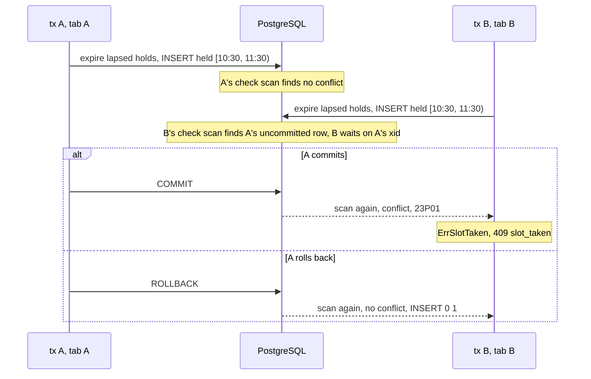
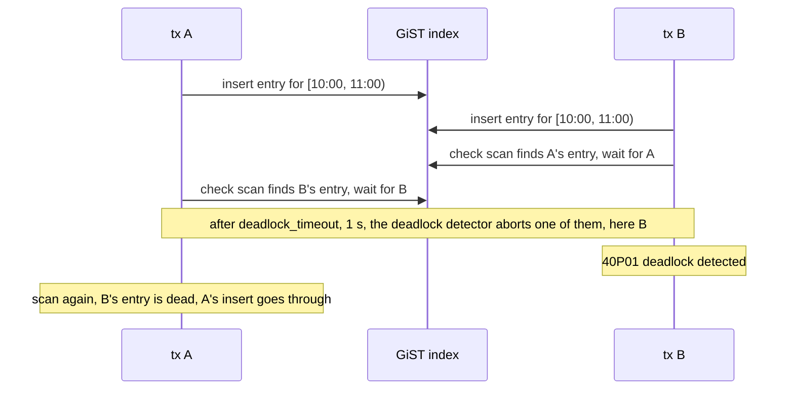

# Two tabs, one slot: letting PostgreSQL refuse the second booking

**English** · [Русский](slotbook-exclusion-constraint.ru.md)

Repository: [sinnercode228/slotbook](https://github.com/sinnercode228/slotbook) · Demo: [sinnercode228.github.io/slotbook](https://sinnercode228.github.io/slotbook/) · Code links point to commit [`1c83184`](https://github.com/sinnercode228/slotbook/tree/1c8318474319f6e61cc76a3bbc5b5911625d7c1e) (before the fix) and [`939022a`](https://github.com/sinnercode228/slotbook/tree/939022ae1a3c00362d064e0a11dee60eb2d4958d) (the fix)

Two customers pick the same specialist and click the same time, and both requests reach `POST /v1/holds` within a millisecond. Slotbook does not search for an overlap in Go before inserting the hold. It inserts, and an exclusion constraint in PostgreSQL decides: the first transaction commits, the second fails with SQLSTATE `23P01`, and that customer gets `409 slot_taken`. This note covers the constraint, what the second transaction waits for, why a reschedule cancels before it inserts, and one interleaving where the loser got a `500` instead, with the retry that fixed it.

Slotbook is a demo: the salon chain, its staff and its customers are made up. The code, the tests and the measurements below are real.

## One row for every piece of busy time

Appointments, holds and staff time blocks share one table, `bookings`. The constraint works on its `period` column:

```sql
    starts_at         timestamptz NOT NULL,
    ends_at           timestamptz NOT NULL,
    -- ends_at plus the service's cleanup buffer.
    busy_until        timestamptz NOT NULL,
    -- [starts_at, busy_until): the time the staff member is taken.
    period            tstzrange NOT NULL,
```

[`0001_schema.sql#L80-L85`](https://github.com/sinnercode228/slotbook/blob/1c8318474319f6e61cc76a3bbc5b5911625d7c1e/internal/db/migrations/0001_schema.sql#L80-L85)

A Berlin haircut takes 45 minutes plus a 15-minute cleanup buffer, so a hold at 10:30 takes `[10:30, 11:30)`. The buffer is inside the period, and nobody can book 11:15 while the chair is still being cleaned. An admin block is a row with `kind = 'block'` and `busy_until` equal to `ends_at` ([`admin.go#L51-L54`](https://github.com/sinnercode228/slotbook/blob/1c8318474319f6e61cc76a3bbc5b5911625d7c1e/internal/booking/admin.go#L51-L54)).

Until commit [`cc82734`](https://github.com/sinnercode228/slotbook/commit/cc827346dc26ab43bad77e89b8196e15a3afab9b), `period` was a generated column. Now every insert writes it as `tstzrange(starts_at, busy_until, '[)')`, and `CHECK (period = tstzrange(starts_at, busy_until, '[)'))` refuses a row where the two disagree ([`0001_schema.sql#L101`](https://github.com/sinnercode228/slotbook/blob/1c8318474319f6e61cc76a3bbc5b5911625d7c1e/internal/db/migrations/0001_schema.sql#L101)). The constraint reads `period`, while the slot generator, the API and the day view read `starts_at` and `busy_until`, so the CHECK keeps them describing the same time. `TestPeriodMustMatchStartAndBusyUntil` inserts a one-hour block with a one-minute period and expects the error to name the constraint `bookings_period_matches`.

`'[)'` makes the range half-open: it contains its start and not its end. In psql, `[10:00, 11:00) && [11:00, 12:00)` is `f`, and the same pair with a closed `11:00]` is `t`. A booking may start at the minute the previous buffer ends. [`TestExclusionConstraintRejectsOverlap`](https://github.com/sinnercode228/slotbook/blob/1c8318474319f6e61cc76a3bbc5b5911625d7c1e/internal/db/db_test.go#L56-L71) checks both sides: next to a one-hour block, a block that starts 30 minutes into it is refused, and one that starts at its end goes in.

## The constraint

```sql
    -- The double-booking guarantee: active rows of one staff member never overlap.
    CONSTRAINT bookings_no_overlap EXCLUDE USING gist (staff_id WITH =, period WITH &&)
        WHERE (status IN ('held', 'confirmed'))
```

[`0001_schema.sql#L111-L113`](https://github.com/sinnercode228/slotbook/blob/1c8318474319f6e61cc76a3bbc5b5911625d7c1e/internal/db/migrations/0001_schema.sql#L111-L113)

It reads: no two rows with equal `staff_id` and overlapping `period`. PostgreSQL enforces it through a GiST index. GiST supports `&&` on ranges by itself but has no operator class for `=` on `bigint`. The `btree_gist` extension, created on line 1 of the migration, adds one, so a single index covers both columns.

The `WHERE` makes the index partial: only `held` and `confirmed` rows are in it. Cancelled bookings and expired holds stay in the table as history and block nothing. [`TestExclusionConstraintIgnoresInactiveRows`](https://github.com/sinnercode228/slotbook/blob/1c8318474319f6e61cc76a3bbc5b5911625d7c1e/internal/db/db_test.go#L73-L103) inserts an `expired` hold, then a `held` one on the same period, which goes in, then a second `held` one, which is refused. A refused insert names both keys:

```
ERROR:  conflicting key value violates exclusion constraint "bookings_no_overlap"
DETAIL:  Key (staff_id, period)=(5, ["2026-10-15 08:30:00+00","2026-10-15 09:30:00+00")) conflicts with existing key (staff_id, period)=(5, ["2026-10-15 08:30:00+00","2026-10-15 09:30:00+00")).
```

## A check in Go races

The obvious version reads first: is there an active row for this specialist that overlaps? If not, insert. At READ COMMITTED, PostgreSQL's default, two transactions can both run the read before either inserts. Both see nothing and both insert.

To measure it, I built that version in a scratch copy of the repository; it is not in the repository's history. The constraint is removed from the migration, and `insertHold` runs this before its insert:

```go
		var taken bool
		if err := tx.QueryRow(ctx, `
			SELECT EXISTS (SELECT 1 FROM bookings
			WHERE staff_id = $1 AND period && tstzrange($2, $3, '[)')
			  AND (status = 'confirmed' OR (status = 'held' AND hold_expires_at > $4)))`,
			h.staffID, h.start, h.busyUntil, h.now).Scan(&taken); err != nil {
			return err
		}
		if taken {
			return ErrSlotTaken
		}
```

I ran the repository's race test against it 100 times without `-race` and 100 times with it. It failed 42 times and 34 times. Two of the failure lines:

```
hold_test.go:112: 2 holds succeeded and 18 got slot_taken; want 1 and 19
hold_test.go:112: 14 holds succeeded and 6 got slot_taken; want 1 and 19
```

The first is the most common failure. In the run behind the second line, 14 of the 20 requests got a hold on the same 10:00. CI runs this test once, with `-race`; of my 100 runs with `-race` against this version, 66 passed.

Three standard fixes keep the check in Go. I ran each against the same test, with `-race`, in the scratch copy:

- `SELECT 1 FROM staff WHERE id = $1 FOR UPDATE` at the start of the transaction. Requests for one specialist queue on that row. 20 of 20 runs passed.
- `pg_advisory_xact_lock(staff_id)`, the same queue without a table row. 20 of 20 passed.
- `SERIALIZABLE` isolation. Every run had exactly one winner, but 12 of 20 runs failed on `could not serialize access due to read/write dependencies among transactions (SQLSTATE 40001)`, 18 errors in all. The code would need a retry loop around the transaction.

The two locks work, but only for code that takes them. Holds, admin blocks and reschedules all write busy time, and so would a later import script or a fix typed into psql. A path that forgets the lock writes an overlap, and nothing reports it. The constraint is checked on every write that puts an active row into the table, whoever sends it. In Slotbook three functions insert periods, `insertHold`, `CreateBlock` and `Reschedule`, and none of them contains overlap logic. `Hold` only checks that the start is one the slot generator offers from the specialist's hours, notice and horizon: [`offers`](https://github.com/sinnercode228/slotbook/blob/1c8318474319f6e61cc76a3bbc5b5911625d7c1e/internal/booking/availability.go#L140-L149) calls the slot generator with no busy time.

## What the second insert waits for

PostgreSQL checks an exclusion constraint after the new index entry is in place, with a separate scan of the index ([`execIndexing.c#L31-L37`](https://github.com/postgres/postgres/blob/REL_16_13/src/backend/executor/execIndexing.c#L31-L37) in PostgreSQL 16). The scan sees other transactions' uncommitted rows. When it finds an overlapping one, it waits on that transaction's ID and then scans again. If the other transaction committed, its row is a conflict and the insert fails with `23P01`. If it rolled back, the row is gone and the insert goes through.

I replayed this in two psql sessions on one slot of Jonas W. Session A inserts a hold, sleeps three seconds and commits. Session B inserts the same period half a second after A. While B hangs, `pg_stat_activity` joined with `pg_locks` shows what it waits for:

```
  pid  | wait_event_type |  wait_event   | waits_for_xid | granted
-------+-----------------+---------------+---------------+---------
 14402 | Lock            | transactionid |        177334 | f
```

177334 is A's transaction ID, from `txid_current()` in session A. After A's commit, B fails with the error quoted above, `Time: 2513.648 ms (00:02.514)`. When A ends with `ROLLBACK` instead, B gets `INSERT 0 1` after 2498 ms.



In Go the error comes back through `pgx.BeginFunc`, which rolls the transaction back. `insertHold` turns `db.IsExclusionViolation(err)` into `ErrSlotTaken` and wraps any other error as `booking: insert hold: %w` ([`hold.go#L149-L154`](https://github.com/sinnercode228/slotbook/blob/1c8318474319f6e61cc76a3bbc5b5911625d7c1e/internal/booking/hold.go#L149-L154)). `IsExclusionViolation` compares the `pgconn.PgError` code with `"23P01"` ([`db.go#L40-L55`](https://github.com/sinnercode228/slotbook/blob/1c8318474319f6e61cc76a3bbc5b5911625d7c1e/internal/db/db.go#L40-L55)), and the HTTP layer answers `ErrSlotTaken` with `409 slot_taken` ([`errors.go#L31-L32`](https://github.com/sinnercode228/slotbook/blob/1c8318474319f6e61cc76a3bbc5b5911625d7c1e/internal/httpapi/errors.go#L31-L32)). `CreateBlock` and `Reschedule` map their inserts the same way.

## An expired hold never causes a 409

The constraint knows nothing about time. A hold whose `hold_expires_at` has passed stays `held`, and in the index, until something changes its status. Availability already shows that time as free, because it counts a hold only while `hold_expires_at > now` ([`store.go#L71-L87`](https://github.com/sinnercode228/slotbook/blob/1c8318474319f6e61cc76a3bbc5b5911625d7c1e/internal/booking/store.go#L71-L87)). So every transaction that inserts busy time first expires the lapsed holds it would overlap:

```go
func expireStaleHolds(ctx context.Context, q db.Querier, staffID int64, start, end, now time.Time) error {
	_, err := q.Exec(ctx, `
		UPDATE bookings SET status = 'expired'
		WHERE staff_id = $1 AND status = 'held' AND hold_expires_at <= $4
		  AND period && tstzrange($2, $3, '[)')`, staffID, start, end, now)
	return err
}
```

[`store.go#L63-L69`](https://github.com/sinnercode228/slotbook/blob/1c8318474319f6e61cc76a3bbc5b5911625d7c1e/internal/booking/store.go#L63-L69)

After this `UPDATE` the row's current version is `expired`, outside the constraint's `WHERE`, so the insert in the same transaction does not conflict with it. [`TestExpiredHoldDoesNotBlockANewOne`](https://github.com/sinnercode228/slotbook/blob/1c8318474319f6e61cc76a3bbc5b5911625d7c1e/internal/booking/hold_test.go#L123-L137) holds 10:00, moves the fake clock 10 minutes, holds 10:15, which overlaps the first period `[10:00, 11:00)`, and expects the first row `expired` and the second `held`.

A confirm can reach the same row at the same moment. It is one `UPDATE ... WHERE hold_token_hash = $1 AND status = 'held' AND hold_expires_at > $7` ([`confirm.go#L78-L84`](https://github.com/sinnercode228/slotbook/blob/1c8318474319f6e61cc76a3bbc5b5911625d7c1e/internal/booking/confirm.go#L78-L84)). Both statements lock the row, and the one that waited re-evaluates its `WHERE` against the committed version. I ran both orders in two psql sessions. The confirm used a time one second before expiry, the other session a time one second after it, and whichever went first held its transaction open for two seconds. With the confirm first, the other session waited 1505 ms in its `UPDATE`, got `UPDATE 0` because the row was now `confirmed`, and its `INSERT` failed with `23P01`. With the expiry first, the confirm waited 1506 ms and got `UPDATE 0`; the row now reads `expired`, so [`whyNotConfirmable`](https://github.com/sinnercode228/slotbook/blob/1c8318474319f6e61cc76a3bbc5b5911625d7c1e/internal/booking/confirm.go#L106-L119) returns `ErrHoldExpired`, which the API answers with `410 hold_expired`.

The sweeper in `serve` marks every lapsed hold expired, every 30 seconds by default. Its comment says it is not needed for correctness: "Holds would not block new bookings anyway (see expireStaleHolds); this keeps the table honest for admins and reports" ([`sweep.go#L13-L23`](https://github.com/sinnercode228/slotbook/blob/1c8318474319f6e61cc76a3bbc5b5911625d7c1e/internal/booking/sweep.go#L13-L23)). The expiry test above never calls it.

## A reschedule cancels before it inserts

A reschedule keeps the old row as history and inserts a new `confirmed` row that points back with `rescheduled_from`, both in one transaction. The order is fixed, and a comment says why:

```go
		// The exclusion constraint is checked row by row, so the old row has
		// to leave the active set before the new one goes in; otherwise a
		// move onto a period overlapping the old one would conflict with
		// itself.
		if _, err := markCancelled(ctx, tx, old.ID, now); err != nil {
			return err
		}
```

[`manage.go#L134-L140`](https://github.com/sinnercode228/slotbook/blob/1c8318474319f6e61cc76a3bbc5b5911625d7c1e/internal/booking/manage.go#L134-L140)

I checked what "row by row" means on PostgreSQL 16.13 with scratch tables that carry the same constraint:

1. Insert the new row, then cancel the old one: the `INSERT` fails with `23P01` at once, without waiting for the end of the transaction.
2. Cancel, then insert: both statements succeed.
3. Order 1 with the constraint `DEFERRABLE INITIALLY DEFERRED`: the transaction commits. The conflict is checked again at `COMMIT`, when the old row is already cancelled.
4. One `UPDATE` that moves two back-to-back rows, `[10:00, 11:00)` and `[11:00, 12:00)`, 30 minutes later fails: the first row's new `[10:30, 11:30)` "conflicts with existing key" `[11:00, 12:00)`, the second row's old period. The final state has no overlap. With `DEFERRABLE INITIALLY IMMEDIATE`, checked at the end of the statement, the same `UPDATE` passes.
5. An `UPDATE` that moves one row onto part of its own period passes. The check does not see the row's old version, because the same transaction has already marked it deleted.

So a non-deferrable exclusion constraint is checked for each row as that row is written, before the next row of the same statement. `ExecInsertIndexTuples` does exactly that: for a constraint that is not `DEFERRABLE` it runs the check with `CEOUC_WAIT` and `violationOK = false`, so a conflict is an error on the spot; for a `DEFERRABLE` one it only notes the conflict and queues a recheck, which runs at the end of the statement or at `COMMIT` ([`execIndexing.c#L443-L483`](https://github.com/postgres/postgres/blob/REL_16_13/src/backend/executor/execIndexing.c#L443-L483)). Case 5 shows that moving the row in place would not need the ordering. The reschedule needs it because it writes a second row.

[`TestRescheduleOntoAPeriodOverlappingItsOwn`](https://github.com/sinnercode228/slotbook/blob/1c8318474319f6e61cc76a3bbc5b5911625d7c1e/internal/booking/manage_test.go#L68-L105) moves a 10:00 booking to 10:15, whose `[10:15, 11:15)` overlaps the old `[10:00, 11:00)`. [`TestRescheduleIntoSomeoneElsesBookingChangesNothing`](https://github.com/sinnercode228/slotbook/blob/1c8318474319f6e61cc76a3bbc5b5911625d7c1e/internal/booking/manage_test.go#L137-L153) moves a 10:00 booking to 11:30, into another booking at 12:00. The insert fails, the whole transaction rolls back, and the original booking stays `confirmed` with its two-hour reminder still pending.

## Any available specialist

Without `staff_id`, `Hold` collects every specialist whose schedule offers the start and sorts them: fewest confirmed appointments that local day first, then lowest id ([`orderByLoad`](https://github.com/sinnercode228/slotbook/blob/1c8318474319f6e61cc76a3bbc5b5911625d7c1e/internal/booking/hold.go#L93-L122)). Then it calls `insertHold` for each in turn, one transaction each, and moves on when one returns `ErrSlotTaken` ([`hold.go#L69-L90`](https://github.com/sinnercode228/slotbook/blob/1c8318474319f6e61cc76a3bbc5b5911625d7c1e/internal/booking/hold.go#L69-L90)). The request gets `slot_taken` only when every candidate is taken. The count runs outside the insert transactions, so two concurrent requests can both start with the same person; the constraint settles it, and the loser goes on to the next one. [`TestAnyStaffFallsThroughToTheNextFreeStaffMember`](https://github.com/sinnercode228/slotbook/blob/1c8318474319f6e61cc76a3bbc5b5911625d7c1e/internal/booking/hold_test.go#L168-L183) gives Lena, first in line, a hold at 10:00, expects an any-staff hold for 10:00 to land on Jonas, and a third request to get `ErrSlotTaken`.

## When the loser got a 500

The same comment in `execIndexing.c` goes on ([`#L39-L45`](https://github.com/postgres/postgres/blob/REL_16_13/src/backend/executor/execIndexing.c#L39-L45)):

> There is a chance of deadlock, if two backends insert a tuple at the same time, and then perform the scan to check for conflicts. They will find each other's tuple, and both try to wait for each other. The deadlock detector will detect that, and abort one of the transactions. That's fairly harmless, as one of them was bound to abort with a "duplicate key error" anyway, although you get a different error message.



The different message is `deadlock detected`, SQLSTATE `40P01`. At `1c83184`, `IsExclusionViolation` only knew `23P01`, so `insertHold` wrapped the deadlock as an ordinary error and the API answered `500 internal`. With any staff, the loop stopped instead of trying the next person.

I measured it in a second scratch worktree, with a test that loops around the unmodified `Hold`: two goroutines on one slot per round, the same pool from round to round, the table emptied between rounds. Every round ended with exactly one hold. In three loops of 2000, 1000 and 1000 rounds, 18, 60 and 10 losers got `booking: insert hold: ERROR: deadlock detected (SQLSTATE 40P01)` instead of `ErrSlotTaken` (the loop with 60 emptied the table with `TRUNCATE`, the other two with `DELETE`). Each of those errors came a little over one second after the call, at most 1.005 s. The server log shows the cycle, two `INSERT`s from `insertHold` each waiting for the other's transaction:

```
ERROR:  deadlock detected
DETAIL:  Process 15104 waits for ShareLock on transaction 177625; blocked by process 15105.
	Process 15105 waits for ShareLock on transaction 177626; blocked by process 15104.
```

With 20 goroutines per round, 336 of the 1900 losers in 100 rounds got it, and the errors queued up: the slowest came after 18.02 s.

The guarantee held: no round ended with two holds. But a loser could get `500` instead of `409`, a second or more late. `CreateBlock` and `Reschedule` also checked for `23P01` only, and none of the three retried.

The fix is two commits: [`54ccd48`](https://github.com/sinnercode228/slotbook/commit/54ccd486199c9392846f2730a82e3a3e73a830b4) for holds, blocks and reschedules, and [`939022a`](https://github.com/sinnercode228/slotbook/commit/939022ae1a3c00362d064e0a11dee60eb2d4958d) for confirmations, which I missed at first. `db.IsDeadlock` recognizes `40P01` the way `IsExclusionViolation` recognizes `23P01` ([`db.go#L51-L54`](https://github.com/sinnercode228/slotbook/blob/939022ae1a3c00362d064e0a11dee60eb2d4958d/internal/db/db.go#L51-L54)), and a new helper runs the transaction again when it sees one:

```go
// inTx runs fn in a transaction like pgx.BeginFunc and, when PostgreSQL
// aborts the transaction as a deadlock victim (40P01), runs fn again from the
// start in a new one, up to txAttempts times in all. When ctx is done it
// stops retrying and returns the last error.
//
// Two writes that add overlapping periods to the exclusion constraint's index
// at the same moment (inserts, or the update that confirms a hold) can each
// wait for the other's entry, and the deadlock detector aborts one of them
// instead of letting it fail with 23P01. With more such writes it aborts one
// per deadlock_timeout until one is left. A victim that came straight back
// with a new entry would join that chain again, so a retry starts by taking
// an advisory lock and retries go one at a time.
func inTx(ctx context.Context, b beginner, fn func(pgx.Tx) error) error {
	for attempt := 1; ; attempt++ {
		err := pgx.BeginFunc(ctx, b, func(tx pgx.Tx) error {
			if attempt > 1 {
				if _, err := tx.Exec(ctx, `SELECT pg_advisory_xact_lock(hashtext('slotbook-deadlock-retry'))`); err != nil {
					return err
				}
			}
			return fn(tx)
		})
		if attempt == txAttempts || !db.IsDeadlock(err) {
			return err
		}
		base := time.Millisecond << attempt
		pause := time.NewTimer(base + rand.N(base))
		select {
		case <-ctx.Done():
			pause.Stop()
			return err
		case <-pause.C:
		}
	}
}
```

[`tx.go#L20-L54`](https://github.com/sinnercode228/slotbook/blob/939022ae1a3c00362d064e0a11dee60eb2d4958d/internal/booking/tx.go#L20-L54)

Before a retry it pauses for a random 2–4 ms, then 4–8, 8–16 and 16–32 ms, at most 60 ms over the five attempts. Only `40P01` is retried: `23P01` and every other error come back from the first attempt, as before. `insertHold`, `CreateBlock`, `Reschedule` and `Confirm` call `inTx(ctx, m.pool, ...)` where they called `pgx.BeginFunc`, with the same closure ([`admin.go#L46`](https://github.com/sinnercode228/slotbook/blob/939022ae1a3c00362d064e0a11dee60eb2d4958d/internal/booking/admin.go#L46), [`manage.go#L126`](https://github.com/sinnercode228/slotbook/blob/939022ae1a3c00362d064e0a11dee60eb2d4958d/internal/booking/manage.go#L126), [`confirm.go#L58`](https://github.com/sinnercode228/slotbook/blob/939022ae1a3c00362d064e0a11dee60eb2d4958d/internal/booking/confirm.go#L58)). For a hold:

```go
func (m *Manager) insertHold(ctx context.Context, h newHold) (Booking, error) {
	var b Booking
	err := inTx(ctx, m.pool, func(tx pgx.Tx) error {
		if err := expireStaleHolds(ctx, tx, h.staffID, h.start, h.busyUntil, h.now); err != nil {
			return err
		}
		var err error
		b, err = scanBooking(tx.QueryRow(ctx, `
			INSERT INTO bookings (kind, status, location_id, staff_id, service_id, starts_at, ends_at, busy_until, period,
			                      price_minor, currency, hold_token_hash, hold_expires_at, created_at)
			VALUES ('appointment', 'held', $1, $2, $3, $4, $5, $6, tstzrange($4, $6, '[)'), $7, $8, $9, $10, $11)
			RETURNING `+bookingColumns,
			h.locationID, h.staffID, h.service.ID, h.start, h.end, h.busyUntil,
			h.service.PriceMinor, h.service.Currency, h.tokenHash, h.expiresAt, h.now))
		return err
	})
	if db.IsExclusionViolation(err) {
		return Booking{}, ErrSlotTaken
	}
	if err != nil {
		return Booking{}, fmt.Errorf("booking: insert hold: %w", err)
	}
	return b, nil
}
```

[`hold.go#L133-L156`](https://github.com/sinnercode228/slotbook/blob/939022ae1a3c00362d064e0a11dee60eb2d4958d/internal/booking/hold.go#L133-L156)

The closure is the whole transaction, so a retry repeats all of it: the expiry of lapsed holds and the insert, and in a reschedule also the row lock, the cancel and the reminders. The mapping after it did not change: `23P01` is `ErrSlotTaken`, and a `40P01` that is still there after the fifth attempt is wrapped as before.

A plain retry was not enough. With three or more inserts at the same moment, the check scans wait on one another, and PostgreSQL aborts one victim per `deadlock_timeout` until one inserter is left. A victim that retries at once puts a new entry into the index and joins that chain again. With a plain retry and a short backoff, eight goroutines still left 34 calls failing with `40P01` after five attempts, and in the 20-goroutine scenario described under the tests below, the one run that hit the chain went through 94 deadlock cycles and all 19 losers ended with `40P01`. That is why a retry takes the advisory lock before anything else: retries go one at a time and cannot keep the chain going. The first attempt takes no lock, so a request that meets no deadlock runs as before, and the constraint is still what rules out the overlap. The lock key is one for the whole database, so retries for different specialists also wait for each other. Over 300 rounds per size, the number of attempts each call needed:

```
goroutines per round   1 attempt   2 attempts   3 attempts   4 attempts
                   4        1095           96            9            0
                   8        2041          348           10            1
                  16        4017          758           24            1
```

No call needed a fifth attempt, and none failed.

My first commit missed one more write. Confirming a hold is one `UPDATE` from `held` to `confirmed` ([`confirm.go#L78-L84`](https://github.com/sinnercode228/slotbook/blob/939022ae1a3c00362d064e0a11dee60eb2d4958d/internal/booking/confirm.go#L78-L84)). `status` is in the constraint's `WHERE`, so PostgreSQL cannot make it a HOT update: the new version of the row gets its own entry in `bookings_no_overlap`, and the same check runs as for an insert. A hold or a block inserted on that period at the same moment can wait for the confirm while the confirm waits for it. When PostgreSQL aborted the confirm, the customer who owned the hold got `500`, the insert retried and got `409`, and neither request succeeded. On `54ccd48` the confirm got `40P01` in 43 of 400 rounds against three blocks, in 13 of 400 against three holds, and in 19 to 25 of 400 against a mix of holds and blocks. `939022a` runs `Confirm` through `inTx` as well. The idempotency key reservation and the new manage token are inside the closure, so an aborted attempt's key row rolls back with it, and the token the customer gets is the one whose hash was committed.

The retry does not make the chain shorter. With k simultaneous writes PostgreSQL still needs about (k − 1) × `deadlock_timeout` to resolve them, so a loser now gets `409`, but it can still get it late: in the 20-goroutine scenario at the default 1 s, the two runs that hit the chain took 19.0 s and 20.0 s.

`54ccd48` adds three integration tests that race writes on one period, many rounds on one pool, and `939022a` adds a fourth:

- [`TestSimultaneousHoldsNeverFailWithADeadlock`](https://github.com/sinnercode228/slotbook/blob/939022ae1a3c00362d064e0a11dee60eb2d4958d/internal/booking/hold_test.go#L123-L142): 150 rounds of four holds.
- [`TestSimultaneousBlocksAndHoldsNeverFailWithADeadlock`](https://github.com/sinnercode228/slotbook/blob/939022ae1a3c00362d064e0a11dee60eb2d4958d/internal/booking/admin_test.go#L47-L68): 200 rounds of two blocks and two holds.
- [`TestSimultaneousReschedulesNeverFailWithADeadlock`](https://github.com/sinnercode228/slotbook/blob/939022ae1a3c00362d064e0a11dee60eb2d4958d/internal/booking/manage_test.go#L155-L198): 100 rounds of four reschedules onto one period. The winner moves back after each round, and every loser must still be `confirmed`.
- [`TestSimultaneousConfirmsAndInsertsNeverFailWithADeadlock`](https://github.com/sinnercode228/slotbook/blob/939022ae1a3c00362d064e0a11dee60eb2d4958d/internal/booking/confirm_test.go#L205-L248): 160 rounds of one confirm against two holds and a block. The confirm starts 0 to 975 µs late, in 25 µs steps that repeat every 40 rounds, so that its `UPDATE` meets the inserts.

Every round must end with one success, `ErrSlotTaken` for all the others and one active row on the period ([`checkOneWinner`](https://github.com/sinnercode228/slotbook/blob/939022ae1a3c00362d064e0a11dee60eb2d4958d/internal/booking/fixture_test.go#L115-L143)). The race fixture gives each goroutine its own connection and sets `deadlock_timeout` to 10 ms on every connection ([`fixture_test.go#L86-L92`](https://github.com/sinnercode228/slotbook/blob/939022ae1a3c00362d064e0a11dee60eb2d4958d/internal/booking/fixture_test.go#L86-L92)), so a deadlock costs milliseconds instead of a second. A database role that may not change that setting skips these four tests. The hold test:

```go
// Two transactions that insert the same period at the same moment can each
// find the other's uncommitted entry in the constraint's index and wait for
// it; PostgreSQL's deadlock detector then aborts one of them with 40P01. The
// loser must still get ErrSlotTaken. A round deadlocks only now and then, and
// hardly ever while the index fits in one page (about the first 40 rounds
// here), so the test runs many rounds on one pool.
func TestSimultaneousHoldsNeverFailWithADeadlock(t *testing.T) {
	const rounds, n = 150, 4
	f := newRaceFixture(t, n)
	ctx := context.Background()
	start := at(2026, time.October, 14, 10, 0)
	for round := range rounds {
		errs := race(n, func(int) error {
			_, err := f.manager.Hold(ctx, booking.HoldRequest{ServiceID: f.haircut(), StaffID: f.lena(), Start: start})
			return err
		})
		f.checkOneWinner(t, round, errs, start, start.Add(time.Hour))
		f.clearBookings(t)
	}
}
```

[`hold_test.go#L123-L142`](https://github.com/sinnercode228/slotbook/blob/939022ae1a3c00362d064e0a11dee60eb2d4958d/internal/booking/hold_test.go#L123-L142)

I ran the first three on the old code, the commit before the fix with only the new tests and their helpers added, 20 times each with `-race` and 20 times without. All 120 runs failed, every one on a `40P01` where `ErrSlotTaken` was expected. The first failing round was between 10 and 77 for holds, 1 and 66 for blocks, and 2 and 39 for reschedules:

```
hold_test.go:139: round 39: got booking: insert hold: ERROR: deadlock detected (SQLSTATE 40P01), want ErrSlotTaken
admin_test.go:65: round 39: got booking: insert hold: ERROR: deadlock detected (SQLSTATE 40P01), want ErrSlotTaken
manage_test.go:183: round 30: got ERROR: deadlock detected (SQLSTATE 40P01), want ErrSlotTaken
```

On code without the `Confirm` change, the confirm test failed all 30 of its runs, 15 with `-race` and 15 without, and 20 of 20 more with an earlier 50 µs step. Each failure was `round N: confirm: ERROR: deadlock detected (SQLSTATE 40P01)`, and over those 50 runs the first failing round was between 2 and 103. On `939022a` I ran each of the four tests 30 times with `-race` and 30 times without, together with `TestConcurrentHoldsOnTheSameSlotHaveOneWinner`: 300 runs, no failures, the slowest 3.38 s with `-race`.

Four unit tests drive `inTx` with a fake `pgx.Tx` and an injected `40P01` ([`tx_test.go#L80-L150`](https://github.com/sinnercode228/slotbook/blob/939022ae1a3c00362d064e0a11dee60eb2d4958d/internal/booking/tx_test.go#L80-L150)). It succeeds after four deadlocks with five transactions begun and one commit, and takes the advisory lock only from the second attempt on, before the closure. It gives up after the fifth attempt with the `40P01`, does not retry `23P01` or a domain error, and stops after one call when the context is cancelled.

## What the tests cover

[`TestConcurrentHoldsOnTheSameSlotHaveOneWinner`](https://github.com/sinnercode228/slotbook/blob/1c8318474319f6e61cc76a3bbc5b5911625d7c1e/internal/booking/hold_test.go#L76-L121) starts 20 goroutines that block on one channel, closes it, and lets all of them call `Hold` for Lena at 10:00. It expects exactly one success, 19 `ErrSlotTaken` and no other error, then counts the `held` rows in the table and expects one. The fixture asks for a pool of 25 connections; the test pool defaults to 8 ([`dbtest.go#L37`](https://github.com/sinnercode228/slotbook/blob/1c8318474319f6e61cc76a3bbc5b5911625d7c1e/internal/dbtest/dbtest.go#L37)), and with 8 most goroutines would queue for a connection instead of meeting in the database.

On the old code this test never caught the deadlock: it passed 200 runs out of 200 with `-race` and 200 without. Each run starts on a fresh pool. When I ran the same body after one unasserted round of the race on the same pool, it failed 3 times in 180 runs without `-race` and passed all 180 with it. In each failing run all 19 losers got `40P01`, and the runs took 16.20 s, 19.20 s and 19.22 s. With `deadlock_timeout` at 100 ms, the same body after a warm-up round failed 4 times in 300 runs, each time with all 19 losers on `40P01`. On `54ccd48` it failed in none of 300 runs at 100 ms, none of 250 at the default 1 s and none of 100 with `-race`. Two of the runs at 1 s hit the chain and took 19.0 s and 20.0 s, and no call needed more than three attempts.

While writing the fix I found part of the answer to why a fresh pool hid the deadlock. A scratch test logged the size of the `bookings_no_overlap` index in every round of four simultaneous holds. The index grew from one page to three at round 39, and right after that deadlocks became frequent, in about 20% of rounds; while it was a single page they were rare. Rare is not never: on `54ccd48`, one run of `TestConcurrentHoldsOnTheSameSlotHaveOneWinner` hit the full chain on a fresh pool, took 17.21 s and passed. That is why the race tests above run many rounds on one pool.

Next to it: the constraint tests in `db_test.go` (overlap, adjacent periods, inactive rows, the period CHECK), `TestOverlappingHoldIsSlotTaken` with the buffer (10:45 runs into a 10:00 haircut, 11:00 goes in), [`TestBlocksShareTheOverlapGuarantee`](https://github.com/sinnercode228/slotbook/blob/1c8318474319f6e61cc76a3bbc5b5911625d7c1e/internal/booking/admin_test.go#L13-L45), the expiry, any-staff and reschedule tests above, an HTTP test that expects `409 slot_taken` from `POST /v1/holds`, and the four race tests and four `inTx` unit tests from the fix. Each integration test gets its own freshly migrated schema. On an empty database, with PostgreSQL 16.13 and Go 1.24.7, `go test -race -count=1 ./...` passed 115 test functions and 92 subtests at `939022a`, up from 107 and 92 at `1c83184`.

## Known limitations

Update: [PR #1](https://github.com/sinnercode228/slotbook/pull/1) adds `DELETE /v1/holds/{id}`. It takes the hold token, as a confirm does, and marks the hold `released`, which is outside the constraint's `WHERE`, so the time can be held again at once. The widget sends it when the customer goes back from the contact form; a closed tab still leaves the hold to run out. [PR #2](https://github.com/sinnercode228/slotbook/pull/2) gives each client address a token bucket on `POST /v1/holds`: 10 holds at once, then one every 30 seconds by default, and `429 rate_limited` with `Retry-After` past that. The buckets live in the memory of each API process, and a script spread over many addresses is slowed down, not stopped. The text below describes the code at `939022a`.

- Reschedules are raced only against each other. A hold released at the same moment almost always commits before a reschedule reaches its insert, because the reschedule makes more round trips first (about 2.9 ms against 1.7 ms for a hold), and one or three reschedules racing holds deadlocked in at most 1 of 300 rounds. That mix goes through the same `inTx`, but no test covers it.
- `POST /v1/holds` needs no login and has no rate limit. A script can keep every slot of a salon held, ten minutes at a time, and the constraint protects those holds like real ones.
- No call releases a hold. The booking routes are `POST /v1/holds`, `POST /v1/bookings`, and `GET`, `cancel` and `reschedule` on a booking ([`server.go#L61-L65`](https://github.com/sinnercode228/slotbook/blob/1c8318474319f6e61cc76a3bbc5b5911625d7c1e/internal/httpapi/server.go#L61-L65)). A customer who goes back and picks another time leaves the first one blocked until it runs out.
- Hold expiry compares `hold_expires_at` with the API process's clock, `m.clock.Now()`, not with the database's `now()`. Two API processes whose clocks differ disagree by that much on when a hold has run out.
- The demo on GitHub Pages has no PostgreSQL. It runs a TypeScript port of these rules over IndexedDB, and there the two-tab race is settled by IndexedDB running `readwrite` transactions one at a time, not by this constraint.

Fix: [`54ccd48` Stop answering 500 when simultaneous inserts of one period deadlock](https://github.com/sinnercode228/slotbook/commit/54ccd486199c9392846f2730a82e3a3e73a830b4), [`939022a` Stop answering 500 when a confirm deadlocks with a simultaneous insert on its period](https://github.com/sinnercode228/slotbook/commit/939022ae1a3c00362d064e0a11dee60eb2d4958d) · Tests: [`hold_test.go#L123-L142`](https://github.com/sinnercode228/slotbook/blob/939022ae1a3c00362d064e0a11dee60eb2d4958d/internal/booking/hold_test.go#L123-L142), [`confirm_test.go#L205-L248`](https://github.com/sinnercode228/slotbook/blob/939022ae1a3c00362d064e0a11dee60eb2d4958d/internal/booking/confirm_test.go#L205-L248), [`tx_test.go`](https://github.com/sinnercode228/slotbook/blob/939022ae1a3c00362d064e0a11dee60eb2d4958d/internal/booking/tx_test.go)

Code: [github.com/sinnercode228/slotbook](https://github.com/sinnercode228/slotbook)
