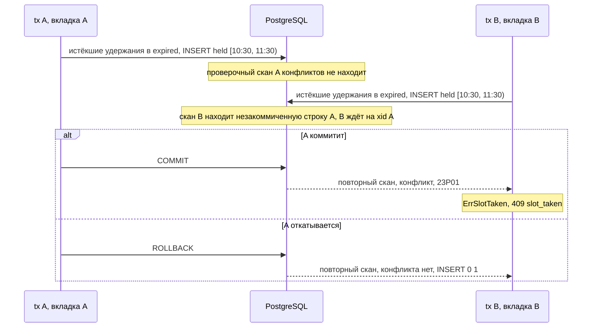
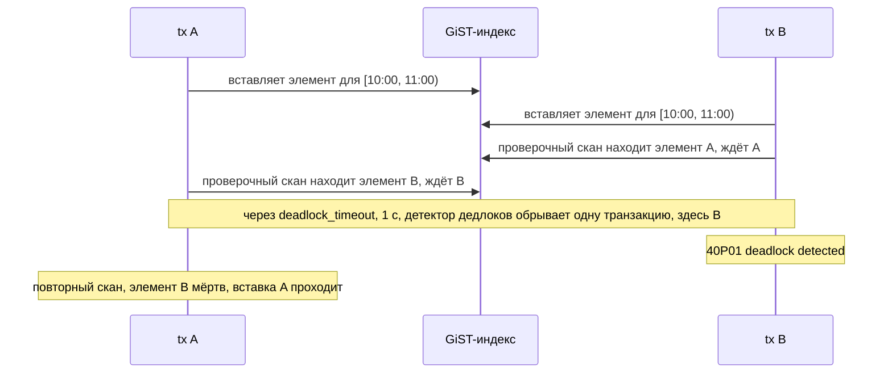

# Две вкладки, один слот: вторую запись отклоняет сам PostgreSQL

[English](slotbook-exclusion-constraint.md) · **Русский**

Репозиторий: [sinnercode228/slotbook](https://github.com/sinnercode228/slotbook) · Демо: [sinnercode228.github.io/slotbook](https://sinnercode228.github.io/slotbook/) · Ссылки на код ведут на коммит [`1c83184`](https://github.com/sinnercode228/slotbook/tree/1c8318474319f6e61cc76a3bbc5b5911625d7c1e) (до исправления) и [`939022a`](https://github.com/sinnercode228/slotbook/tree/939022ae1a3c00362d064e0a11dee60eb2d4958d) (исправление)

Два клиента выбирают одного мастера и нажимают одно и то же время, и оба запроса приходят в `POST /v1/holds` с разницей в миллисекунду. Slotbook не ищет пересечения на Go перед тем, как вставить удержание. Он вставляет строку, а решает exclusion constraint в PostgreSQL: первая транзакция коммитится, вторая падает с SQLSTATE `23P01`, и второй клиент получает `409 slot_taken`. Ниже — само ограничение, чего ждёт вторая транзакция, почему перенос сначала отменяет и только потом вставляет, и один порядок событий, при котором проигравший получал `500` вместо `409`, вместе с повтором транзакции, который это исправил.

Slotbook — демо-проект: сеть салонов, мастера и клиенты выдуманы. Код, тесты и замеры ниже настоящие.

## Одна строка на каждый кусок занятого времени

Записи, удержания и блокировки времени лежат в одной таблице `bookings`. Ограничение работает с её колонкой `period`:

```sql
    starts_at         timestamptz NOT NULL,
    ends_at           timestamptz NOT NULL,
    -- ends_at plus the service's cleanup buffer.
    busy_until        timestamptz NOT NULL,
    -- [starts_at, busy_until): the time the staff member is taken.
    period            tstzrange NOT NULL,
```

[`0001_schema.sql#L80-L85`](https://github.com/sinnercode228/slotbook/blob/1c8318474319f6e61cc76a3bbc5b5911625d7c1e/internal/db/migrations/0001_schema.sql#L80-L85)

Стрижка в Берлине идёт 45 минут плюс 15 минут на уборку, так что удержание на 10:30 занимает `[10:30, 11:30)`. Буфер входит в период, и записаться на 11:15, пока кресло ещё убирают, нельзя. Блокировка времени от администратора — это строка с `kind = 'block'`, у которой `busy_until` равен `ends_at` ([`admin.go#L51-L54`](https://github.com/sinnercode228/slotbook/blob/1c8318474319f6e61cc76a3bbc5b5911625d7c1e/internal/booking/admin.go#L51-L54)).

До коммита [`cc82734`](https://github.com/sinnercode228/slotbook/commit/cc827346dc26ab43bad77e89b8196e15a3afab9b) `period` был генерируемой колонкой. Теперь каждая вставка пишет его сама как `tstzrange(starts_at, busy_until, '[)')`, а `CHECK (period = tstzrange(starts_at, busy_until, '[)'))` не пускает строку, в которой они расходятся ([`0001_schema.sql#L101`](https://github.com/sinnercode228/slotbook/blob/1c8318474319f6e61cc76a3bbc5b5911625d7c1e/internal/db/migrations/0001_schema.sql#L101)). Ограничение читает `period`, а генератор слотов, API и календарь дня читают `starts_at` и `busy_until`; CHECK следит, чтобы они описывали одно и то же время. `TestPeriodMustMatchStartAndBusyUntil` вставляет блокировку на час с периодом в одну минуту и ждёт, что ошибка назовёт ограничение `bookings_period_matches`.

`'[)'` делает диапазон полуоткрытым: начало в него входит, конец нет. Диапазоны, которые только касаются, не пересекаются: в psql `[10:00, 11:00) && [11:00, 12:00)` даёт `f`, а та же пара с закрытой границей `11:00]` даёт `t`. Запись может начаться в ту минуту, когда кончился буфер предыдущей. [`TestExclusionConstraintRejectsOverlap`](https://github.com/sinnercode228/slotbook/blob/1c8318474319f6e61cc76a3bbc5b5911625d7c1e/internal/db/db_test.go#L56-L71) проверяет обе стороны: рядом с часовой блокировкой не проходит блокировка, которая начинается на 30 минут позже её начала, а та, что начинается ровно в её конце, проходит.

## Ограничение

```sql
    -- The double-booking guarantee: active rows of one staff member never overlap.
    CONSTRAINT bookings_no_overlap EXCLUDE USING gist (staff_id WITH =, period WITH &&)
        WHERE (status IN ('held', 'confirmed'))
```

[`0001_schema.sql#L111-L113`](https://github.com/sinnercode228/slotbook/blob/1c8318474319f6e61cc76a3bbc5b5911625d7c1e/internal/db/migrations/0001_schema.sql#L111-L113)

Читается оно так: не бывает двух строк с равным `staff_id` и пересекающимся `period`. PostgreSQL проверяет его через GiST-индекс. GiST сам умеет `&&` для диапазонов, но класса операторов для `=` по `bigint` у него нет. Его добавляет расширение `btree_gist`, которое миграция создаёт первой же строкой, и тогда обе колонки помещаются в один индекс.

`WHERE` делает индекс частичным: в нём только строки со статусами `held` и `confirmed`. Отменённые записи и истёкшие удержания остаются в таблице как история и ничего не занимают. [`TestExclusionConstraintIgnoresInactiveRows`](https://github.com/sinnercode228/slotbook/blob/1c8318474319f6e61cc76a3bbc5b5911625d7c1e/internal/db/db_test.go#L73-L103) вставляет удержание со статусом `expired`, затем `held` на тот же период, и оно проходит, затем второе `held`, и оно отклоняется. Отклонённая вставка называет оба ключа:

```
ERROR:  conflicting key value violates exclusion constraint "bookings_no_overlap"
DETAIL:  Key (staff_id, period)=(5, ["2026-10-15 08:30:00+00","2026-10-15 09:30:00+00")) conflicts with existing key (staff_id, period)=(5, ["2026-10-15 08:30:00+00","2026-10-15 09:30:00+00")).
```

## Проверка на Go даёт гонку

Очевидный вариант сначала читает: есть ли у мастера активная строка, которая пересекается с новой? Если нет, вставляет. На READ COMMITTED, уровне изоляции PostgreSQL по умолчанию, две транзакции могут обе выполнить чтение раньше, чем любая из них вставит строку. Обе ничего не видят, и обе вставляют.

Чтобы измерить, как часто это бывает, я собрал такой вариант во временной копии репозитория; в истории репозитория его нет. Из миграции убрано ограничение, а `insertHold` перед вставкой делает вот что:

```go
		var taken bool
		if err := tx.QueryRow(ctx, `
			SELECT EXISTS (SELECT 1 FROM bookings
			WHERE staff_id = $1 AND period && tstzrange($2, $3, '[)')
			  AND (status = 'confirmed' OR (status = 'held' AND hold_expires_at > $4)))`,
			h.staffID, h.start, h.busyUntil, h.now).Scan(&taken); err != nil {
			return err
		}
		if taken {
			return ErrSlotTaken
		}
```

Тест гонки из репозитория я прогнал против этой версии 100 раз без `-race` и 100 раз с ним. Он упал 42 и 34 раза. Две строки из упавших прогонов:

```
hold_test.go:112: 2 holds succeeded and 18 got slot_taken; want 1 and 19
hold_test.go:112: 14 holds succeeded and 6 got slot_taken; want 1 and 19
```

Первая — самый частый случай. В прогоне со второй строкой удержание на одни и те же 10:00 получили 14 запросов из 20. В CI этот тест идёт один раз, с `-race`; из моих 100 таких прогонов против этой версии прошли 66.

Оставить проверку на Go можно тремя обычными способами. Каждый я прогнал на том же тесте с `-race` во временной копии:

- `SELECT 1 FROM staff WHERE id = $1 FOR UPDATE` в начале транзакции. Запросы к одному мастеру встают в очередь на его строке. Прошли 20 прогонов из 20.
- `pg_advisory_xact_lock(staff_id)` — та же очередь, только без строки в таблице. 20 из 20.
- Уровень изоляции `SERIALIZABLE`. Победитель в каждом прогоне был ровно один, но 12 прогонов из 20 упали на `could not serialize access due to read/write dependencies among transactions (SQLSTATE 40001)`, всего 18 таких ошибок. Коду понадобился бы цикл повтора вокруг транзакции.

Оба варианта с блокировкой работают, но только для кода, который её берёт. Занятое время пишут удержания, блокировки времени и переносы, а позже его может записать скрипт импорта или правка руками в psql. Путь, который забыл взять блокировку, запишет пересечение, и ничто об этом не сообщит. Ограничение же проверяется при каждой операции, которая кладёт в таблицу активную строку, кто бы её ни отправил. В Slotbook периоды вставляют три функции, `insertHold`, `CreateBlock` и `Reschedule`, и логики пересечений нет ни в одной из них. `Hold` проверяет только, что такое начало генератор слотов предлагает по часам мастера, минимальному запасу и горизонту: [`offers`](https://github.com/sinnercode228/slotbook/blob/1c8318474319f6e61cc76a3bbc5b5911625d7c1e/internal/booking/availability.go#L140-L149) вызывает генератор без занятого времени.

## Чего ждёт вторая вставка

PostgreSQL проверяет exclusion constraint, когда новый элемент уже лежит в индексе, отдельным сканированием этого индекса ([`execIndexing.c#L31-L37`](https://github.com/postgres/postgres/blob/REL_16_13/src/backend/executor/execIndexing.c#L31-L37) в PostgreSQL 16). Сканирование видит незакоммиченные строки других транзакций. Найдя пересекающуюся, оно ждёт на ID её транзакции и сканирует заново. Если та транзакция закоммитилась, её строка — конфликт, и вставка падает с `23P01`. Если откатилась, строки больше нет, и вставка проходит.

Я повторил это в двух сессиях psql на одном слоте Jonas W. Сессия A вставляет удержание, спит три секунды и коммитит. Сессия B вставляет тот же период через полсекунды после A. Пока B висит, `pg_stat_activity` вместе с `pg_locks` показывает, чего она ждёт:

```
  pid  | wait_event_type |  wait_event   | waits_for_xid | granted
-------+-----------------+---------------+---------------+---------
 14402 | Lock            | transactionid |        177334 | f
```

177334 — ID транзакции A, его вернул `txid_current()` в сессии A. После коммита A сессия B падает с ошибкой, приведённой выше, `Time: 2513.648 ms (00:02.514)`. Если A заканчивается `ROLLBACK`, B получает `INSERT 0 1` через 2498 мс.



В Go ошибка возвращается через `pgx.BeginFunc`, который откатывает транзакцию. `insertHold` превращает `db.IsExclusionViolation(err)` в `ErrSlotTaken`, а любую другую ошибку оборачивает как `booking: insert hold: %w` ([`hold.go#L149-L154`](https://github.com/sinnercode228/slotbook/blob/1c8318474319f6e61cc76a3bbc5b5911625d7c1e/internal/booking/hold.go#L149-L154)). `IsExclusionViolation` сравнивает код `pgconn.PgError` с `"23P01"` ([`db.go#L40-L55`](https://github.com/sinnercode228/slotbook/blob/1c8318474319f6e61cc76a3bbc5b5911625d7c1e/internal/db/db.go#L40-L55)), а HTTP-слой отвечает на `ErrSlotTaken` кодом `409 slot_taken` ([`errors.go#L31-L32`](https://github.com/sinnercode228/slotbook/blob/1c8318474319f6e61cc76a3bbc5b5911625d7c1e/internal/httpapi/errors.go#L31-L32)). `CreateBlock` и `Reschedule` разбирают ошибки своих вставок так же.

## Истёкшее удержание не даёт 409

Ограничение ничего не знает о времени. Удержание, у которого `hold_expires_at` уже прошёл, остаётся `held`, а значит и в индексе, пока кто-нибудь не сменит ему статус. При этом расчёт свободных слотов уже показывает это время свободным: удержание считается занятым, только пока `hold_expires_at > now` ([`store.go#L71-L87`](https://github.com/sinnercode228/slotbook/blob/1c8318474319f6e61cc76a3bbc5b5911625d7c1e/internal/booking/store.go#L71-L87)). Поэтому каждая транзакция, которая вставляет занятое время, сначала переводит в `expired` истёкшие удержания, с которыми пересеклась бы:

```go
func expireStaleHolds(ctx context.Context, q db.Querier, staffID int64, start, end, now time.Time) error {
	_, err := q.Exec(ctx, `
		UPDATE bookings SET status = 'expired'
		WHERE staff_id = $1 AND status = 'held' AND hold_expires_at <= $4
		  AND period && tstzrange($2, $3, '[)')`, staffID, start, end, now)
	return err
}
```

[`store.go#L63-L69`](https://github.com/sinnercode228/slotbook/blob/1c8318474319f6e61cc76a3bbc5b5911625d7c1e/internal/booking/store.go#L63-L69)

После этого `UPDATE` текущая версия строки — `expired`, она вне `WHERE` ограничения, и вставка в той же транзакции с ней не конфликтует. [`TestExpiredHoldDoesNotBlockANewOne`](https://github.com/sinnercode228/slotbook/blob/1c8318474319f6e61cc76a3bbc5b5911625d7c1e/internal/booking/hold_test.go#L123-L137) удерживает 10:00, сдвигает поддельные часы на 10 минут, удерживает 10:15, что пересекается с первым периодом `[10:00, 11:00)`, и ждёт, что первая строка станет `expired`, а вторая будет `held`.

В ту же строку одновременно может прийти подтверждение. Это один `UPDATE ... WHERE hold_token_hash = $1 AND status = 'held' AND hold_expires_at > $7` ([`confirm.go#L78-L84`](https://github.com/sinnercode228/slotbook/blob/1c8318474319f6e61cc76a3bbc5b5911625d7c1e/internal/booking/confirm.go#L78-L84)). Оба оператора берут блокировку строки, и тот, кто ждал, заново проверяет свой `WHERE` на закоммиченной версии. Оба порядка я проверил в двух сессиях psql. Подтверждение брало время за секунду до истечения, вторая сессия — через секунду после него, и та, что шла первой, держала транзакцию открытой две секунды. Когда первым идёт подтверждение, вторая сессия ждала в своём `UPDATE` 1505 мс, получила `UPDATE 0`, потому что строка уже стала `confirmed`, и её `INSERT` упал с `23P01`. Когда первым идёт истечение, подтверждение ждало 1506 мс и получило `UPDATE 0`; строка теперь читается как `expired`, поэтому [`whyNotConfirmable`](https://github.com/sinnercode228/slotbook/blob/1c8318474319f6e61cc76a3bbc5b5911625d7c1e/internal/booking/confirm.go#L106-L119) возвращает `ErrHoldExpired`, а API отвечает `410 hold_expired`.

Чистильщик в `serve` помечает `expired` все истёкшие удержания, по умолчанию раз в 30 секунд. Его комментарий говорит, что для корректности он не нужен: «Holds would not block new bookings anyway (see expireStaleHolds); this keeps the table honest for admins and reports» ([`sweep.go#L13-L23`](https://github.com/sinnercode228/slotbook/blob/1c8318474319f6e61cc76a3bbc5b5911625d7c1e/internal/booking/sweep.go#L13-L23)). Тест на истечение выше его не вызывает.

## Перенос сначала отменяет, потом вставляет

Перенос оставляет старую строку как историю и вставляет новую со статусом `confirmed`, которая ссылается на старую через `rescheduled_from`, всё в одной транзакции. Порядок шагов фиксирован, и комментарий объясняет почему:

```go
		// The exclusion constraint is checked row by row, so the old row has
		// to leave the active set before the new one goes in; otherwise a
		// move onto a period overlapping the old one would conflict with
		// itself.
		if _, err := markCancelled(ctx, tx, old.ID, now); err != nil {
			return err
		}
```

[`manage.go#L134-L140`](https://github.com/sinnercode228/slotbook/blob/1c8318474319f6e61cc76a3bbc5b5911625d7c1e/internal/booking/manage.go#L134-L140)

Что значит «row by row», я проверил на PostgreSQL 16.13 на временных таблицах с тем же ограничением:

1. Вставить новую строку, потом отменить старую: `INSERT` сразу падает с `23P01`, конца транзакции проверка не ждёт.
2. Отменить, потом вставить: оба оператора проходят.
3. Порядок из пункта 1, но ограничение объявлено `DEFERRABLE INITIALLY DEFERRED`: транзакция коммитится. Конфликт проверяется ещё раз на `COMMIT`, когда старая строка уже отменена.
4. Один `UPDATE`, который сдвигает две строки подряд, `[10:00, 11:00)` и `[11:00, 12:00)`, на 30 минут позже, падает: новый `[10:30, 11:30)` первой строки «conflicts with existing key» `[11:00, 12:00)`, то есть со старым периодом второй. В итоговом состоянии пересечений нет. С `DEFERRABLE INITIALLY IMMEDIATE`, где проверка идёт в конце оператора, тот же `UPDATE` проходит.
5. `UPDATE`, который сдвигает одну строку на часть её собственного периода, проходит. Старую версию строки проверка не видит: та же транзакция уже пометила её удалённой.

Значит, ограничение без `DEFERRABLE` проверяется для каждой строки в тот момент, когда она пишется, раньше следующей строки того же оператора. То же видно в `ExecInsertIndexTuples`: для ограничения без `DEFERRABLE` проверка идёт с `CEOUC_WAIT` и `violationOK = false`, и конфликт сразу становится ошибкой, а для `DEFERRABLE` конфликт только запоминается и ставится в очередь повторная проверка, в конце оператора или на `COMMIT` ([`execIndexing.c#L443-L483`](https://github.com/postgres/postgres/blob/REL_16_13/src/backend/executor/execIndexing.c#L443-L483)). Пункт 5 показывает, что при сдвиге строки на месте порядок был бы не нужен. Переносу он нужен, потому что перенос пишет вторую строку.

[`TestRescheduleOntoAPeriodOverlappingItsOwn`](https://github.com/sinnercode228/slotbook/blob/1c8318474319f6e61cc76a3bbc5b5911625d7c1e/internal/booking/manage_test.go#L68-L105) переносит запись с 10:00 на 10:15, и новый `[10:15, 11:15)` пересекается со старым `[10:00, 11:00)`. [`TestRescheduleIntoSomeoneElsesBookingChangesNothing`](https://github.com/sinnercode228/slotbook/blob/1c8318474319f6e61cc76a3bbc5b5911625d7c1e/internal/booking/manage_test.go#L137-L153) переносит запись с 10:00 на 11:30, в чужую запись на 12:00. Вставка падает, вся транзакция откатывается, исходная запись остаётся `confirmed`, а её напоминание за два часа по-прежнему ждёт отправки.

## Любой свободный мастер

Без `staff_id` `Hold` собирает всех мастеров, у которых по расписанию есть это начало, и сортирует их: сначала те, у кого меньше подтверждённых записей в этот местный день, затем по id ([`orderByLoad`](https://github.com/sinnercode228/slotbook/blob/1c8318474319f6e61cc76a3bbc5b5911625d7c1e/internal/booking/hold.go#L93-L122)). Потом по очереди вызывает `insertHold` для каждого, каждый раз в отдельной транзакции, и при `ErrSlotTaken` переходит к следующему ([`hold.go#L69-L90`](https://github.com/sinnercode228/slotbook/blob/1c8318474319f6e61cc76a3bbc5b5911625d7c1e/internal/booking/hold.go#L69-L90)). `slot_taken` запрос получает, только если заняты все кандидаты. Подсчёт идёт вне транзакций вставки, так что два параллельных запроса могут начать с одного и того же мастера; спор решает ограничение, и проигравший идёт дальше по списку. [`TestAnyStaffFallsThroughToTheNextFreeStaffMember`](https://github.com/sinnercode228/slotbook/blob/1c8318474319f6e61cc76a3bbc5b5911625d7c1e/internal/booking/hold_test.go#L168-L183) даёт Lena, первой в очереди, удержание на 10:00 и ждёт, что удержание «любого мастера» на 10:00 достанется Jonas, а третий такой запрос получит `ErrSlotTaken`.

## Когда проигравший получал 500

Тот же комментарий в `execIndexing.c` продолжается так ([`#L39-L45`](https://github.com/postgres/postgres/blob/REL_16_13/src/backend/executor/execIndexing.c#L39-L45)):

> There is a chance of deadlock, if two backends insert a tuple at the same time, and then perform the scan to check for conflicts. They will find each other's tuple, and both try to wait for each other. The deadlock detector will detect that, and abort one of the transactions. That's fairly harmless, as one of them was bound to abort with a "duplicate key error" anyway, although you get a different error message.



Это другое сообщение — `deadlock detected`, SQLSTATE `40P01`. На `1c83184` `IsExclusionViolation` знала только `23P01`, поэтому `insertHold` оборачивал дедлок как обычную ошибку, и API отвечал `500 internal`. Если мастер любой, цикл на этом останавливался и к следующему кандидату не переходил.

Я измерил это во второй временной копии тестом, который крутит в цикле неизменённый `Hold`: две горутины на один слот за раунд, один пул на все раунды, таблица очищается между раундами. Каждый раунд кончился ровно одним удержанием. В трёх циклах по 2000, 1000 и 1000 раундов 18, 60 и 10 проигравших получили вместо `ErrSlotTaken` ошибку `booking: insert hold: ERROR: deadlock detected (SQLSTATE 40P01)` (цикл с 60 очищал таблицу через `TRUNCATE`, два других через `DELETE`). Каждая такая ошибка пришла чуть позже чем через секунду после вызова, самое позднее через 1,005 с. В логе сервера виден цикл: два `INSERT` из `insertHold`, и каждый ждёт транзакцию другого:

```
ERROR:  deadlock detected
DETAIL:  Process 15104 waits for ShareLock on transaction 177625; blocked by process 15105.
	Process 15105 waits for ShareLock on transaction 177626; blocked by process 15104.
```

С 20 горутинами на раунд её получили 336 из 1900 проигравших за 100 раундов, и ошибки выстроились в очередь: самая поздняя пришла через 18,02 с.

Гарантия держалась: ни один раунд не кончился двумя удержаниями. Но проигравший мог получить `500` вместо `409`, да ещё на секунду и больше позже. `CreateBlock` и `Reschedule` тоже проверяли только `23P01`, и ни одна из трёх функций транзакцию не повторяла.

Исправление — два коммита: [`54ccd48`](https://github.com/sinnercode228/slotbook/commit/54ccd486199c9392846f2730a82e3a3e73a830b4) для удержаний, блокировок и переносов и [`939022a`](https://github.com/sinnercode228/slotbook/commit/939022ae1a3c00362d064e0a11dee60eb2d4958d) для подтверждений, которые я сначала упустил. `db.IsDeadlock` распознаёт `40P01` так же, как `IsExclusionViolation` распознаёт `23P01` ([`db.go#L51-L54`](https://github.com/sinnercode228/slotbook/blob/939022ae1a3c00362d064e0a11dee60eb2d4958d/internal/db/db.go#L51-L54)), а новая вспомогательная функция при такой ошибке запускает транзакцию заново:

```go
// inTx runs fn in a transaction like pgx.BeginFunc and, when PostgreSQL
// aborts the transaction as a deadlock victim (40P01), runs fn again from the
// start in a new one, up to txAttempts times in all. When ctx is done it
// stops retrying and returns the last error.
//
// Two writes that add overlapping periods to the exclusion constraint's index
// at the same moment (inserts, or the update that confirms a hold) can each
// wait for the other's entry, and the deadlock detector aborts one of them
// instead of letting it fail with 23P01. With more such writes it aborts one
// per deadlock_timeout until one is left. A victim that came straight back
// with a new entry would join that chain again, so a retry starts by taking
// an advisory lock and retries go one at a time.
func inTx(ctx context.Context, b beginner, fn func(pgx.Tx) error) error {
	for attempt := 1; ; attempt++ {
		err := pgx.BeginFunc(ctx, b, func(tx pgx.Tx) error {
			if attempt > 1 {
				if _, err := tx.Exec(ctx, `SELECT pg_advisory_xact_lock(hashtext('slotbook-deadlock-retry'))`); err != nil {
					return err
				}
			}
			return fn(tx)
		})
		if attempt == txAttempts || !db.IsDeadlock(err) {
			return err
		}
		base := time.Millisecond << attempt
		pause := time.NewTimer(base + rand.N(base))
		select {
		case <-ctx.Done():
			pause.Stop()
			return err
		case <-pause.C:
		}
	}
}
```

[`tx.go#L20-L54`](https://github.com/sinnercode228/slotbook/blob/939022ae1a3c00362d064e0a11dee60eb2d4958d/internal/booking/tx.go#L20-L54)

Перед повтором она ждёт случайное время: 2–4 мс, потом 4–8, 8–16 и 16–32 мс, за пять попыток не больше 60 мс. Повторяется только `40P01`: `23P01` и любая другая ошибка возвращаются после первой попытки, как раньше. `insertHold`, `CreateBlock`, `Reschedule` и `Confirm` вызывают `inTx(ctx, m.pool, ...)` там, где вызывали `pgx.BeginFunc`, с тем же замыканием ([`admin.go#L46`](https://github.com/sinnercode228/slotbook/blob/939022ae1a3c00362d064e0a11dee60eb2d4958d/internal/booking/admin.go#L46), [`manage.go#L126`](https://github.com/sinnercode228/slotbook/blob/939022ae1a3c00362d064e0a11dee60eb2d4958d/internal/booking/manage.go#L126), [`confirm.go#L58`](https://github.com/sinnercode228/slotbook/blob/939022ae1a3c00362d064e0a11dee60eb2d4958d/internal/booking/confirm.go#L58)). Для удержания:

```go
func (m *Manager) insertHold(ctx context.Context, h newHold) (Booking, error) {
	var b Booking
	err := inTx(ctx, m.pool, func(tx pgx.Tx) error {
		if err := expireStaleHolds(ctx, tx, h.staffID, h.start, h.busyUntil, h.now); err != nil {
			return err
		}
		var err error
		b, err = scanBooking(tx.QueryRow(ctx, `
			INSERT INTO bookings (kind, status, location_id, staff_id, service_id, starts_at, ends_at, busy_until, period,
			                      price_minor, currency, hold_token_hash, hold_expires_at, created_at)
			VALUES ('appointment', 'held', $1, $2, $3, $4, $5, $6, tstzrange($4, $6, '[)'), $7, $8, $9, $10, $11)
			RETURNING `+bookingColumns,
			h.locationID, h.staffID, h.service.ID, h.start, h.end, h.busyUntil,
			h.service.PriceMinor, h.service.Currency, h.tokenHash, h.expiresAt, h.now))
		return err
	})
	if db.IsExclusionViolation(err) {
		return Booking{}, ErrSlotTaken
	}
	if err != nil {
		return Booking{}, fmt.Errorf("booking: insert hold: %w", err)
	}
	return b, nil
}
```

[`hold.go#L133-L156`](https://github.com/sinnercode228/slotbook/blob/939022ae1a3c00362d064e0a11dee60eb2d4958d/internal/booking/hold.go#L133-L156)

Замыкание — это вся транзакция, поэтому повтор проходит её целиком: истечение просроченных удержаний и вставку, а в переносе ещё блокировку строки, отмену и напоминания. Обработка ошибки после него не изменилась: `23P01` — это `ErrSlotTaken`, а `40P01`, оставшаяся после пятой попытки, оборачивается как раньше.

Простого повтора не хватило. Когда три вставки и больше приходят в один момент, их проверочные сканы ждут друг друга, и PostgreSQL обрывает по одной жертве за `deadlock_timeout`, пока не останется одна вставка. Жертва, которая сразу повторяет транзакцию, кладёт в индекс новый элемент и снова встаёт в эту цепочку. С простым повтором и короткой паузой у восьми горутин 34 вызова всё равно упали с `40P01` после пяти попыток, а в сценарии с 20 горутинами, описанном ниже в разделе о тестах, единственный прогон, попавший в цепочку, прошёл 94 цикла дедлоков, и все 19 проигравших закончили с `40P01`. Поэтому повтор первым делом берёт advisory lock: повторы идут по одному и не могут поддерживать цепочку. Первая попытка блокировку не берёт, так что запрос, не попавший в дедлок, выполняется как раньше, и пересечение по-прежнему запрещает ограничение. Ключ этой блокировки один на всю базу, поэтому повторы для разных мастеров тоже ждут друг друга. За 300 раундов на каждый размер вызовам понадобилось столько попыток:

```
горутин в раунде   1 попытка   2 попытки   3 попытки   4 попытки
               4        1095          96           9           0
               8        2041         348          10           1
              16        4017         758          24           1
```

Пятая попытка не понадобилась ни одному вызову, и ни один не упал.

В первом коммите я упустил подтверждение. Подтверждение удержания — один `UPDATE` из `held` в `confirmed` ([`confirm.go#L78-L84`](https://github.com/sinnercode228/slotbook/blob/939022ae1a3c00362d064e0a11dee60eb2d4958d/internal/booking/confirm.go#L78-L84)). `status` входит в `WHERE` ограничения, поэтому PostgreSQL не может сделать это обновление HOT: новая версия строки получает свой элемент в `bookings_no_overlap`, и проверка идёт та же, что при вставке. Удержание или блокировка, вставленные на тот же период в тот же момент, могут ждать подтверждение, пока подтверждение ждёт их. Когда PostgreSQL обрывал подтверждение, клиент, чьё это было удержание, получал `500`, вставка повторялась и получала `409`, и ни один из двух запросов не проходил. На `54ccd48` подтверждение получило `40P01` в 43 раундах из 400 против трёх блокировок, в 13 из 400 против трёх удержаний и в 19–25 из 400 против смеси удержаний и блокировок. `939022a` тоже пускает `Confirm` через `inTx`. Ключ идемпотентности резервируется, а новый токен управления создаётся внутри замыкания, поэтому строка ключа из оборванной попытки откатывается вместе с ней, а клиент получает тот токен, чей хеш закоммичен.

Цепочку повтор не укорачивает. При k одновременных конфликтующих операциях PostgreSQL всё так же нужно около (k − 1) × `deadlock_timeout`, чтобы их разобрать, так что проигравший теперь получает `409`, но может получить его поздно: в сценарии с 20 горутинами при `deadlock_timeout` по умолчанию, 1 с, два прогона, попавшие в цепочку, заняли 19,0 с и 20,0 с.

`54ccd48` добавляет три интеграционных теста, которые сталкивают одновременные операции на одном периоде, много раундов на одном пуле, а `939022a` — четвёртый:

- [`TestSimultaneousHoldsNeverFailWithADeadlock`](https://github.com/sinnercode228/slotbook/blob/939022ae1a3c00362d064e0a11dee60eb2d4958d/internal/booking/hold_test.go#L123-L142): 150 раундов по четыре удержания.
- [`TestSimultaneousBlocksAndHoldsNeverFailWithADeadlock`](https://github.com/sinnercode228/slotbook/blob/939022ae1a3c00362d064e0a11dee60eb2d4958d/internal/booking/admin_test.go#L47-L68): 200 раундов по две блокировки и два удержания.
- [`TestSimultaneousReschedulesNeverFailWithADeadlock`](https://github.com/sinnercode228/slotbook/blob/939022ae1a3c00362d064e0a11dee60eb2d4958d/internal/booking/manage_test.go#L155-L198): 100 раундов по четыре переноса на один период. Победитель после каждого раунда возвращается на место, а каждый проигравший должен остаться `confirmed`.
- [`TestSimultaneousConfirmsAndInsertsNeverFailWithADeadlock`](https://github.com/sinnercode228/slotbook/blob/939022ae1a3c00362d064e0a11dee60eb2d4958d/internal/booking/confirm_test.go#L205-L248): 160 раундов, в каждом одно подтверждение против двух удержаний и блокировки. Подтверждение стартует с задержкой от 0 до 975 мкс, шагами по 25 мкс, которые повторяются каждые 40 раундов, чтобы его `UPDATE` встретился со вставками.

Каждый раунд должен закончиться одним успехом, `ErrSlotTaken` у всех остальных и одной активной строкой на периоде ([`checkOneWinner`](https://github.com/sinnercode228/slotbook/blob/939022ae1a3c00362d064e0a11dee60eb2d4958d/internal/booking/fixture_test.go#L115-L143)). Фикстура для гонок даёт каждой горутине своё соединение и ставит `deadlock_timeout` в 10 мс на каждом соединении ([`fixture_test.go#L86-L92`](https://github.com/sinnercode228/slotbook/blob/939022ae1a3c00362d064e0a11dee60eb2d4958d/internal/booking/fixture_test.go#L86-L92)), так что дедлок стоит миллисекунды, а не секунду. Если роль в базе не может менять эту настройку, четыре этих теста пропускаются. Тест на удержания:

```go
// Two transactions that insert the same period at the same moment can each
// find the other's uncommitted entry in the constraint's index and wait for
// it; PostgreSQL's deadlock detector then aborts one of them with 40P01. The
// loser must still get ErrSlotTaken. A round deadlocks only now and then, and
// hardly ever while the index fits in one page (about the first 40 rounds
// here), so the test runs many rounds on one pool.
func TestSimultaneousHoldsNeverFailWithADeadlock(t *testing.T) {
	const rounds, n = 150, 4
	f := newRaceFixture(t, n)
	ctx := context.Background()
	start := at(2026, time.October, 14, 10, 0)
	for round := range rounds {
		errs := race(n, func(int) error {
			_, err := f.manager.Hold(ctx, booking.HoldRequest{ServiceID: f.haircut(), StaffID: f.lena(), Start: start})
			return err
		})
		f.checkOneWinner(t, round, errs, start, start.Add(time.Hour))
		f.clearBookings(t)
	}
}
```

[`hold_test.go#L123-L142`](https://github.com/sinnercode228/slotbook/blob/939022ae1a3c00362d064e0a11dee60eb2d4958d/internal/booking/hold_test.go#L123-L142)

Первые три я запустил на старом коде, то есть на коммите перед исправлением, к которому добавлены только новые тесты и их вспомогательные функции, по 20 раз с `-race` и 20 раз без. Упали все 120 прогонов, каждый на `40P01` там, где ожидался `ErrSlotTaken`. Первым падал раунд с номером от 10 до 77 у удержаний, от 1 до 66 у блокировок и от 2 до 39 у переносов:

```
hold_test.go:139: round 39: got booking: insert hold: ERROR: deadlock detected (SQLSTATE 40P01), want ErrSlotTaken
admin_test.go:65: round 39: got booking: insert hold: ERROR: deadlock detected (SQLSTATE 40P01), want ErrSlotTaken
manage_test.go:183: round 30: got ERROR: deadlock detected (SQLSTATE 40P01), want ErrSlotTaken
```

На коде без изменения в `Confirm` тест на подтверждения упал во всех 30 прогонах, 15 с `-race` и 15 без, и ещё в 20 из 20 с прежним шагом в 50 мкс. Каждый раз это было `round N: confirm: ERROR: deadlock detected (SQLSTATE 40P01)`, а первым по этим 50 прогонам падал раунд с номером от 2 до 103. На `939022a` я запустил каждый из четырёх тестов 30 раз с `-race` и 30 раз без, вместе с `TestConcurrentHoldsOnTheSameSlotHaveOneWinner`: 300 прогонов, ни одного падения, самый долгий занял 3,38 с с `-race`.

Четыре юнит-теста гоняют `inTx` с поддельным `pgx.Tx` и подставленной ошибкой `40P01` ([`tx_test.go#L80-L150`](https://github.com/sinnercode228/slotbook/blob/939022ae1a3c00362d064e0a11dee60eb2d4958d/internal/booking/tx_test.go#L80-L150)). Функция проходит после четырёх дедлоков, начав пять транзакций и закоммитив одну, и берёт advisory lock только со второй попытки, до замыкания. Она сдаётся после пятой попытки с `40P01`, не повторяет `23P01` и доменную ошибку и останавливается после одного вызова, если контекст отменён.

## Что покрывают тесты

[`TestConcurrentHoldsOnTheSameSlotHaveOneWinner`](https://github.com/sinnercode228/slotbook/blob/1c8318474319f6e61cc76a3bbc5b5911625d7c1e/internal/booking/hold_test.go#L76-L121) запускает 20 горутин, которые ждут на одном канале, закрывает его, и все они вызывают `Hold` для Lena на 10:00. Тест ждёт ровно один успех, 19 `ErrSlotTaken` и ни одной другой ошибки, а потом считает строки `held` в таблице и ждёт одну. Фикстура просит пул на 25 соединений; по умолчанию у тестового пула их 8 ([`dbtest.go#L37`](https://github.com/sinnercode228/slotbook/blob/1c8318474319f6e61cc76a3bbc5b5911625d7c1e/internal/dbtest/dbtest.go#L37)), и с восемью большинство горутин стояло бы в очереди за соединением, а не встречалось в базе.

На старом коде этот тест дедлок так и не поймал: 200 прогонов из 200 прошли с `-race` и 200 из 200 без него. Каждый прогон начинается со свежего пула. Когда я запустил то же тело после одного раунда гонки без проверок на том же пуле, оно упало 3 раза из 180 без `-race` и прошло все 180 прогонов с ним. В каждом упавшем прогоне все 19 проигравших получили `40P01`, а сами прогоны заняли 16,20 с, 19,20 с и 19,22 с. С `deadlock_timeout` в 100 мс то же тело после разогревочного раунда упало 4 раза из 300, и каждый раз все 19 проигравших получили `40P01`. На `54ccd48` оно не упало ни в одном из 300 прогонов при 100 мс, ни в одном из 250 при 1 с по умолчанию и ни в одном из 100 с `-race`. Два прогона при 1 с попали в цепочку и заняли 19,0 с и 20,0 с, и ни одному вызову не понадобилось больше трёх попыток.

Пока я писал исправление, нашлась часть ответа на вопрос, почему на свежем пуле дедлок не проявлялся. Временный тест записывал размер индекса `bookings_no_overlap` в каждом раунде с четырьмя одновременными удержаниями. Индекс вырос с одной страницы до трёх на 39-м раунде, и сразу после этого дедлоки стали частыми, примерно в 20% раундов; пока индекс помещался в одну страницу, они были редкими. Редкими, но не невозможными: на `54ccd48` один прогон `TestConcurrentHoldsOnTheSameSlotHaveOneWinner` попал в полную цепочку на свежем пуле, занял 17,21 с и прошёл. Поэтому тесты на гонку выше крутят много раундов на одном пуле.

Рядом с ним: тесты ограничения в `db_test.go` (пересечение, соседние периоды, неактивные строки, CHECK на период), `TestOverlappingHoldIsSlotTaken` с буфером (10:45 упирается в стрижку на 10:00, 11:00 проходит), [`TestBlocksShareTheOverlapGuarantee`](https://github.com/sinnercode228/slotbook/blob/1c8318474319f6e61cc76a3bbc5b5911625d7c1e/internal/booking/admin_test.go#L13-L45), тесты на истечение, «любого мастера» и перенос, о которых шла речь выше, HTTP-тест, который ждёт `409 slot_taken` от `POST /v1/holds`, а также четыре теста на гонку и четыре юнит-теста `inTx` из исправления. Каждый интеграционный тест получает свою свежую схему с миграциями. На пустой базе, с PostgreSQL 16.13 и Go 1.24.7, `go test -race -count=1 ./...` на `939022a` прошёл 115 тестовых функций и 92 подтеста, а на `1c83184` — 107 и 92.

## Известные слабые места

Обновление: [PR #1](https://github.com/sinnercode228/slotbook/pull/1) добавляет `DELETE /v1/holds/{id}`. Он принимает токен удержания, как и подтверждение, и помечает удержание как `released`; этот статус не попадает под `WHERE` ограничения, поэтому время можно сразу удержать снова. Виджет отправляет этот запрос, когда клиент возвращается назад с формы контактов; если закрыть вкладку, удержание по-прежнему истекает само. [PR #2](https://github.com/sinnercode228/slotbook/pull/2) даёт каждому адресу клиента ведро токенов на `POST /v1/holds`: по умолчанию 10 удержаний сразу, потом по одному раз в 30 секунд, а дальше `429 rate_limited` с `Retry-After`. Вёдра живут в памяти каждого процесса API, и скрипт, разнесённый по многим адресам, лимит замедляет, но не останавливает. Текст ниже описывает код на коммите `939022a`.

- Переносы в тестах соревнуются только друг с другом. Удержание, отпущенное в тот же момент, почти всегда коммитится раньше, чем перенос доходит до вставки, потому что перенос сначала делает больше обращений к базе (около 2,9 мс против 1,7 мс у удержания), и один или три переноса против удержаний попадали в дедлок не больше чем в 1 раунде из 300. Такая смесь идёт через тот же `inTx`, но тестом она не покрыта.
- `POST /v1/holds` не требует входа и не ограничен по частоте. Скрипт может держать занятыми все слоты салона, по десять минут за раз, и ограничение защищает такие удержания так же, как настоящие.
- Освободить удержание нельзя. Маршруты записи — `POST /v1/holds`, `POST /v1/bookings`, а также `GET`, `cancel` и `reschedule` для записи ([`server.go#L61-L65`](https://github.com/sinnercode228/slotbook/blob/1c8318474319f6e61cc76a3bbc5b5911625d7c1e/internal/httpapi/server.go#L61-L65)). Клиент, который вернулся назад и выбрал другое время, оставляет первое занятым до истечения.
- Истечение удержания сравнивает `hold_expires_at` с часами процесса API, `m.clock.Now()`, а не с `now()` базы. Два процесса API с расходящимися часами на столько же разойдутся в том, когда удержание истекло.
- В демо на GitHub Pages PostgreSQL нет. Там работает копия этих правил на TypeScript поверх IndexedDB, и гонку двух вкладок решает то, что IndexedDB выполняет `readwrite`-транзакции по одной, а не это ограничение.

Исправление: [`54ccd48` Stop answering 500 when simultaneous inserts of one period deadlock](https://github.com/sinnercode228/slotbook/commit/54ccd486199c9392846f2730a82e3a3e73a830b4), [`939022a` Stop answering 500 when a confirm deadlocks with a simultaneous insert on its period](https://github.com/sinnercode228/slotbook/commit/939022ae1a3c00362d064e0a11dee60eb2d4958d) · Тесты: [`hold_test.go#L123-L142`](https://github.com/sinnercode228/slotbook/blob/939022ae1a3c00362d064e0a11dee60eb2d4958d/internal/booking/hold_test.go#L123-L142), [`confirm_test.go#L205-L248`](https://github.com/sinnercode228/slotbook/blob/939022ae1a3c00362d064e0a11dee60eb2d4958d/internal/booking/confirm_test.go#L205-L248), [`tx_test.go`](https://github.com/sinnercode228/slotbook/blob/939022ae1a3c00362d064e0a11dee60eb2d4958d/internal/booking/tx_test.go)

Код: [github.com/sinnercode228/slotbook](https://github.com/sinnercode228/slotbook)
